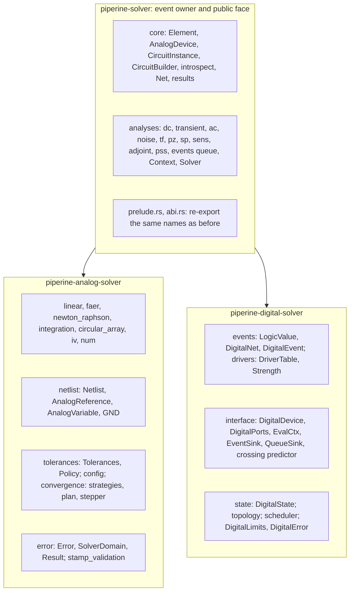

# Solver Restructure Design

**Spec**: `.specs/features/solver-restructure/spec.md`
**Status**: Draft

---

## Architecture Overview

Four phases, each leaving the solver green: make the suite run alone, remove the retired crates, remove the safe surplus, split into three crates. Removal comes before the split so that less code is moved and no removed item needs a home.

The three crates after phase 4:

The owner depends on both. `piperine-analog-solver` and `piperine-digital-solver` have no dependency in the tree, so the compiler refuses any use of one from the other. A test adds the identifier check of SR-04 AC 4 and 5 on top.

---

## Code Reuse Analysis

### Existing Components to Leverage

| Component | Location | How to Use |
| --- | --- | --- |
| Hand-written mixed test elements | `crates/piperine-solver/tests/helpers/mod.rs` (`D2ADevice` and others) | the pattern for the new analog test elements; the new ones go beside it |
| Inline hand-written elements in existing targets | `tests/parity_baseline.rs`, `tests/mixed_signal.rs`, `tests/live_params.rs` | source of resistor, source and capacitor stamps already proven against analytic values; copy the stamping, do not invent it |
| Surface tests | `tests/abi_surface.rs`, `tests/prelude_surface.rs` | they already pin the two public modules and stay untouched; they prove the facade after the split |
| The two-tier surface (MD-17) | `src/prelude.rs`, `src/abi.rs` | stay the only public paths; after the split they re-export from the sub-crates |
| `predict_crossing`, `CrossDir`, `Prediction` | `crates/piperine-ir/src/events.rs` (lines 145 to 190, tests at 464 to 480) | copied verbatim into the digital crate before `piperine-ir` is deleted |

### Integration Points

| System | Integration Method |
| --- | --- |
| Kept crates that name `piperine-solver` (`piperine-api`, root shell) | the crate keeps its name and its two public modules; nothing they import is renamed, only removed items disappear |
| Workspace manifest | members and `default-members` updated; Cranelift profile entries dropped |
| CI | `.github/workflows/ci.yml` and `release.yml` lose the steps that build removed crates |

---

## Components

### Test element library

- **Purpose**: hand-written analog and mixed `Element`s that replace the Verilog-A sources of the five ported targets.
- **Location**: `crates/piperine-solver/tests/helpers/devices.rs` (a submodule of the existing `helpers`).
- **Interfaces**: `Resistor { r }`, `Capacitor { c }`, `Diode { is, n }`, `VSource { v }`, `VSine { amp, freq }`, `VRamp { slope }`, `ClockSource { period }`, `Comparator { threshold }`, `ToggleDff`; each implements `Element` with `list_params`/`get_param`/`set_param` for the parameters the ported tests read or perturb, and `param_stamps` where the test needs an analytic `∂F/∂p`. `OptResistor` reports `Invalidation::Rebuild` for the parameter `sens.rs` uses for its rebuild-class row.
- **Dependencies**: `piperine_solver::abi`.
- **Reuses**: stamping patterns of `parity_baseline.rs` and `helpers/mod.rs`.
- **Rule**: an element reproduces the equations of the Verilog-A module it replaces, constant for constant, so the ported assertions hold with their present tolerances. The original source text is quoted in a comment above each element.

### `piperine-analog-solver`

- **Purpose**: the numeric engine, with no digital knowledge.
- **Location**: `crates/piperine-analog-solver/src/`.
- **Modules** (file moved from the owner in parentheses): `error.rs` (`error.rs`, plus the `Result` alias from `core/result.rs`), `math/{num, linear, circular_array, iv, faer, newton_raphson, integration}.rs` (`math/*`), `netlist.rs` (`analog.rs`), `tolerances.rs` (`Tolerances` and `Policy` from `analyses/context.rs`), `config.rs` (`analyses/config.rs`), `convergence.rs` (`analyses/convergence.rs`), `stamp_validation.rs` (`analyses/stamp_validation.rs`).
- **Interfaces**: every item public today stays public under `piperine_analog_solver::...`. Two signatures change shape without changing behavior: the stepper takes `StepLimits { dt_min, dt_max }` instead of `&TransientAnalysisOptions` (it reads only those two fields), and `PlanLimits` loses its two digital fields to `DigitalLimits`.
- **Dependencies**: `faer`, `ndarray`, `num-complex`, `num-traits`, `thiserror`, `log`, `bimap`, `tracing` as each module needs.
- **What stays behind**: `Netlist::nets()` (it returns the mixed `Net`) becomes a function in the owner's `core/net.rs`; the two unit tests of `integration.rs` that build a full `Element` move to the owner as an integration target.

### `piperine-digital-solver`

- **Purpose**: the digital scheduler as it stands, with no analog knowledge.
- **Location**: `crates/piperine-digital-solver/src/`.
- **Modules**: `events.rs`, `drivers.rs`, `interface.rs` (with `DigitalDevice`, moved from `core/element.rs`, and the copied crossing predictor), `state.rs`, `topology.rs`, `scheduler.rs`, `limits.rs` (`DigitalLimits { max_delta_cycles, time_epsilon }`), `error.rs` (`DigitalError`).
- **Interfaces**: the scheduler and the topology become generic over the element type: `D: DigitalParticipant + ?Sized`, where `trait DigitalParticipant: DigitalDevice { fn is_digital(&self) -> bool; }`. The owner writes `impl DigitalParticipant for dyn Element` returning `capabilities().contains(DIGITAL)`, which is the test the scheduler performs today. Calls on `&mut [Box<dyn Element>]` compile unchanged.
- **Dependencies**: none in the tree; no external crate is needed beyond `std`.
- **Errors**: the two loud failures of the scheduler return `DigitalError::DeltaCycleLimit { .. }` and `DigitalError::DagNotConverged { .. }`, whose `Display` is the present message text. The owner has `impl From<DigitalError> for Error` producing `Error::simple(SolverDomain::Digital, e.to_string())`, so every caller's `?` and every asserted message is unchanged.
- **Unit tests**: the test modules of `events.rs` and `interface.rs` implement the full `Element` on mock devices only because the scheduler asked for it; in the new crate they implement `DigitalDevice` and `DigitalParticipant`, with the same assertions.

### `piperine-solver` (owner)

- **Purpose**: owns the composed `Element`, the circuit, the analysis drivers and the event queue; the public face.
- **Location**: `crates/piperine-solver/src/` (`core/`, `analyses/`, `prelude.rs`, `abi.rs`, `lib.rs`).
- **Interfaces**: `prelude` and `abi` re-export the same names, now sourced from the sub-crates (`pub use piperine_analog_solver::...`). Internal `crate::math::...`, `crate::analog::...`, `crate::digital::...` paths become the sub-crate paths; no `pub use` shim modules named `math`, `analog` or `digital` are kept in the owner, so a leftover internal path is a compile error, not a silent alias.
- **Why `AnalogDevice` stays here**: `load_dc` and `load_transient` take `DcAnalysisState` and `TransientAnalysisState`, which hold `digital: &[LogicValue]`. That field is the shared-state coupling feature (B) replaces with events. Moving the trait now would force the analog crate to name a digital type.

### Guards

- **Purpose**: keep the structure true after this feature (MD-31).
- **Location**: three new targets of the owner crate: `tests/workspace_shape.rs` (manifests, retired crates, root tests, examples, workflows, instruction files), `tests/removed_surface.rs` (the removed names) and `tests/crate_boundaries.rs` (the three-crate boundary). They scan the repository from `CARGO_MANIFEST_DIR/../..`. They live in the owner crate because the root package, where MD-28 would place a cross-crate proof, does not compile.
- **Interfaces**: `sub_solvers_depend_on_no_workspace_crate`, `owner_depends_on_both_sub_solvers_only`, `analog_sources_name_no_digital_type`, `digital_sources_name_no_analog_type` (manifest and source text scans, plain `std::fs`); one test per removed item of SR-03 (scans every `src/` of the solver crates), with a self-test that the scan catches a planted name.

---

## Removal map

What each phase-3 task removes, and what it must leave alone.

| Item | Removed | Left alone |
| --- | --- | --- |
| Distortion | `analyses/disto.rs`; `load_disto2/3`; `Disto2/3`; `DistoOptions`, `DistoSolver`, `DistoResult`; `HAS_DISTO2`, `HAS_DISTO3`, `NUMERIC_JACOBIAN`; `CircuitInstance::disto`; `SolverDomain::Disto` | bit positions of the other capability flags (leave the three bits vacant, as bit 10 already is) |
| Text and file IO | `core/output.rs`; `Context.io`; the hand-written `Debug`/`Default` of `Context` reduced to what remains | `Context::init_global` |
| Verification channels | `core/{validation, margin, coverage}.rs`; `CheckPosture`, `CoverPosture`, `RequireScope`; `EMITS_VALIDATION`; the five `Element` methods; `CircuitInstance::{validation_reports, consume_validation_reports, evaluate_constraints_at, margin_reports, coverage_reports, reset_margin_tracking}`; `SolverStats.{validation, margins}`; the calls in the drivers | `AnalysisKind` and `start_analysis`/`finish_analysis` (still used); `SolverStats.limiting` |
| `specify` timing | `digital/delays.rs`; `DigitalState.{delay_table, timing_checks, last_change}`, `record_change`, `check_timing_violations`; `QueueSink::with_delay_table` and the `extra` delay (always 0 with an empty table); `CircuitInstance::consume_timing_check_violations` | the delay argument of `emit` |
| Regions | `digital/regions.rs`; the `region` field and its comparison in `DigitalEvent::cmp`; the import in `analyses/events.rs` | `(time, seq)` ordering; the `strength` field and `DriverTable` (feature B) |
| `simprobe` | `simprobe`, `SimprobeError` and their tests in `core/introspect.rs` | the rest of introspection |

---

## Error Handling Strategy

| Error Scenario | Handling | User Impact |
| --- | --- | --- |
| A test not rewritten by this feature fails on the first run of the suite | stop; report the test and its output to the user (SR-01 AC 5) | the user decides whether it is a stale test or a real defect before structure moves |
| A ported test cannot hold its tolerance on the hand-written element | stop; the element does not reproduce the model. The tolerance is never loosened | none; the task is not done |
| A move needs a type from the other sub-crate | the item stays in the owner; the task's commit body says which and why | the design's "what stays" list grows; no boundary is bent |
| A removed crate is still named by a kept manifest | the dependency line is removed; the kept crate fails at compile, as it does today | `cargo metadata` keeps working |

---

## Risks & Concerns

| Concern | Location (file:line) | Impact | Mitigation |
| --- | --- | --- | --- |
| The 34 targets that do not import codegen have not run since the frontend was deleted | `crates/piperine-solver/tests/` | some may be red for reasons unrelated to this feature | T1 records the baseline and stops on any failure |
| `sens`, `adjoint_dc`, `adjoint_vs_sens` compare analytic `∂F/∂p` against finite differences on JIT devices | `tests/adjoint_vs_sens.rs:128` | a hand-written `param_stamps` with a sign or scale error fails them | the element library's own target (T2) checks each `param_stamps` against a central difference of its `load_dc` |
| `pss.rs` needs a mixed-signal divider (clock source, comparator, toggle flip-flop) | `tests/pss.rs:59` | the largest port | its own task (T7), after the simpler four |
| `Context` has hand-written `Debug` and `Default` because of `io` | `src/analyses/context.rs:286` | removing `io` tempts a wider rewrite | only the `io` lines go; derive is not introduced in this feature |
| Scheduler functions take `&mut [Box<dyn Element>]` | `src/digital/scheduler.rs:68`, `src/digital/topology.rs:20` | they cannot name `Element` from the digital crate | generic `D: DigitalParticipant + ?Sized`; `dyn Element` satisfies it through the owner's impl |
| `PlanLimits::default()` is built inline in the circuit | `src/core/circuit.rs:298` | splitting the struct could change which default applies | `DigitalLimits::default()` carries the same two literals (1000, 1e-12); a test asserts them |
| `SolverDomain` keeps `Digital` and `Bridge` variants inside the analog crate | `src/error.rs:7` | the analog crate names a digital concept in an enum | disclosed; feature (B) replaces string errors with typed run errors per side |
| Root package and four kept crates do not compile | `Cargo.toml`, `crates/piperine-{api,cli,project,lang-server}` | a bare `cargo build` at the root fails | `default-members`; every gate of this feature is `-p` |
| CLAUDE.md is loaded into every session and describes the VAMS pipeline | `CLAUDE.md` | agents of later features are misled | Phase 5 rewrites the crate table and the build section |

---

## Tech Decisions (only non-obvious ones)

| Decision | Choice | Rationale |
| --- | --- | --- |
| Order | run alone, delete crates, delete surplus, split | every step is verified by a running suite; removal shrinks what is moved |
| Owner keeps the name `piperine-solver` | yes | the public paths of MD-17 survive; kept crates need no rename |
| No shim modules in the owner | internal paths are rewritten to the sub-crates | a shim would hide a wrong dependency direction |
| Error type in the analog crate | yes, re-exported by the owner | three crates and no sub-solver may depend on the other; see spec Assumptions |
| What is not split yet | `AnalogDevice`, analysis state types, drivers | they carry the digital snapshot; feature (B) |
| Guards as text scans | `std::fs` over manifests and sources | no new dependency; the same style as `tests/suite_hygiene.rs` |
| A project-level decision | appended to `.specs/STATE.md` in Phase 5 (T26) | the structure binds every later solver feature |
