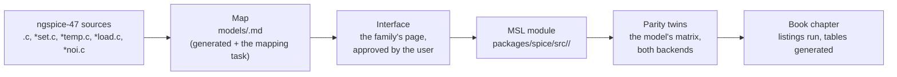

# Spice Models Design

**Spec**: `.specs/features/spice-models/spec.md`
**Status**: Draft — awaiting user approval of the interface (`interface-review.md`)

The design has six parts, in the order the request gives them: the parameter and usage map (§4), the interface (§2, §3), the implementation map (§5), the parity plan (§6), the Book (§7), and the phases and risks (§9, §10). §8 lists what the models need of the language, the solver and the device ABI. No `tasks.md` exists yet: tasks are written after the interface is approved.

Paths and crate names are those of `origin/main` at `7d4d544e0`. `code-clarity` renames crates before this feature starts (`piperine-lang` to `piperine-language`, and others); the first task re-takes every path on the merged `main`.

---

## 1. Overview

One model goes through five steps, and a family is a batch of models that go through them together.



Three things are settled once, before the first family: the package and its rules (§2, §3), the parity scaffold with its gates (§6), and the capabilities the later families need (§8).

**What makes the work tractable.** In ngspice a device is some thirty C files: one function per analysis, each with hand-written derivatives. In MSL a device is one module: its params, one `analog` block that states the currents, the charges and the noise sources, and for some devices a `digital` block. The derivatives, the AC and pole-zero stamps, the truncation-error control and the sensitivities come from the language. Of the 376,000 lines of C behind the in-scope devices, what a model must restate is the setup and temperature code (the params and the body `let`s) and the current and charge part of the load function. Appendix D of the language specification shows the size this gives: a junction diode is about ten lines.

---

## 2. The package

### 2.1 Location and manifest

```
packages/spice/
    Piperine.toml                 name = "spice"
    LICENSE                       ngspice's Modified BSD notice, and the list of the ngspice files the package derives from
    NGSPICE_VERSION               the tag the models were written from: ngspice-47
    src/
        lib.msl                   the namespaces, pub
        constants.msl             ngspice's physical constants
        junction.msl              what the junction devices share: depletion charge, the temperature laws, critical voltage
        temperature.msl           the instance-temperature rule of interface-review §2.7
        passive.msl               or passive/mod.msl with one file per device when a namespace grows
        source.msl
        controlled.msl
        switch.msl
        line.msl
        diode.msl
        bipolar/{mod,bjt,vbic,hicum2}.msl
        jfet.msl
        mesfet/{mod,mesfet,mesa,hfet1,hfet2}.msl
        mosfet/{mod,mos1,mos2,mos3,mos6,mos9,vdmos,meyer}.msl
        bsim/{mod,bsim1,bsim2,bsim3,bsim3_v32,bsim3_v1,bsim3_v0,bsim4,bsim4_v7,bsim4_v6,bsim4_v5}.msl
        soi/{mod,bsim3_soi_fd,bsim3_soi_dd,bsim3_soi_pd,bsim4_soi,soi3}.msl
        hisim/{mod,hisim2,hisim_hv1,hisim_hv2}.msl
```

A module and its behavior blocks are in one file (§8 rule 5), so one device is one file, and a large one (BSIM4) is a large file. What devices share is in functions of `junction.msl`, `temperature.msl` and `mosfet/meyer.msl`; a `fn` keeps no state (§3), so sharing costs nothing at run time.

How a user depends on the package is decision D5. Inside this repository the parity crate and the Book's test target name it by `path`.

### 2.2 Namespaces

`lib.msl` declares one `pub mod` per row of `interface-review.md` §1 and re-exports nothing at the root: a user writes `use spice::diode::Diode;`. The shared namespaces (`constants`, `junction`, `temperature`) are `pub`, so a user's own model can use ngspice's temperature laws and constants.

`spice::constants` holds ngspice's values, which differ from the standard library's in the last digits: `CHARGE = 1.6021766208e-19`, `BOLTZMANN = 1.38064852e-23`, `CELSIUS_TO_KELVIN = 273.15`, `REFERENCE_TEMPERATURE = 300.15`, and the derived `BOLTZMANN_OVER_CHARGE`, `ROOT_TWO`, `VT0` (`src/include/ngspice/const.h`). A model reads these, never `std::constants::Q` or `K_B`, so a thermal voltage has ngspice's digits.

### 2.3 What the package does not hold

No `extern` module. No Rust. No host code. No netlist reader. The package is MSL source that the ordinary pipeline elaborates, plans and runs on both backends.

---

## 3. The interface rules

`interface-review.md` shows these rules at work and asks for the decisions. This section states them as the implementer follows them. Where a rule depends on a decision, it is written on the recommended side and the decision is named.

### 3.1 One module per model

1. Each ngspice device whose `level` or `version` selects a separate parameter table is a module per table (D8 for the legacy versions). `level` and `version` are then not params.
2. A device whose levels share one parameter table keeps the level as an enum param (`Mesa`, `level: MesaLevel`).
3. A device that accepts two sets of required parameters is two modules, each requiring its own set (resistor, capacitor, inductor, diode levels 1 and 3). The module that takes the geometry accepts everything the other does, so each combination of parameters ngspice accepts is expressible in exactly one of them.
4. Each list of terminals a device accepts is a module (`…SelfHeating`, the SOI body-contact variants), because a carrier port is never optional (§8.1.8). The variants of one device share their equations through functions; the thermal variant differs by reading its temperature from a node.
5. A terminal ngspice defaults to ground (the BJT's substrate) is a port; the user passes `gnd`.

### 3.2 Names

1. A param's name is the name of the first entry of the ngspice table for that quantity, in lower case. Aliases (the entries ngspice marks redundant) are not names.
2. The rename table is closed: `as` to `as_`, `pub` to `pub_` (keywords); `ic-vds`, `ic-vgs` to `icvds`, `icvgs`; the model's `m` to `mj` (diode, VDMOS) and to `m_knee` (MESA, HFET1, HFET2); Mos6's model `ps` to `ps_sat`; `on` and `off` of the switches to `initial`; the type keywords and hicum's `type` to `polarity`. A guard compares every other param name with the ngspice table.
3. Where a name is in both the instance and the model table with one meaning (some 130 cases, most of them in BSIM4 and HiSIM_HV), the module has one param.
4. Module names, port names, namespaces, enums, variants and functions are full words, or the device's established name written as a word.
5. Ports: `p, n` for two-terminal elements; `a, k` for diodes; `c, b, e, s` for bipolar transistors; `d, g, s, b` for MOSFETs; `d, g, s` for JFETs and MESFETs; `cp, cn` for a controlling voltage; `sp, sn` for a current-sensing branch; `p1, n1, p2, n2` for a two-port line; `tj`, `dt`, `tcase` for thermal terminals, as their model names them.

### 3.3 Types

| ngspice type | MSL type |
| --- | --- |
| real | `f64` or `Option<f64>` |
| integer that counts (`n` of URC, `np` of a pulse) | `u32` or `Option<u32>` |
| integer that selects (`capmod`, `mobmod`, `tlev`, `nlev`, `noimod`) | `i32`, with a `where` listing the values the model accepts. An enum per selector would give 200 enums whose variants are numbers; the numbers are the documented vocabulary of each model. |
| flag | `bool` |
| a group of exclusive flags | one enum param |
| real vector that is a list of scalars (`ic`) | the scalar params that already exist |
| real vector that is data (`pwl`, the matrices of `cpl`) | an array param with a const-generic length |
| expression (`asrc`) | a value input |
| instance name (`control` of F, H, W; the inductors of K) | ports |
| string (`version`) | not a param: the module |

### 3.4 Defaults and given-ness

`models/*.md` classifies each parameter from the sources: `default`, `given-ness read`, `computed default`, `unresolved`. The mapping task of a family turns the classification into a declaration:

1. `default` becomes `name: f64 = <ngspice's constant>;`.
2. `computed default` becomes `name: Option<f64>;` and a body `let` that computes the effective value, in the order ngspice computes it.
3. `given-ness read` is read case by case: when the flag is read only to print a warning, the param takes rule 1; when it changes a result, rule 2.
4. `unresolved` (354 of 11,027 at extraction: the default is assigned outside the `if (!given)` idiom) is resolved by reading the setup function.
5. A parameter with no default in ngspice and no meaning when absent is required.
6. A default that ngspice takes from a circuit option (`defw`, `defl`, `tnom`) is ngspice's built-in value of that option.
7. A default that ngspice takes from the analysis card is refused as a default: the param is required or `Option` with "absent" given a meaning that does not depend on the analysis (interface-review §4.1).

### 3.5 `where`

1. A `where` is written where ngspice's setup or check function returns an error for the value. The diagnostic is the language's (`E0317`, `E0802`).
2. Where ngspice warns and continues, the model continues with the same value. Where ngspice replaces the value, the effective value is a body `let` that makes the same replacement.
3. One `where` per module states a rule that spans params ("`td` or `f`"), written on the last of them.
4. The range checks of BSIM3, BSIM4 and HiSIM (`b3check.c`, `b4check.c`, `hsm2set.c`) are fatal for some parameters and warnings for others; the mapping task lists which, and only the fatal ones are `where`.

### 3.6 Model cards

1. A card is a template of the device module (§8.4), held in a `const` or returned by a function.
2. The package ships no cards. The Book and the parity fixtures have cards of public parts, each with its source.
3. With D3 a placement through a card may rebind params. Without it, a card whose instances differ is a function of what differs.
4. Binning is a function that returns a template (§8.4.7).

### 3.7 Temperature, multiplicity, initial state

1. `spice::temperature::device_kelvin(temp, dtemp)` returns the instance temperature in kelvin: `temp + 273.15` when `temp` is given, else `temperature().unwrap_or(REFERENCE_TEMPERATURE) + dtemp`. Every model calls it; none reads `temperature()` itself.
2. Every temperature-dependent quantity is a body `let` over params and that temperature. It is a discrete expression (§8.2), so it is evaluated when a param or the run changes, not at every Newton iteration: this is ngspice's temperature function.
3. A self-heating variant computes the same quantities from `device_kelvin(…) + potential(tj)`; they are then continuous expressions, differentiated like any other, and the thermal node receives the dissipated power.
4. `m` follows §8.5.5: `m.or(multiplicity()).unwrap_or(DEFAULT_MULTIPLICITY)`.
5. `off` gives the seed of each `limit` instance of the model: 0 when `off`, the critical voltage otherwise (§18 rules 1 and 2, ngspice's `MODEINITJCT`).
6. `ic`-family params follow §16 H7: under `analysis(Transient) && analysis(Static)` the branch is a potential source at the given value.

### 3.8 What a model exposes

1. Each read-only quantity of the ngspice instance table that is not a node number or a sensitivity is a named `let` of the `analog` block with the ngspice name, hence an operating-point variable (§11 rule 6). Small-signal conductances are `ddx` of the current; capacitances are `ddx` of the charge.
2. Each noise source has the name ngspice's noise function gives it.
3. Internal nodes are `signal`s named as ngspice names them where the name is a word (`drain`, `source`, `base`, `collector`, `emitter`), and are not `pub`. A user's module cannot attach to them; the host observes them by path (§21).
4. Each param has a `///` text: one sentence of meaning, the unit in brackets, and "ngspice: `name`" when the MSL name differs.

### 3.9 ngspice parameters with no MSL param

The closed list. A guard fails when a settable ngspice parameter is neither a param nor here.

| Parameters | Devices | In MSL |
| --- | --- | --- |
| `sens_*` | every device | the host's gradients over every param (§21 rule 7) |
| `level`, `version` | diode, BJT, JFET, MESFET, MOSFET | the module (§3.1) |
| type keywords (`npn`, `pnp`, `nmos`, `pmos`, `njf`, `pjf`, `nmf`, `pmf`, `nhfet`, `phfet`, `vdmosn`, `vdmosp`, `nsoi`, `psoi`) | transistors | `polarity` |
| model keywords that only name the device (`d`, `r`, `c`, `l`, `sw`, `csw`, `ltra`, `txl`, `cpl`, `urc`) | their devices | the module |
| `ic` vectors | transistors, lines | the scalar `ic…` params |
| `pulse`, `sin`, `exp`, `pwl`, `sffm`, `am`, `trnoise`, `trrandom`, and `r`, `td` of a PWL | `vsrc`, `isrc` | the waveform modules |
| `ac` vector | `vsrc`, `isrc` | `acmag`, `acphase` |
| `distof1`, `distof2` | `vsrc`, `isrc` | refused: no `.disto` (§16.3); owner: none, by the language's design |
| `portnum`, `z0`, `pwr`, `freq`, `phase` | `vsrc` | refused: ports belong to the host's S-parameter analysis; owner: the host surface, a `GAPS.md` row |
| `external`, `snd` | `vsrc`, `isrc` | refused: a host drive (§23.1); owner: the same row |
| `control`, `inductor1`, `inductor2` | F, H, W, K | ports (D10, D11) |
| `pos_node`, `neg_node`, `pos_nodes`, `neg_nodes`, `dimension` | switches, `txl`, `cpl` | ports and the const generic `N` |
| `i`, `v` of `asrc` | B | the module (`BehavioralCurrentSource`, `BehavioralVoltageSource`) and its value input |
| `thermal` flag | diode, VDMOS | the `…SelfHeating` module |
| `on`, `off` | switches | `initial` |
| the eight exclusive option flags of `ltra` | `ltra` | two enum params |

---

## 4. The parameter and usage map

`models/<family>.md` is the map: thirteen files, one per family, every device of ngspice-47, every entry of its instance and model tables.

**How it is made.** `tools/extract.py <ngspice tree> inventory.json` reads each device directory: the `IFparm` tables (name, id, type, direction, redundancy, description), the terminal names, the `SPICEdev` entry points, the field each parameter is stored in (the `*par*.c` files), the default assigned under `if (!…Given)` anywhere in the directory, how many times the given flag is read outside the parameter files, the limiting functions called, the internal unknowns created, the noise source names and the length of the state vector. `tools/render.py inventory.json models/` writes the files. Both are committed; a test of the feature renders again from a checkout of the tag and compares (SPM-01).

**What the extraction does not give.** Units (the tables have none), the meaning of "absent" for each `Option`, and the 354 defaults assigned outside the idiom. These are the **mapping task** of each family: its output is the family's interface page (a hand-written table per device in the form of `interface-review.md` §3.1, with unit, type, default and meaning for every param), which goes to the user before the family is implemented (SPM-06, SPM-42). The unit of each BSIM, HiSIM, VBIC and HICUM parameter is taken from the model's reference manual, which the page cites.

**Usage rules** are recorded per device in the same page: which parameters are required, which exclude each other, what a model selector switches, which terminals may be tied. For the families of `interface-review.md` §3 to §7 they are in that page now.

**Analyses.** §5's table gives, per device, the ngspice entry points. In MSL:

| ngspice entry | In MSL | Needs of the model |
| --- | --- | --- |
| `DEVload` (OP, DC, transient) | the `analog` block | the currents and the charges under `ddt` |
| `DEVacLoad`, `DEVpzLoad` | the small-signal rule over the same block (§11.1.4); pole-zero and transfer function are host analyses (§16.3) | nothing more |
| `DEVnoise` | `noise`, `white_noise`, `flicker_noise` instances | one per ngspice source |
| `DEVtemperature` | body `let`s over params and the instance temperature | §3.7 |
| `DEVtrunc` | the truncation-error test of each `ddt` state (§17.2.1) | `abstol` of a charge where ngspice uses `chgtol` |
| `DEVconvTest` | the solver's convergence test and the `limit` veto (§17.1, §18) | nothing; a deviation of path, never of answer |
| `DEVsetic` | §16 H7 | the `ic…` params |
| `DEVaccept` (breakpoints, line history) | `at`, `delay` | scheduled corners; §8 for the lossy line |
| `DEVsen*` | the host's gradients | nothing |
| `DEVdisto` | none: distortion is a transient and a Fourier analysis | nothing |
| `DEVsoaCheck` | a reaction `on settle` that writes a warning record, placed only when a limit is given | the `…_max` params |
| `DEVask` | operating-point variables | §3.8 |

A device for which ngspice has no noise entry (`mos6`, `mesa`, `hfet1`, `hfet2`, the lines) places no noise source (SPM-21).

---

## 5. The implementation map

One row per in-scope device, generated from the sources (the same extraction as §4). *Equations* names the files whose current and charge code the model restates; the AC, pole-zero and sensitivity files are listed only to show they exist and are not restated. *Internal unknowns* are ngspice's; a node that exists only when a resistance is positive is a `signal` whose series branch is a param-selected short (§11 rule 3). *States* is the length of ngspice's state vector, an upper bound on the charges and held values the model has.

| Device | Equations | Temperature | Noise sources | Limiting | Internal unknowns | States | AC | PZ | Noise | Trunc | IC | Accept | SOA |
| --- | --- | --- | --- | --- | --- | --- | --- | --- | --- | --- | --- | --- | --- |
| `res` | `resload.c`, `respzld.c`, `ressload.c` | `restemp.c` | thermal, 1overf | — | — | — | yes | yes | yes | — | — | — | yes |
| `cap` | `capacld.c`, `capload.c`, `cappzld.c` | `captemp.c` | — | — | — | 2 | yes | yes | — | yes | yes | — | yes |
| `ind` | `indacld.c`, `indload.c`, `indpzld.c` | `indtemp.c`, `muttemp.c` | — | — | branch branch | 2 | yes | yes | — | yes | — | — | — |
| `vsrc` | `vsrcacld.c`, `vsrcload.c`, `vsrcpzld.c` | `vsrctemp.c` | — | — | branch branch, node res | — | yes | yes | — | — | — | yes | — |
| `isrc` | `isrcacld.c`, `isrcload.c` | `isrctemp.c` | — | — | — | — | yes | — | — | — | — | yes | — |
| `asrc` | `asrcacld.c`, `asrcload.c`, `asrcpzld.c` | `asrctemp.c` | — | — | branch branch | — | yes | yes | — | — | — | — | — |
| `vcvs` | `vcvsload.c`, `vcvspzld.c`, `vcvssld.c` | — | — | — | branch branch | — | yes | yes | — | — | — | — | — |
| `vccs` | `vccsload.c`, `vccspzld.c`, `vccssld.c` | — | — | — | — | — | yes | yes | — | — | — | — | — |
| `cccs` | `cccsload.c`, `cccspzld.c`, `cccssld.c` | — | — | — | — | — | yes | yes | — | — | — | — | — |
| `ccvs` | `ccvsload.c`, `ccvspzld.c`, `ccvssld.c` | — | — | — | branch branch | — | yes | yes | — | — | — | — | — |
| `sw` | `swacload.c`, `swload.c`, `swpzload.c` | — | — | — | — | — | yes | yes | yes | yes | — | — | — |
| `csw` | `cswacld.c`, `cswload.c`, `cswpzld.c` | — | — | — | — | — | yes | yes | yes | yes | — | — | — |
| `tra` | `traacld.c`, `traload.c` | `tratemp.c` | — | — | node i1, node i2, node int1, node int2 | — | yes | — | — | yes | — | yes | — |
| `ltra` | `ltraacld.c`, `ltraload.c` | `ltratemp.c` | — | — | node i1, node i2 | — | yes | — | — | yes | — | yes | — |
| `txl` | `txlload.c` | — | — | — | branch branch, branch branch1, branch branch2 | — | yes | — | — | — | — | — | — |
| `cpl` | `cplload.c` | — | — | — | — | — | — | — | — | — | — | — | — |
| `urc` | — | — | — | — | — | — | — | — | — | — | — | — | — |
| `dio` | `dioacld.c`, `dioload.c`, `diopzld.c` | `diotemp.c` | rs, id, 1overf, rsw, idsw, 1overfsw | limitlog, pnjlim | node internal, node internal_sw, node qp | 22 | yes | yes | yes | yes | yes | — | yes |
| `bjt` | `bjtacld.c`, `bjtload.c`, `bjtpzld.c` | `bjttemp.c` | rc, rb, re, ic, ib, 1overf | pnjlim | node collCX, node collector, node base, node emitter | 33 | yes | yes | yes | yes | yes | — | yes |
| `vbic` | `vbicacld.c`, `vbicload.c`, `vbicpzld.c` | `vbictemp.c` | rc, rci, rb, rbi, re, rbp, rs, ic, ib, ibep, iccp, 1overfbe, 1overfbep | limitlog, pnjlim | node collector, node base, node emitter, node substrate, node collCI, node baseBP, node baseBI, node xf1, node xf2 | 86 | yes | yes | yes | yes | yes | — | yes |
| `hicum2` | `hicum2acld.c`, `hicum2pzld.c` | `hicumL2temp.cpp` | rcx, rbx, rbi, re, rsu, iavl, ibci, ibep, ijbcx, ijsc, it, ibei, 1overfbe, 1overfre | limitlog, pnjlim | node collCI, node baseBP, node emitEI, node subsSI, node baseBI, node dT, node xf, node xf1, node xf2 | 126 | yes | yes | yes | yes | yes | — | yes |
| `jfet` | `jfetacld.c`, `jfetload.c`, `jfetpzld.c` | `jfettemp.c` | rd, rs, id, 1overf | fetlim, pnjlim | node source, node drain | 13 | yes | yes | yes | yes | yes | — | — |
| `jfet2` | `jfet2acld.c`, `jfet2load.c` | `jfet2temp.c` | rd, rs, id, 1overf | fetlim, pnjlim | node source, node drain | 19 | yes | — | yes | yes | yes | — | — |
| `mes` | `mesload.c`, `mespzld.c` | `mestemp.c` | rd, rs, id, 1overf | fetlim, pnjlim | node source, node drain | 13 | yes | yes | yes | yes | yes | — | — |
| `mesa` | `mesaload.c` | `mesatemp.c` | — | fetlim, pnjlim | node source, node drain, node gate, node gs, node gd | 20 | yes | yes | — | yes | yes | — | — |
| `hfet1` | `hfetload.c` | `hfettemp.c` | — | fetlim | node source, node drain, node gate, node gd, node gs | 24 | yes | yes | — | yes | yes | — | — |
| `hfet2` | `hfet2load.c` | `hfet2temp.c` | — | fetlim, pnjlim | node source, node drain | 13 | yes | yes | — | yes | yes | — | — |
| `mos1` | `mos1acld.c`, `mos1load.c`, `mos1pzld.c` | `mos1temp.c` | rd, rs, id, 1overf | fetlim, limvds, pnjlim | node drain, node source | 17 | yes | yes | yes | yes | yes | — | — |
| `mos2` | `mos2acld.c`, `mos2load.c`, `mos2pzld.c` | `mos2temp.c` | rd, rs, id, 1overf | fetlim, limvds, pnjlim | node internal#drain, node internal#source | 17 | yes | yes | yes | yes | yes | — | — |
| `mos3` | `mos3acld.c`, `mos3load.c`, `mos3pzld.c` | `mos3temp.c` | rd, rs, id, 1overf | fetlim, limvds, pnjlim | node internal#drain, node internal#source | 17 | yes | yes | yes | yes | yes | — | — |
| `mos6` | `mos6load.c` | `mos6temp.c` | — | fetlim, limvds, pnjlim | node drain, node source | 17 | — | — | — | yes | yes | — | — |
| `mos9` | `mos9acld.c`, `mos9load.c`, `mos9pzld.c` | `mos9temp.c` | rd, rs, id, 1overf | fetlim, limvds, pnjlim | node internal#drain, node internal#source | 17 | yes | yes | yes | yes | yes | — | — |
| `vdmos` | `vdmosacld.c`, `vdmosload.c`, `vdmospzld.c` | `vdmostemp.c` | rd, rs, id, 1overf | fetlim, limitlog, limvds, pnjlim | node drain, node gate, node source, node body_diode, node Tj, node Tc, branch VdevTemp, node cktTemp, node qp | 25 | yes | yes | yes | yes | yes | — | yes |
| `bsim1` | `b1acld.c`, `b1eval.c`, `b1ld.c` | `b1temp.c` | rd, rs, id, 1overf | fetlim, limvds, pnjlim | node drain, node source | 35 | yes | yes | yes | yes | yes | — | — |
| `bsim2` | `b2acld.c`, `b2eval.c`, `b2ld.c` | `b2temp.c` | rd, rs, id, 1overf | fetlim, limvds, pnjlim | node drain, node source | 35 | yes | yes | yes | yes | yes | — | — |
| `bsim3` | `b3acld.c`, `b3ld.c`, `b3pzld.c` | `b3temp.c` | rd, rs, id, 1overf | fetlim, limvds, pnjlim | node drain, node source, node charge | 17 | yes | yes | yes | yes | yes | — | yes |
| `bsim3v32` | `b3v32acld.c`, `b3v32ld.c`, `b3v32pzld.c` | `b3v32temp.c` | rd, rs, id, 1overf | fetlim, limvds, pnjlim | node drain, node source, node charge | 17 | yes | yes | yes | yes | yes | — | yes |
| `bsim3v1` | `b3v1acld.c`, `b3v1ld.c`, `b3v1pzld.c` | `b3v1temp.c` | rd, rs, id, 1overf | fetlim, limvds, pnjlim | node drain, node source, node charge | 18 | yes | yes | yes | yes | yes | — | — |
| `bsim3v0` | `b3v0acld.c`, `b3v0ld.c`, `b3v0pzld.c` | `b3v0temp.c` | rd, rs, id, 1overf | fetlim, limvds, pnjlim | node drain, node source, node charge | 18 | yes | yes | yes | yes | yes | — | — |
| `bsim4` | `b4acld.c`, `b4ld.c`, `b4pzld.c` | `b4temp.c` | rd, rs, rg, rbps, rbpd, rbpb, rbsb, rbdb, id, 1overf, igs, igd, igb, corl | fetlim, limvds, pnjlim | node drain, node source, node gate, node midgate, node dbody, node body, node sbody, node charge | 29 | yes | yes | yes | yes | yes | — | yes |
| `bsim4v7` | `b4v7acld.c`, `b4v7ld.c`, `b4v7pzld.c` | `b4v7temp.c` | rd, rs, rg, rbps, rbpd, rbpb, rbsb, rbdb, id, 1overf, igs, igd, igb, corl | fetlim, limvds, pnjlim | node drain, node source, node gate, node midgate, node dbody, node body, node sbody, node charge | 29 | yes | yes | yes | yes | yes | — | yes |
| `bsim4v6` | `b4v6acld.c`, `b4v6ld.c`, `b4v6pzld.c` | `b4v6temp.c` | rd, rs, rg, rbps, rbpd, rbpb, rbsb, rbdb, id, 1overf, igs, igd, igb | fetlim, limvds, pnjlim | node drain, node source, node gate, node midgate, node dbody, node body, node sbody, node charge | 29 | yes | yes | yes | yes | yes | — | yes |
| `bsim4v5` | `b4v5acld.c`, `b4v5ld.c`, `b4v5pzld.c` | `b4v5temp.c` | rd, rs, rg, rbps, rbpd, rbpb, rbsb, rbdb, id, 1overf, igs, igd, igb | fetlim, limvds, pnjlim | node drain, node source, node gate, node midgate, node dbody, node body, node sbody, node charge | 29 | yes | yes | yes | yes | yes | — | yes |
| `bsim3soi_fd` | `b3soifdacld.c`, `b3soifdld.c`, `b3soifdpzld.c` | `b3soifdtemp.c` | rd, rs, id, 1overf, fb | — | node drain, node source, node Body, node Temp | 25 | yes | yes | yes | yes | yes | — | — |
| `bsim3soi_dd` | `b3soiddacld.c`, `b3soiddld.c`, `b3soiddpzld.c` | `b3soiddtemp.c` | rd, rs, id, 1overf, fb | — | node drain, node source, node Body, node Temp | 25 | yes | yes | yes | yes | yes | — | — |
| `bsim3soi_pd` | `b3soipdacld.c`, `b3soipdld.c`, `b3soipdpzld.c` | `b3soipdtemp.c` | rd, rs, id, 1overf, fb | — | node drain, node source, node Body, node Temp | 25 | yes | yes | yes | yes | yes | — | — |
| `bsimsoi` | `b4soiacld.c`, `b4soild.c`, `b4soipzld.c` | `b4soitemp.c` | rd, rs, rg, id, 1overf, fb_ibs, fb_ibd, igs, igd, igb, rbsb, rbdb, rbody | — | node drain, node source, node Body, node Temp, node gate, node midgate, node dbody, node sbody | 38 | yes | yes | yes | yes | yes | — | yes |
| `soi3` | `soi3acld.c`, `soi3load.c` | `soi3temp.c` | rd, rs, id, 1overf | fetlim, limvds, soipnjlim | node drain, node source, branch branch, node tout1, node tout2, node tout3, node tout4 | 64 | yes | — | yes | yes | yes | — | — |
| `hisim2` | `hsm2acld.c`, `hsm2eval.c`, `hsm2ld.c` | `hsm2temp.c` | rd, rs, id, 1ovf, igs, igd, igb, ign | fetlim, limvds, pnjlim | node drain, node source, node gate, node dbody, node body, node sbody | 18 | yes | yes | yes | yes | yes | — | yes |
| `hisimhv1` | `hsmhvacld.c`, `hsmhveval.c`, `hsmhvld.c` | `hsmhvtemp.c` | rd, rs, id, 1ovf, ign | fetlim, limvds, pnjlim | node drain, node source, node gate, node dbody, node body, node sbody, node temp, node qi_nqs, node qb_nqs | 31 | yes | yes | yes | yes | yes | — | yes |
| `hisimhv2` | `hsmhv2acld.c`, `hsmhv2eval.c`, `hsmhv2ld.c` | `hsmhv2temp.c` | rd, rs, id, 1ovf, ign | fetlim, limvds, pnjlim | node drain, node source, node gate, node dbody, node body, node sbody, node temp, node qi_nqs, node qb_nqs | 31 | yes | yes | yes | yes | yes | — | yes |

### 5.1 How each ngspice mechanism is written in MSL

| ngspice | MSL | Reference |
| --- | --- | --- |
| a current stamped between two nodes | `i(a, b) +> expr;` | §11 rule 1 |
| a charge in the state vector, integrated by `NIintegrate` | `i(a, b) +> ddt(q);` | §14.5 |
| a capacitance integrated as `C·dV` (the Meyer model of `mos1` to `mos9`, `DEVqmeyer`) | `i(a, b) +> c * ddt(v(a, b));` with `c` the Meyer capacitance at the present solution | §14.5; risk R4 |
| a voltage source or an inductor branch | `v(a, b) +> expr;` | §11 rule 1 |
| a series resistance with an internal node, absent when the resistance is zero | `signal`, and `if rs > 0.0 { i(a, ai) +> v(a, ai) / rs; } else { v(a, ai) +> 0.0; }` | §11 rule 3, the `Diode` of §18 |
| `DEVpnjlim`, `DEVfetlim`, `DEVlimvds` | `limit(x, …)` with `std`'s `pnjlim`, `fetlim`, `limvds` | §18, §22.2 |
| `DEVlimitlog` (diode, VBIC, HICUM, VDMOS thermal and tunnel branches), `DEVsoipnjlim` | functions of `spice::junction`, transliterated from `devsup.c`, passed to `limit` | §14.7 |
| `MODEINITJCT`, `off` | the `seed` of `limit` | §18 rules 1, 2 |
| `CKTgmin` across a junction | `gmin() * v` | §14.4 |
| source stepping | `source_scale()` in the independent sources | §14.4 |
| the temperature function | body `let`s | §3.7 |
| hand-written derivatives (`gm`, `gds`, `capbd`, …) | nothing: the language differentiates (§11 rule 5); the reported values are `ddx` | §14.2 |
| white noise `4kT·g`, shot noise `2qI`, flicker `kf·I^af/f^ef` | `white_noise`, `flicker_noise`, or `noise(psd)` when the density has another shape | §14.8, §22.2 |
| correlated noise (induced gate noise of BSIM4 `tnoimod`) | one `noise` instance read in two contributions | §11.1.8 |
| excess phase (`ptf` of the BJT), NQS charge nodes (`BSIM3`, `BSIM4`, HiSIM) | internal nodes with their own equation, as ngspice has them | §11 rule 14 |
| breakpoints of a source | `at(t)` in the waveform module's `digital` block | §13 |
| the delay of a lossless line | `delay(x, td)` | §14.6 |
| a switch's state | a `signal` of `Bit`, changed by reactions on `above` | §12, §11.2 |
| lumps of the URC line | generation `for` over a structural param | §8.2.7 |
| a self-heating node | a port of nature `Thermal`; the power is a flow contribution | §4 |
| `bypass`, `DEVpred`, per-device convergence shortcuts | nothing: solver matters | spec, Out of Scope |

### 5.2 Per-family notes

**Passive.** `res`: the conductance and its temperature factor are discrete `let`s; noise is thermal `4kT/R` scaled by `m`, plus flicker over the effective noise area. `cap`: `ddt(c_effective * v)`; the semiconductor capacitor's value is a `let` from geometry. `ind`: `v +> ddt(l * i + sqrt(l) * coupled_flux)`, where the coupled flux arrives through the `link` node (D10): the inductor pins `potential(link)` to `sqrt(l)·i` and reads the branch's flow, and each `MutualInductor` contributes `k · potential(other)` into it, which gives `M = k·sqrt(l1·l2)`.

**Sources.** `vsrc` and `isrc`: `dc * source_scale()`, `ac_stim(acmag, acphase in radians)`, and the waveform under `analysis(Transient)`. Each waveform module is a result module with params; `pulse` and `piecewise_linear` keep the index of the present segment in a signal and schedule the next corner with `at` (the `Pwl` of Appendix D.1). `transient_noise` and `transient_random` draw from `std`'s `normal` with a seeded state carried in a signal.

**Switches.** A `Bit` state with hysteresis; conductance `1/ron` or `1/roff`; thermal noise of the present resistance. The operating point settles the state by the rounds of §16.

**Lines.** `tra`: the two ports of the method of characteristics, each a potential contribution `z0 * i + delay(v_other + z0 * i_other, td)`. `urc`: generation. `txl` and `cpl`: ngspice approximates the line by a delay and a rational (Padé) function per mode; in MSL the same poles and residues are a `laplace_*` filter per mode and a `delay`, with the coefficients computed in body `let`s by the algorithm of `txlsetup.c` and `cplsetup.c`. `ltra`: a convolution of the port quantities with the line's impulse responses over the whole accepted history, whose kernels ngspice integrates anew for each step. No MSL primitive reads an arbitrary stretch of history; this is capability N3 of §8.

**Junction devices** (`dio`, `bjt`, `jfet`, `mes`, the bulk diodes of every MOSFET). The shared functions of `spice::junction`: depletion charge with the `fc` linearization, the temperature laws of saturation current, built-in potential and capacitance for each `tlev`/`tlevc`, the critical voltage, `limitlog`. A device calls them with its own parameters. Known traps from the earlier ports, to be re-checked by twins: the BJT's substrate junction polarity for lateral devices, the JFET's `b` (doping tail) term, the diode's breakdown matching (`bv` is adjusted so the two exponentials meet at `ibv`), and the dependence of convergence on `gmin` stepping.

**MOS levels 1 to 9.** Each has ngspice's source/drain interchange (the model is evaluated with the terminals swapped when `vds < 0`): in MSL an `if` on the probe between two expressions, which §11 rule 5 allows. The Meyer gate capacitances are the one place where ngspice's charge is not a function of the present voltages (risk R4). `mos2` computes its saturation voltage by solving a quartic; `mos6` has no AC, pole-zero or noise entry in ngspice, and in MSL has AC by construction and no noise.

**BSIM, HiSIM, SOI, VBIC, HICUM.** Each is one large `analog` block, written as a sequence of `let`s that follows the load function statement by statement, so that a reader can hold the two side by side. The size-dependent and temperature-dependent parameters (the `pParam` structure of BSIM, computed once per instance in `b4temp.c`) are body `let`s over params. Selector params (`capmod`, `mobmod`, …) choose among expressions; a selector that adds or removes a node (`rgatemod`, `rbodymod`, `trnqsmod`) is structural. `hicum2` in ngspice-47 is C++ with dual numbers (`hicumL2.cpp`): its currents are plain expressions and its derivatives are automatic there as here.

---

## 6. The parity plan

### 6.1 What is compared

The oracle is ngspice-47, run at test time by `piperine-parity` on a `.cir`; the MSL twin is run by `piperine` on both backends; each printed quantity is compared under one `ToleranceContract`. This is the harness of today (`crates/piperine-parity`), with more fixtures and three new gates.

| Analysis | Compared | Contract |
| --- | --- | --- |
| operating point | node voltages, terminal currents | `DC_VOLTAGE`, `DC_CURRENT` |
| DC sweep | terminal currents along the sweep | `DC_CURRENT` |
| AC | magnitude and phase of a transfer or a port admittance over frequency | `AC_MAGNITUDE`, `AC_PHASE` |
| transient | node voltages at ngspice's print points | `TRAN_VOLTAGE` |
| noise | output noise density per frequency, per source and total; band totals | `NOISE` |
| transfer function | gain, input and output resistance | `TF_RATIO` |
| pole-zero | poles and zeros | `PZ_ROOT` |
| sensitivity | DC sensitivities to model parameters | `SENSITIVITY` |
| distortion | harmonics of a transient, both sides by Fourier analysis (`.four` in ngspice) | `TRAN_VOLTAGE` on the waveform; the harmonics by the host's measure under `AC_MAGNITUDE` |
| temperature | each of the above at three temperatures | the same contracts |

No contract is added and none is changed (SPM-28). A comparison that fails is a defect of the model or of the solver, or a deviation recorded with its cause (`piperine-parity/src/deviation.rs`) and approved by the user.

### 6.2 The matrix of a model

Each model has a matrix: rows are conditions, columns are analyses. A cell is one twin or a recorded refusal. The rows by family:

| Family | Rows (conditions) |
| --- | --- |
| passive | value; geometry; temperature coefficients at three temperatures; `m` and `scale`; `ic`; flicker noise; coupling (`k` at 0.1, 0.9, 1) |
| sources | each waveform with defaults and with every parameter set; corners that fall between print points; `acmag`/`acphase`; source stepping in a hard operating point |
| switches | on, off, hysteresis up and down, `initial` each way, noise in each state |
| lines | matched, open and shorted terminations; a step and a sine; lossy cases at three lengths; coupled pairs with near- and far-end crosstalk |
| diode | forward (low injection, knee, series-resistance limited), reverse leakage, breakdown, tunnelling, recombination; `area` and `pj` scaling; sidewall; each `tlev`/`tlevc`; reverse recovery (`tt`, `vp`); depletion and diffusion capacitance in AC; shot, thermal and flicker noise; self-heating |
| bipolar | Gummel plot; output characteristics with Early effect; forward and reverse active, saturation, cut-off; quasi-saturation; both polarities; lateral and vertical substrate; `ft` versus `ic` in AC; storage time in transient; each noise source; three temperatures; for VBIC and HICUM the same plus self-heating and avalanche |
| JFET, MESFET, HFET | transfer and output curves; pinch-off, ohmic, saturation; gate forward conduction; both polarities; capacitances in AC; noise at `nlev` 0, 1, 2, 3 where the model has it |
| MOS 1 to 9, VDMOS | `id`–`vgs` at low and high `vds`, `id`–`vds` at four `vgs`, each at three body biases; subthreshold, linear, saturation; reverse mode (`vds < 0`); both polarities; process-derived versus given `vto`, `kp`, `gamma`, `phi`; junction diodes forward and reverse; overlap and Meyer capacitances in AC at five biases; an inverter and a ring oscillator in transient; noise per `nlev`; three temperatures; VDMOS body diode and self-heating |
| BSIM, HiSIM, SOI | the above; plus a geometry grid (short, long, narrow, wide, and the four corners); each model selector at each value; gate current; the NQS options in AC and transient; stress and well-proximity parameters; binned cards; the model's own regression decks from `ngspice/tests/` |

A twin is small: one device, its sources, at most a load. The existing fixtures of `tests/e2e/twins/` (66 netlists, 24 with an MSL twin today) are kept, and their hand-written `devices.msl` is replaced by the package once phase 1 lands.

### 6.3 Layout and generation

```
packages/spice/parity/<family>/<model>/<case>.cir      the ngspice netlist
packages/spice/parity/<family>/<model>/<case>.msl      the MSL twin
packages/spice/parity/<family>/<model>/matrix.toml     the cells: case, analysis, quantities, contract, or the refusal and its owner
crates/piperine-parity/tests/spice_<family>.rs         one target per family; it walks the matrices
```

The `.cir` and the `.msl` of a twin are written by hand for the first families. From the MOSFETs on, a card has hundreds of parameters, and a twin's two files must carry the same card: a small generator in `piperine-parity` writes both from one table of `name = value` pairs (the ngspice spelling and the MSL spelling come from the rename table). The generator is test support; it is the seed of the netlist importer that the spec leaves out.

### 6.4 The gates

| Gate | Fails when | Requirement |
| --- | --- | --- |
| matrix completeness | a cell of a model's matrix has no twin and no recorded refusal | SPM-27 |
| parameter coverage | a param of a model is set to a non-default value by no twin (the list is printed; the gate holds a ceiling per model that only goes down, and is zero at the model's closure) | SPM-33 |
| parameter completeness | an ngspice parameter is neither a param of the module nor in the closed list of §3.9 | SPM-02 |
| name fidelity | a param's name is not the ngspice name and not in the rename table | SPM-09 |
| contract only | a parity test compares with a literal (the existing rule of `contract.rs`) | SPM-28 |
| oracle version | the installed ngspice does not report the version of `NGSPICE_VERSION` | SPM-05, SPM-36 |
| map freshness | `models/*.md` differs from a fresh rendering | SPM-01 |

Per the project's gate policy, a task runs the targets of the family it touches; the full suite runs once, at the family's final verification.

### 6.5 Where the two simulators differ by design

Known before starting, and each needs a decision recorded in the deviation ledger when a twin meets it:

| Difference | Effect | Handling |
| --- | --- | --- |
| time stepping (TR-BDF2 against ngspice's trapezoidal with its own step control) | transient waveforms differ within the truncation tolerance | `TRAN_VOLTAGE` already accounts for it; fixtures use ngspice's `maxstep` small enough that ngspice's own error is below the contract |
| located crossings against step-quantized switching | a switch closes at slightly different times | the same; twins measure after the event, not at it |
| the Meyer capacitance averaging | small differences of gate charging in transient | risk R4 |
| ngspice's derivative not being the derivative of its current | AC and noise differ where it happens | found by the AC twins; recorded per model (SPM-24) |
| physical constants | none: the package uses ngspice's | |
| random sources | different samples | compare mean, variance and spectrum, not samples |

---

## 7. The Book

A new part, after "In depth": **Part 3, The SPICE model library**. It is a manual: each chapter explains its devices to a reader who has used a transistor and not necessarily a SPICE model, and it is complete without ngspice's manual. Every listing is run by the `book` target; every parameter table is generated from the package's `///` texts, so the Book cannot drift from the source.

Each device section has the same seven parts, in this order:

1. **What it is**: the physical device, and what the model captures and leaves out.
2. **Choosing it**: when this model, when its neighbours (level 1 against BSIM4; Gummel-Poon against VBIC).
3. **Placing it**: the minimal listing, with its result.
4. **A model card**: a card of a real part or process, as a `const` or a function, and how to share it.
5. **The parameters, explained**: grouped by what they affect, each group with its equation and a figure where a curve says it better (the knee of a diode, the output curves against `lambda`); then the generated reference table with unit, default and ngspice name.
6. **Use cases**: one to three small circuits, each run, with what to look at.
7. **Reading it back, and limits**: the operating-point variables, the noise sources, what differs from ngspice, what is refused.

| Chapter | Sections | Use cases (each a run listing) |
| --- | --- | --- |
| **Using the `spice` package** | the dependency; `use`; the naming rule; a card is a template; card functions and binning; units and SI suffixes; temperature, `dtemp`, `tnom`; multiplicity; initial conditions; reading operating-point variables and noise by source; **from an ngspice netlist to MSL**: the element-by-element translation table, the aliases, the expression functions of the B source; what differs on purpose; what is refused and who owns it; models ngspice loads through OSDI and how MSL loads them | a netlist translated line by line and run to the same answers |
| **Passive elements** | resistor (by value, by geometry, temperature, noise); capacitor; inductor; coupled inductors and transformers; the uniform RC line | a divider over temperature; a resistor's noise; a transformer; an RC line's delay |
| **Sources and switches** | DC and AC; the eight waveforms, each with its parameters drawn on its curve; a waveform of your own; behavioural sources; the four controlled sources; current sensing; switches and hysteresis | a pulse train into an RC; an AM signal; an ideal op-amp from a controlled source; a relaxation oscillator with a switch |
| **Transmission lines** | lossless; reflections and termination; lossy and coupled lines; which model for which problem | a mismatched line's ringing; crosstalk on a coupled pair |
| **Diodes** | the junction; DC parameters; breakdown; charge storage and recovery; temperature; noise; the geometric diode; self-heating | a rectifier; a Zener regulator; reverse recovery; a varactor in AC |
| **Bipolar transistors** | Gummel-Poon from the ideal transistor up; Early effect, high injection, base resistance; charge and `ft`; temperature; noise; VBIC and what it adds; HICUM; self-heating | a common-emitter stage (bias, gain, noise); a current mirror over temperature; a switching transistor's storage time |
| **JFETs, MESFETs and HFETs** | Shichman-Hodges JFET; Parker-Skellern; Statz MESFET; MESA; HFET | a JFET source follower; a MESFET amplifier's gain against bias |
| **MOSFETs: the classic levels** | level 1 from the square law; process-derived parameters; body effect; junctions and overlap; the Meyer capacitances; levels 2, 3, 6, 9 and what each adds; the power MOSFET (VDMOS) | an inverter's transfer curve and delay; a differential pair; a power switch with its body diode |
| **MOSFETs: BSIM** | what BSIM3 and BSIM4 model; **working with a foundry card** (a card function, binning, corners, mismatch); the parameter groups; the model selectors; layout effects; noise models; the earlier versions and BSIM1, BSIM2 | a ring oscillator from a card; `gm/id` curves; `ft` against bias; a binned card |
| **SOI and HiSIM** | body effects in SOI, the body contact, self-heating; the BSIMSOI family; STAG; HiSIM2 and HiSIM_HV | a floating-body kink; a high-voltage switch |
| **Reference** | every parameter of every model, generated; the translation table; the index of ngspice names | |

The chapters are written with their family (SPM-43), not at the end. The Book's rules hold: self-contained, respectful, every listing run, values allowed to move with the solver while they stay close to ngspice.

---

## 8. What the models need

Checked against the language specification, `GAPS.md` at `7d4d544e0` and the capabilities C1 to C98 of the device ABI (proposal §22.7). The ABI is what a compiled MSL module is expressed in; a model never names it.

| # | Need | Used by | Language | ABI capability | Status |
| --- | --- | --- | --- | --- | --- |
| N1 | flow and potential contributions, param-selected shorts | every device | §11 rules 1 to 3 | C1, C4, C23 | there |
| N2 | charges under `ddt` with a per-state tolerance | every dynamic device | §14.5 | C2 | there |
| N3 | **a convolution over the accepted history with a kernel that depends on the present step** | `ltra` | none | none (C3 is a fixed delay) | **missing.** Owner to be named before phase 6: a core primitive, or the lossy line refused. The other lines do not need it. |
| N4 | Newton limiting with a seed and a veto | every junction and FET | §18 | C9, C10, C95 | there |
| N5 | noise sources, named, correlated through shared instances, frequency-dependent | every noisy device | §14.8, §11.1.8 | C12, C96 | there |
| N6 | AC stimulus | sources | §14.3 | C13 | there |
| N7 | operating-point variables, `ddx` | every device | §11 rule 6, §14.2 | C14 | there; `ddx` through the long `let` chains of BSIM is the first thing the BSIM spike measures |
| N8 | `gmin()`, `source_scale()`, `temperature()`, `analysis(…)` | every device | §14.4 | C18, C56, C76 | there |
| N9 | scheduled events and located crossings | waveforms, switches | §13 | C15, C46 | there |
| N10 | `delay` | `tra`, `txl`, `cpl` | §14.6 | C3 | there |
| N11 | `laplace_*` filters with coefficients from params | `txl`, `cpl` | §22.2 | C24 | there for constant coefficients; coefficients computed in a body `let` to be verified |
| N12 | generation over a structural param, arrays of nodes | `urc`, `cpl` | §8.2.7 | C32 | there |
| N13 | a `Thermal` port | self-heating variants | §4 | C27 | there |
| N14 | templates, `const` of module type, functions returning templates | every card | §8.4 | C73 | specified; to be verified at scale in phase 0 |
| N15 | a param block on a template placement | cards with instance params | amendment of §8.4.4 (D3) | none | decision |
| N16 | a `pub` node of an instance passed as a sibling's connection | `MutualInductor` (D10) | §8.2.8, §8.1.10 | C28 | specified; to be verified in phase 0 |
| N17 | enum, `bool`, `i32` and array params read in `analog`; a param that selects a branch kind | every transistor | §8.1.15, §11 rule 3 | C30 `STRUCTURAL` | there (`GAPS.md` L93 refuses `str` params, which the package does not use) |
| N18 | modules of 900 params and analog blocks of several thousand `let`s, on both backends, in acceptable compile time | BSIM4, BSIMSOI, HiSIM | no limit stated | no limit stated | **unknown.** Measured by the phase-0 spike (§9); risk R1 |
| N19 | a record written at accepted solutions (`on settle` with a probe) | safe-operating-area limits | §12.1.5, §19 | C44, C47 | there |
| N20 | host `set`, sweep and gradient of any model param | fitting, corners, `.sens` parity | §21, §23 | C26, C64 | there; `GAPS.md` L61 (a param folded at elaboration cannot be swept after `open`) bites structural params only |
| N21 | a `git` dependency on a package in a subdirectory | users of the package | amendment of §3.6.7 (D5) | none | decision |

Nothing here asks the device ABI for a new capability except N3, and N3 is first a question for the language (what the primitive is), then for the ABI.

---

## 9. Phases

Each phase after the first has the same shape: mapping task and the family's interface page; the user's approval; the modules; the parity matrix; the Book chapter; closure with `GAPS.md` and `ROADMAP.md`. Phases 3 onward are independent of each other once phase 2 is done and can run as parallel lanes, each in its own worktree with its own target directory.

| Phase | Content | Models | Depends on |
| --- | --- | --- | --- |
| 0 | **Ground.** The package skeleton, `constants`, `temperature`, the licence file; the parity scaffold (the layout of §6.3, the seven gates); the map-freshness test; the decisions D1 to D12 applied; D3 and D5 amendments if approved; **the scale spike**: a synthetic module with 900 params and 3,000 `let`s through both backends, to size N18 before any large model is planned | — | `code-clarity` merged |
| 1 | Linear elements, sources, switches | `res`, `cap`, `ind` and `K`, `vsrc`, `isrc`, `asrc`, `vcvs`, `vccs`, `cccs`, `ccvs`, `sw`, `csw` (13 kinds, 18 modules and 8 waveforms) | 0 |
| 2 | The diode and `spice::junction` | `dio` (4 modules) | 1 |
| 3 | Bipolar, JFET, MESFET, HFET | `bjt`, `jfet`, `jfet2`, `mes`, `mesa`, `hfet1`, `hfet2` | 2 |
| 4 | MOS levels and the power MOSFET | `mos1`, `mos2`, `mos3`, `mos6`, `mos9`, `vdmos` | 2 |
| 5 | BSIM3 and BSIM4 | `bsim3` (3.3.0), `bsim4` (4.8) | 4, the spike |
| 6 | Lines | `tra`, `urc`, `txl`, `cpl`; `ltra` when N3 has an owner | 1 |
| 7 | Advanced bipolar | `vbic`, `hicum2`, with self-heating | 3 |
| 8 | Early BSIM and the legacy versions | `bsim1`, `bsim2`, `bsim3v0`, `bsim3v1`, `bsim3v32`, `bsim4v5`, `bsim4v6`, `bsim4v7` | 5 |
| 9 | SOI | `bsim3soi_fd`, `bsim3soi_dd`, `bsim3soi_pd`, `bsimsoi`, `soi3` | 5 |
| 10 | HiSIM | `hisim2`, `hisimhv1`, `hisimhv2` | 5 |
| 11 | **Close.** The Book's first and last chapters complete, the reference generated, every gate at zero, the refused list in `GAPS.md`, the full suite once | — | all |

**Why this order.** Every twin needs sources and resistors, so they are first. The diode is the smallest device with limiting, charge, temperature and noise, and every transistor contains it. BSIM3 and BSIM4 are what a user with a foundry kit needs, so they come before the lines and the advanced bipolar models even though they are larger. The legacy versions are near-copies of the models of phase 5 and are cheapest after it.

**Size.** Phases 1 to 4 restate about 80,000 lines of C in an estimated 8,000 lines of MSL. Phases 5 and 8 to 10 are where the volume is: 268,000 lines of C, of which the load and temperature functions that must be restated are about a third. These are not one-pass phases; each large model is its own sequence of tasks (DC and temperature, then charge and AC, then noise, then the selectors), as the `ngspice-bsim3` scaffold already foresaw.

---

## 10. Risks

| # | Risk | What it would cost | Mitigation |
| --- | --- | --- | --- |
| R1 | **Scale of the compact models.** A module with 900 params and a block of thousands of `let`s, differentiated symbolically, may exceed what the planner, the interpreter or the generated Rust handle in reasonable time or memory (the earlier Cranelift path overran on `mos2`/`mos3` distortion kernels) | phases 5, 8, 9, 10 blocked | the phase-0 spike measures it with a synthetic module before any large model is planned; a finding becomes a solver feature with its own owner, not a workaround in the model |
| R2 | **Transliteration errors** in the equations of 52 devices | wrong models that look right | the parity matrix with a geometry grid and every selector; ngspice's own regression decks; the parameter-coverage gate, which makes an unused parameter visible |
| R3 | **ngspice's derivative is not the derivative of its current** in some model | AC or noise outside the contract with a correct model | found per model by the AC twins; recorded as a deviation with the source lines; never a wider contract |
| R4 | **Meyer capacitances** (`mos1` to `mos9`): ngspice integrates the average of the capacitance at two time points, which is not `ddt` of a charge | transient gate currents differ slightly; charge is not conserved in either simulator | `c * ddt(v)` with the present capacitance; twins that charge a gate through a resistor; if the contract fails, the exact averaging needs the previous value of `c`, a signal updated `on settle`, which is exact for ngspice's rule at accepted steps |
| R5 | **The lossy line** needs N3 | `ltra` late or refused | named now; the other four lines do not depend on it |
| R6 | **Convergence**: a faithful model with ngspice's limiting may still need ngspice's shortcuts (bypass, its initial-junction sequence) to converge on hard circuits | twins that do not solve | `off`, the `limit` seeds and `gmin`/source stepping are in the language; the earlier ports found junction convergence solvable by gmin stepping; a failure is a solver item |
| R7 | **Licence.** The device sources are Modified BSD (`COPYING` lists no device as an exception); a transliteration is a derived work | a package that cannot be redistributed as it is | the package carries ngspice's notice and each file names its sources (SPM-25); the repository's own licence is MIT, which the notice is compatible with. Reported to the user for confirmation; no model file is committed before it |
| R8 | **Units and meanings of 10,000 parameters** written by hand per family | a slow mapping task, or wrong units in the Book | the unit is metadata, never read by a model, so an error there cannot change a result; the reference manuals are cited per parameter group; the tables are generated from one place |
| R9 | **The interface freezes too early.** A rule approved on small devices may not fit BSIMSOI's terminals or HiSIM's options | a late change of names users already wrote | each family's page is approved before that family; the rules of §3 are the same for all, and the open points (SOI terminal variants) are named now |
| R10 | **Two ports of the same model disagree across backends** (`interp` and `rust`) on a large model | a twin green on one backend | SPM-35: each twin runs on both |
| R11 | **The oracle moves.** A machine with another ngspice version gives other values for the newer models | false failures or false passes | the oracle-version gate (SPM-36); the version is recorded with every compared point, as today |
| R12 | **`code-clarity` and the ABI refactor move the ground** under this feature | rebases | the feature adds a package and test fixtures and changes no crate's source until the parity scaffold; lanes rebase at phase boundaries |

---

## 11. Tech decisions (only the non-obvious ones)

| Decision | Reason |
| --- | --- |
| The map is generated and committed, with the tools | 11,027 rows cannot be kept true by hand, and a reviewer must be able to see where a row came from |
| Selector parameters stay integers | the values are each model's documented vocabulary; two hundred enums of numbers would add names and remove nothing |
| No card library in the package | a card is a claim about a part or a process; the package claims only ngspice's models. Cards of public parts live in the Book and the fixtures, each with its source |
| The package's constants, not `std`'s | parity to the last digit of a thermal voltage; a user's own model may use either |
| One file per device even when large | §8 rule 5 requires a module and its blocks in one file; splitting BSIM4's block would mean splitting its equations into functions by an order ngspice does not have, which defeats the side-by-side reading |
| Twins live in the package, the runner in `piperine-parity` | the fixtures are the package's proof and travel with it; the harness and the contracts stay in one crate |
| Refused forms are diagnostics with a name, never a silent default | project rule: every refused form named and owned |

## 12. Open questions

D1 to D12 of the spec, shown with examples in `interface-review.md` §12, and the sixteen per-family choices C1 to C16 listed there. Two more points are open and are not the user's to decide yet: the owner of N3 (the lossy line), and the terminal variants of the SOI models, which the SOI family's page settles.
