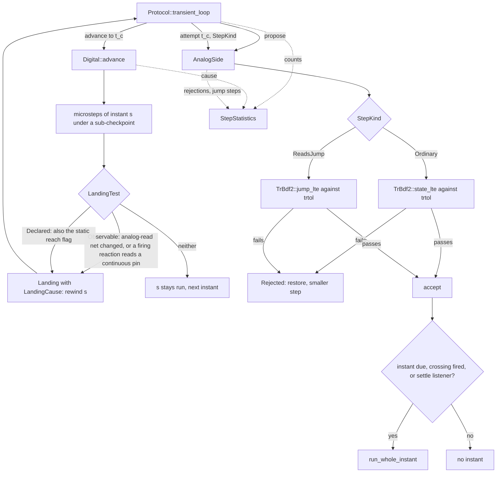

# Transient Performance Design

**Spec**: `.specs/features/transient-performance/spec.md`
**Status**: Draft (approved under the AFK rule with the spec; D-defaults are the user's to correct)
**Measured basis**: `.specs/features/transient-performance/diagnosis.md`

---

## Architecture Overview

The protocol keeps its shape (abi.md §5: propose, look ahead, solve on the left value, run the
instant). Three things change inside it, and one thing is added beside it.

1. **The look-ahead decides "landing" by what the instant did, not by what it could do.** The test
   moves out of `Digital::microsteps` into a type of its own, `LandingTest`, with two rules
   (`TimePointRule::Observable`, the default, and `TimePointRule::Declared`, today's). The result
   carries its cause.
2. **The analog side knows two kinds of step, not two booleans.** `StepKind::Ordinary` is tested
   with Milne's estimate (today's `state_lte`), whether or not it ends on a landing.
   `StepKind::ReadsJump` is tested with a first-order estimate of its own two stages.
3. **The hot loop stops allocating and stops validating.** Lengths are computed when a `Handle` is
   bound, buffers are owned by the `Assembly` and by the Newton solver, the clock is read only when
   timing was asked for, and an accepted step with nothing due runs no instant.
4. **`StepStatistics` is filled by the protocol and by both sides** and reaches the host.



### Approaches considered

| Approach | What it does | Verdict |
| --- | --- | --- |
| **A. Observable landings + tested steps + a cheaper step** (chosen) | Skips the landings nothing observes, closes the two exemptions, removes the per-step waste | 4x fewer steps and 1.5x to 2x per step, measured; more accurate than today |
| B. Analog first, digital inside the step on an interpolant, backtrack on a write (the user's idea as stated) | The analog step is solved to the controller's proposal; instants inside it read the dense output; a write to an analog-read net restores and retakes | Same landings as A after the skip, plus the 50 sampling landings per 100 µs saved (under 0.5 %), minus every Newton solve thrown away on a write (367 per 100 µs, each a full step). The look-ahead already gives the benefit without the cost |
| C. Remove the look-ahead's cost by a static proof | A stronger reachability analysis (value ranges of `count`, of `hs`) | Cannot prove that `hs <- hs_next` leaves `hs` unchanged; the dynamic test costs one comparison per analog-read net |

---

## Spec amendments (written before the code, in their own tasks)

| Document | Place | Today | Amended |
| --- | --- | --- | --- |
| `docs/spec/appendix_c_implementation.md` C.2 | "time points (§17.2)" row | a reachability set computed once at elaboration marks the reactions that can touch the analog side; only their scheduled times are breakpoints | the look-ahead runs each scheduled instant under a sub-checkpoint and lands on it when a carrier `analog` reads changed or a firing reaction reads a continuous pin; in a design with a reaction on `settle`, a host waiter or a host probe at that time, it lands on every time point rule 2 gives (the reachability set); a solver option restores that rule everywhere. As-if: no model can observe a skipped landing |
| `.specs/features/device-abi/abi.md` §5 | after R4 | - | one paragraph, "R4 as implemented": the dynamic test, its three exceptions, and that the protocol text is unchanged |
| `docs/spec/part_v_execution.md` §15.2 | rule 6, last sentences | the restart step is at most a tenth of the smaller of the last step and the gap, never larger than the controller's proposal | adds: "It is tested for truncation error with the first-order estimate of its two stages, against the tolerance of §17.2 rule 1; a step that fails is rejected and retaken smaller, and it is still the step that reads the jump." |
| `docs/spec/part_v_execution.md` §15.2 | "Before the solve of `t`" bullet, and §15 S3 | the step that arrives at `t` is exempt from the truncation-error test | "the step that reads the change is the one treated specially (rule 6); a step that arrives at a landing and reads no change is an ordinary step, tested like any other" |
| Appendix C.2 | "the jump", "truncation error", "restart" rows; the constants row "restart step after a landing or a host `set`" | "a step that landed on a digital event or a breakpoint is exempt"; "a step that lands on a jump is exempt" | the landing step is tested; the step that reads a jump is tested with the first-order estimate; the constants row gains "tested with the first-order estimate, retaken at an eighth" |
| Appendix D.4 and Appendix F | the two "Restart" rows | "the step to `t` landed there ..., so it is exempt from the truncation-error test" | "the step to `t` is an ordinary step; the step after it reads the change, is first order and is tested with the first-order estimate" |

Part V §17.2 rule 2 is not edited (`multi-rate` Q1 B). `crates/piperine-lang/tests/spec_text.rs`
pins each amended sentence.

---

## Code Reuse Analysis

### Existing Components to Leverage

| Component | Location | How to Use |
| --- | --- | --- |
| The look-ahead and its sub-checkpoint | `crates/piperine-digital-solver/src/advance.rs`, `engine.rs` (`mark`, `rewind`, `release`) | unchanged; it already runs an instant and undoes it |
| The two checks of the time-point test | `crates/piperine-digital-solver/src/instant.rs` lines 163 to 187 (`analog_now`, `probing`, `irreversible`, `waited`) | moved into `LandingTest`; `probing` splits into "reads a continuous pin" and "flagged by reachability" |
| `Analysis::probes`, `settle_nets` | `crates/piperine-digital-solver/src/plan.rs` | `probes` stays the `Declared` rule's flag; a second table `samples` holds the reactions that read a continuous pin themselves (the `samples` local of `reachability`) |
| `TrBdf2::state_lte`, `DdtState` | `crates/piperine-analog-solver/src/math/integration.rs` | `jump_lte` sits beside it and uses the same per-state bound |
| `SolverStats` | `crates/piperine-solver/src/core/result.rs` | gains the analog side's new counts; `StepStatistics` embeds what the protocol counts |
| `StepObserver`, `buck_long` | `crates/piperine-solver/src/protocol/step.rs`, `crates/piperine-api/tests/buck_long.rs` | `buck_long` prints the statistics and holds the step gate |
| The counting allocator | `crates/piperine-api/tests/support/heap.rs` | copied pattern for the allocation tests (a test-only allocator per target) |
| The open-loop fixture's parts | `crates/piperine-lang/std/convert.msl` (`D2A`), `examples/buck/src/dpwm.msl` (`Osc`) | the fixture of TP-09 AC 1 |
| `ProtocolOptions`, `TransientAnalysisOptions` | `crates/piperine-solver/src/protocol/transient.rs`, `analyses/transient.rs` | carry `TimePointRule` to the digital side |

### Integration Points

| System | Integration Method |
| --- | --- |
| `piperine-digital-solver` to `piperine-solver` | `Advance::Landing` gains `cause: LandingCause`; the adapter in `analyses/adapters.rs` maps it to the protocol's own enum in `protocol/sides.rs` |
| `piperine-solver` to `piperine-api` | `TransientAnalysisResult::statistics()`; `Session::statistics()` returns the last run's |
| `piperine-abi` (embedded in every generated design, `abi_source.rs`) | `Handle` changes only in `caller.rs`, which the host side uses; the generated side (`thunk.rs`, `device.rs`) is untouched, so no generated text moves and the ABI version does not change; the cache key of compiled designs changes with the embedded source, so each design recompiles once |

---

## Components

### `LandingCause` and `TimePointRule`

- **Purpose**: name why an instant is a landing, and which rule decides.
- **Location**: `crates/piperine-digital-solver/src/landing.rs` (new)
- **Interfaces**:
  - `enum LandingCause { AnalogReadChanged, ContinuousRead, DeclaredReach, Irreversible, HostWaiter }`
  - `LandingCause::is_time_point(&self) -> bool` - false for `Irreversible` and `HostWaiter` (R6)
  - `enum TimePointRule { Observable, Declared }`, `Default` is `Observable`
- **Dependencies**: none
- **Reuses**: replaces `Stepped::Landing { time_point }` and `Advance::Landing { time_point }`

### `LandingTest`

- **Purpose**: decide, after the functions of one microstep of a look-ahead, whether the instant is a landing.
- **Location**: `crates/piperine-digital-solver/src/landing.rs`
- **Interfaces**:
  - `LandingTest::new(rule: TimePointRule, plan: &DigitalPlan, waited: &[NetId]) -> LandingTest` - the effective rule is `Declared` when the plan has a `settle` net with a listening reaction or `waited` is not empty (TP-03 AC 2, AC 3)
  - `LandingTest::after_functions(&self, store: &Store, firing: &[Firing], analog_read_changed: bool) -> Option<LandingCause>`
- **Dependencies**: `Analysis::probes`, `Analysis::samples`, `Store::fired`
- **Reuses**: the body of `microsteps`'s `if lookahead { ... }` block, which shrinks to one call

A host probe at a scheduled time is a host waiter on the engine (abi.md R7), so `waited` covers
"host probe at `t`".

### `Analysis::samples`

- **Purpose**: which reactions read a continuous pin themselves (R4, second clause), apart from the reach flag.
- **Location**: `crates/piperine-digital-solver/src/plan.rs`
- **Interfaces**: `Analysis::samples(&self, instance: u32, reaction: u32) -> bool`
- **Reuses**: `reachability`'s `samples` local, computed once at plan time

### `StepStatistics`

- **Purpose**: how a transient's steps were spent.
- **Location**: `crates/piperine-solver/src/protocol/statistics.rs` (new)
- **Interfaces**:
  - `enum StepEnd { Landing(LandingCause), Crossing, MaxStep, Cap, Stop, Proposal }`
  - `StepStatistics::record_end(&mut self, end: StepEnd)`, `record_instant(&mut self)`, `record_retake(&mut self)`
  - `StepStatistics::landings(&self, cause: LandingCause) -> u64`, `accepted(&self) -> u64`, `ended(&self, end: StepEnd) -> u64`, `instants_run(&self) -> u64`, `sampling_share(&self) -> f64`
  - `Protocol::statistics(&self) -> &StepStatistics`
- **Dependencies**: `LandingCause` (the protocol's own copy in `sides.rs`, so the seam stays free of the sub-solver's types)
- **Reuses**: the analog side's counts stay in `SolverStats` (`steps_rejected` splits into `rejected_truncation` and `rejected_newton`; `jump_steps`, `jump_retakes`, `steps_at_max_step` are added); `TransientAnalysisResult::statistics()` returns both

The analog side tells the protocol how a step ended when it was its own choice: `AnalogSide::proposal_bound(&self) -> ProposalBound` (`MaxStep`, `Cap`, `Stop`, `Controller`), read after `propose`.

### `StepKind` and the two tests

- **Purpose**: replace `landed_on_breakpoint` and `post_set_step` in the accept gate by what the step reads.
- **Location**: `crates/piperine-solver/src/analyses/transient.rs` (`StepPrediction`, `assess_step`, `device_attempt`); `crates/piperine-analog-solver/src/math/integration.rs` (`TrBdf2::jump_lte`)
- **Interfaces**:
  - `enum StepKind { Ordinary, ReadsJump }` on `StepPrediction`
  - `TrBdf2::jump_lte(states: &[DdtState], tol: &Tolerances, h: f64) -> f64` - normalized like `state_lte` (1.0 at tolerance)
  - `AnalogSide::attempt(&mut self, to: f64, landing: bool)` - the parameter keeps its position; it no longer exempts, it only says the step ends on the tick exactly (today's `exempt` does both)
- **Dependencies**: `analog-operators` T9 on main (both stages of the jump step are backward Euler from the step's start)
- **Reuses**: `cut_after_failure`, `is_at_floor`, the floor rule

**The estimate.** With T9 the step that reads a jump runs backward Euler over `γh` to `q_γ` and
backward Euler over `h` to `q_1`, both from `q_0`. Backward Euler's local error over `h` is
`(h²/2)·q''`. The two stages give two slopes, `s_γ = (q_γ − q_0)/(γh)` and `s_1 = (q_1 − q_0)/h`,
each the secant over its own interval (the derivative at that interval's midpoint, so the two
midpoints are `(1 − γ)h/2` apart), so `q'' ≈ 2(s_1 − s_γ)/((1 − γ)h)` and

```
error(state) = h · |s_1 − s_γ| / (1 − γ)
jump_lte     = max over states of error(state) / bound(state)
bound(state) = max( h·(abstol + reltol·max|i|), reltol·max(|q|, chgtol) )      (state_lte's own)
```

The step is rejected when `jump_lte > trtol` above the floor. It uses nothing from before the
jump: `q_0` is the state at `t` after the delivery. Two checks the worker makes before trusting it:
TP-05 AC 4 (an RC reading an ideal step: the closed form is known) and that `DdtState::q[0]` of a
jump step is the state evaluated with the delivered values (if it is the pre-jump value for a state
whose expression reads the changed carrier, `q_0` is re-evaluated at `t` with the new values; the
worker records which it is).

On a rejection the retaken step is still the step that reads the jump (`sets_just_applied` stays
set; the protocol's restore does not clear the delivery, which was made before the checkpoint).
Its size is the controller's `reject_dt` (an eighth), as for any rejection.

### `FunctionFrame` (in `Handle`)

- **Purpose**: the cell lengths of each function, computed once.
- **Location**: `crates/piperine-abi/src/caller.rs`
- **Interfaces**: `Handle` holds `frames: Vec<FunctionFrame>`; `FunctionFrame { reads: Box<[usize]>, writes: Box<[usize]>, partials: usize }`; `Handle::eval` checks the buffers against it and builds its pointer lists in two `Vec`s the caller passes in (`EvalBuffers`, owned by the `Assembly`)
- **Reuses**: `device::cell_lens`, called at `Handle` construction; a function whose cells break a rule is the same error, raised at the first `eval` as today

### `EvalBuffers` and `Assembly::assemble_into`

- **Purpose**: the buffers one function call and one assembly need, owned across calls.
- **Location**: `crates/piperine-analog-solver/src/device/assembly.rs`
- **Interfaces**:
  - `EvalBuffers { input: Vec<*const u8>, output: Vec<*mut u8> }` beside `Assembly::scratch`
  - `Assembly::assemble_tran_into(&mut self, x: &[f64], amb: Ambient, stage: Stage, out: &mut Vec<Stamp<..>>)`; `assemble_tran` stays as the allocating wrapper for callers that keep the result
  - `NonLinearSystem::assemble_into(&mut self, state, out: &mut Vec<Stamp<..>>)` with a default that calls `assemble`; the Newton solver owns the stamp buffer and the `nodes` list (built once in `new`)
- **Reuses**: `run`, `stamp_flow`, `stamp_ddt` unchanged in what they compute

### `SolveTimer`

- **Purpose**: read the clock around assembly and the linear solve only when asked.
- **Location**: `crates/piperine-analog-solver/src/math/newton_raphson.rs`
- **Interfaces**: `SolveTimer::new(enabled: bool)`, `start(&self) -> Option<Instant>`, `add(&mut self, started: Option<Instant>, which: TimedPart)`; enabled by `TraceFlags::timing` (`PIPERINE_TRACE_TIMING`, beside the three existing trace flags)
- **Reuses**: `assembly_ns`, `solve_ns`

### The idle instant

- **Purpose**: run no instant at an accepted step where nothing can happen.
- **Location**: `crates/piperine-solver/src/protocol/transient.rs` (step 5), `protocol/sides.rs`
- **Interfaces**: `DiscreteSide::is_idle_at(&self, at: Tick) -> bool` - true when no commit is due at `at`, no instant is suspended, no function is dirty and no reaction listens to `settle`. The protocol skips `run_whole_instant` when it is true and `accepted.fired` is empty
- **Reuses**: `Digital::next_due`, the dirty set, `Analysis::settle_nets`

### Deferred: `DenseOutput` (TP-D1, TP-D2; not built here)

Recorded so the later feature starts from the measurement. A TR-BDF2 step has three solutions,
`x(t)`, `x(t + γh)`, `x(t + h)`; the quadratic through them is second-order accurate and costs
nothing. A sample-only instant at `s` inside the step would read it instead of landing, under the
same as-if condition as TP-03 plus "the instant commits nothing that reaches the analog side at
`s`"; when it does, the look-ahead's rewind already handles it and no analog solve is lost. The
print grid would read it instead of the linear interpolation of `Table::on_grid`, which moves every
printed row between steps. Build it when `StepStatistics::sampling_share()` of a real design is
large; the buck's is under 0.5 %.

---

## Data Models

```rust
/// Why the look-ahead stopped before an instant.
pub enum LandingCause { AnalogReadChanged, ContinuousRead, DeclaredReach, Irreversible, HostWaiter }

/// Which rule makes a scheduled instant a landing.
pub enum TimePointRule { Observable, Declared }

/// How one accepted step ended: exactly one per step (TP-01 AC 3).
pub enum StepEnd { Landing(LandingCause), Crossing, MaxStep, Cap, Stop, Proposal }

/// What a transient step reads, which decides how its error is measured.
pub enum StepKind { Ordinary, ReadsJump }
```

**Relationships**: `Advance::Landing { tick, cause }` (digital) maps to the protocol's
`Advance::Landing { tick, cause }`; `StepEnd` is chosen in `transient_loop` from the `Advance`, the
`Attempt` and `AnalogSide::proposal_bound`.

---

## Error Handling Strategy

| Error Scenario | Handling | User Impact |
| --- | --- | --- |
| A jump step fails `jump_lte` above the floor | `Attempt::Rejected`; retaken at an eighth, still `ReadsJump` | none; counted in `jump_retakes` |
| A jump step fails at the floor | accepted and counted in `floor_accepts` (the floor rule) | none |
| A landing step fails Milne's test | `Attempt::Rejected`; the protocol restores and replays the look-ahead | none |
| More than `max_rejections` in a row | today's error, naming the time | "64 consecutive rejected attempts from t = ..." |
| A buffer shorter than its cell at `Handle::eval` | `CallError::frame`, today's text | unchanged |
| A parity value, a twin's bytes or a pinned grid moves | the task stops; nothing is edited | reported to the user (D5) |

---

## Risks & Concerns

| Concern | Location (file:line) | Impact | Mitigation |
| --- | --- | --- | --- |
| `transient.rs` is 1 766 lines and `device_attempt` is 100; the accept gate reads two booleans set far apart | `crates/piperine-solver/src/analyses/transient.rs:1436` | a third condition would be unreadable | `StepKind` replaces both booleans in `StepPrediction`; no new branch is added to `device_attempt` beyond choosing the kind |
| `microsteps` is 150 lines and mixes the loop with the landing test | `crates/piperine-digital-solver/src/instant.rs:132` | the new rule would grow it | `LandingTest` takes the block out; `unknown-semantics-events` edits the same function, so the rebase comes first |
| TP-04 and TP-05 change which steps are rejected in every circuit with a landing or a jump, parity twins included (the T9 attempt moved twins' goldens) | `crates/piperine-parity/tests/parity_tran.rs`, `twins.rs`, `crates/piperine-solver/tests/parity_baseline.rs` | a parity value could move | both tests only ever reject a step the tolerance refuses; each task runs the parity targets before its commit and stops on any move (D5) |
| The estimate of `jump_lte` is derived here, not measured | design "The estimate" | it could be too strict (more steps) or blind to a state | TP-05 AC 4 (closed form), AC 5 (the buck against the fine reference) and TP-06 AC 1 (the step gate) bound it from both sides; a miss of either gate returns to the user |
| `analog-operators` T9 and `unknown-semantics-events` are not on main | their worktrees | the estimate is defined on T9's stages; the `settle` exception needs the MSL event | Phase 1 (statistics) may start on main as it is; Phases 2 and 3 start only after both merge and the worktree is rebased; T1's done-criteria check it |
| Clock readings cost 1.5 µs each on this machine (`clocksource = hpet`) | `crates/piperine-analog-solver/src/math/newton_raphson.rs:401` | 12 % of the run | `SolveTimer` |
| The profile is 220 samples | `diagnosis.md` §3 | shares are ±3 points | TP-07's criteria are allocation counts, not times; the wall time is printed, never asserted |
| The idle-instant skip could hide a discrete function that depends on time | `crates/piperine-digital-solver/src/run.rs` (`run_functions`) | a record or a net could differ | `is_idle_at` is false while any function is dirty; TP-09 AC 1 and the buck's `checks` compare every record |
| `Assembly::push_stage` re-evaluates every function after each converged stage, 21 % of the time | `crates/piperine-analog-solver/src/device/assembly.rs:418` | the largest remaining per-step cost | out of scope (D11): it changes the iterate the histories read; reported |

---

## Tech Decisions

| Decision | Choice | Rationale |
| --- | --- | --- |
| Where the landing rule lives | `piperine-digital-solver::landing`, one module | the rule is the digital engine's (R4); the module tree says where it is |
| How the rule is selected | a field of the digital engine set at construction from `ProtocolOptions`; no environment variable, no run key | `multi-rate` Q4 A |
| The protocol's `LandingCause` | its own enum in `sides.rs`, mapped in the adapter | the seam's types are defined at the seam (`sides.rs` header) |
| The jump step's first size | unchanged: §15.2 rule 6 | only the test is added, so a step the tolerance accepts is bit-identical to today's |
| Statistics timing | off by default | nothing reads the two totals during a run |
| `StepStatistics` vs `SolverStats` | protocol counts in the new type, analog counts stay | each side counts what it knows |
| Free functions | none added: `LandingTest`, `SolveTimer`, `StepStatistics` and `TrBdf2` carry the methods | the user's cleanliness rules |
