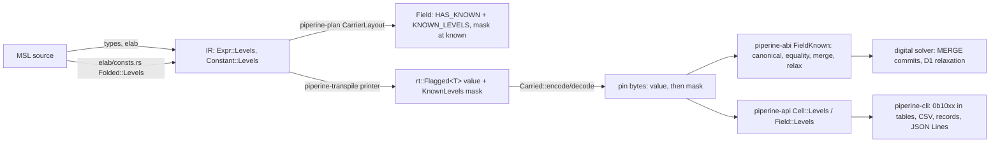

# Unknown Semantics: Per-Level Flags Design

**Spec**: `.specs/features/unknown-semantics-per-level/spec.md`
**Status**: Approved (2026-11-21, under the user's standing AFK rule: "Eu gostaria que engatilhasse até o 12"; 2026-11-21 "pode ir tocando como previsto, parando só depois da revisão no item 13"; see "Decisions taken (user AFK)")
**Base**: `main` at `856d2668`. Phases 1 to 8 (T1 to T26) start from it now. Phases 9 to 12
(T27 to T34) start once `composite-values` phases A–B are on `main` (D8, D9, D15).

---

## What the code does today (`main` at `856d2668`)

| Area | Today | Where |
| ---- | ----- | ----- |
| The ABI field | `Field { name, leaf, offset, count, flags, known }`; `field_flag::HAS_KNOWN` (1) is the only field flag; `known` is the offset of one byte per element | `crates/piperine-abi/src/raw.rs:481`, `:722`; abi.md §3 |
| ABI version | `MAJOR` 1, `MINOR` 1 (`commit_with`), symbol `piperine_abi_1`; the in-tree loader refuses a `Library.minor` newer than the host's | `raw.rs:649`; `crates/piperine-transpile/src/load.rs:71` |
| Shape validation of a field | refuses an unknown field flag bit and a known byte outside the layout | `crates/piperine-abi/src/validate.rs:374` |
| P3, P4, C7 on bytes | free functions `known_of`, `layout_eq`, `is_canonical` and the `Merge` type compare and merge one known byte per element | `crates/piperine-abi/src/layout.rs:48`, `:56`, `:65`, `:121` |
| D1 relaxation | a field whose value or known byte still moves is cleared whole (value bytes and known byte) | `crates/piperine-digital-solver/src/run.rs:380` |
| `MERGE` commits | `Merge::of(layout).merge_into` at the due microstep | `crates/piperine-digital-solver/src/instant.rs:84` |
| Host-written bytes | `bind.rs` writes the known byte as `1` after a host value | `crates/piperine-solver/src/core/bind.rs:317` |
| Carrier layouts | `CarrierLayout::of(ty)`: one leaf `v` and one known byte right after it, every type; sizes `bool` 2, `u8` 2, `u16` 4, `u32` 8, `u64` 16, `f64` 16. `RecordLayout` lays each record field as a carrier of its type | `crates/piperine-plan/src/digital.rs:165` to `:320` |
| The runtime value | `Flagged<T> { value: T, known: bool }`; `&` and `|` are decided only by a known all-false or all-true operand; `^` all-or-nothing; shifts fill known levels when the operand is unknown; `merge` keeps the value only when both are known and equal; `level(k)` is known only when the value is | `crates/piperine-transpile/src/rt/flag.rs` |
| Constant folding | `Folded::{Known, Unknown}`; `logic` with an `x` folds to `Unknown` | `crates/piperine-lang/src/elab/consts.rs:65`, `:654` |
| `logic` lowering | the folded constant, or `Expr::Unknown` | `crates/piperine-lang/src/elab/intrinsics.rs:50` |
| IR | `Constant::{Real, Bool, Int}`; a carrier's `init: Option<Constant>`, `None` meaning unknown; `Expr::Unknown` is every level unknown | `crates/piperine-ir/src/model.rs:188`, `:400`, `:728` |
| Host decode | `Cell::{Real, Bool, Int, Text, Unknown}`: a known byte of 0 is `Unknown`; records the same through `Field` | `crates/piperine-api/src/table.rs:18`, `:76`; `record.rs:202` |
| Host print | `Cell::Unknown` prints `x` in tables and record lines, `null` in JSON Lines | `crates/piperine-cli/src/render/number.rs:17`, `json.rs:28` |
| Guards | `docs.rs` asserts S6 and G6 stay in `GAPS.md` | `crates/piperine-cli/tests/docs.rs:375` |

The spec text (`docs/spec/`) is already per level (§2 "each level has its own known flag",
§3.3.2, §22.1). No spec sentence changes; the code is brought to it.

---

## Architecture Overview

The language decides what a level means; the ABI moves masks as bytes. One flag bit in the
ABI, one owner type that reads it, and the runtime value carries a mask instead of a `bool`.



### The mask (D1, D2, D12)

A field with `HAS_KNOWN | KNOWN_LEVELS` has, per element, a mask of `leaf_size(leaf)` bytes at
`known + element * leaf_size`, little-endian; bit `k` set means level `k` is known. Bits at or
above the type's level count are always zero (a `u9` known whole has mask `0x01FF`). P3 holds
unchanged: a zero mask is every level unknown, and the value bit of an unknown level is zero.
The carrier layouts keep their sizes: the mask sits where the known byte sat, in what was
padding (`u16`: value 0..2, mask 2..4; `u64` and `f64`: value 0..8, mask 8..16). A `bool` and a
one-level enum tag keep the plain known byte: a one-level mask is that byte.

### The runtime (D13)

`Flagged<T>` becomes `{ value: T, known: KnownLevels }`. `KnownLevels` is a `u64` mask owned by
`rt/flag.rs`, normalized to the type's level count; a type that is not `Carried` (reals of
analog code, `()`) has one level (§3.3.1: one flag for the whole value). Every all-or-nothing
operator asks `is_whole()` and gives `KnownLevels::none()` otherwise, so arithmetic,
comparisons, `as` and calls keep today's code paths. The per-level operators work on the mask:

| Operator | Result mask | Result value |
| --- | --- | --- |
| `a & b` | `(ka & kb) \| (ka & !va) \| (kb & !vb)` | `va & vb` on known levels, 0 elsewhere |
| `a \| b` | `(ka & kb) \| (ka & va) \| (kb & vb)` | `va \| vb` on known levels, 0 elsewhere |
| `a ^ b` | `ka & kb` | `va ^ vb` on known levels, 0 elsewhere |
| `!a` | `ka` | `!va` on known levels, 0 elsewhere |
| `a << n`, `a >> n` (known `n`) | the mask shifted the same way; vacated levels known (false), or for a signed `>>` the sign level's flag | the value shifted; vacated levels false or the sign level |
| `merge(a, b)` | `ka & kb & !(va ^ vb)` | `va` on known levels |
| `same(a, b)` | known | `ka == kb && (va & ka) == (vb & kb)` |
| `level(k)` | known | `Some` exactly when bit `k` of the mask is set |
| `cast` | the mask, level for level | the value, level for level |

Every result is normalized (value bits of unknown levels cleared), so P3 holds on every write.

### Constant folding: the reference (D7)

`Folded` gains `Levels { bits: u64, known: u64, levels: u32 }`, a partly known value of a type
with levels. `Folded::Known` and `Folded::Unknown` stay the two ends (a fully known `Levels` is
normalized to `Known`, a zero mask to `Unknown`), so every existing fold is unchanged. The same
table of operators as the runtime, written once on `Folded`'s own methods. UL-10 AC 3 is a
source test that records one table from `const` items (folded) and from carriers (compiled)
and compares them row by row: the folder is the oracle the compiled operators are checked
against, and the interpreter stays frozen.

### Partly known constants in the IR (D20)

`Expr::Levels { bits: u64, known: u64 }` (appended last, typed `Flagged` of its integer, enum
or `f64` type) is what `logic("10xx")` and a partly known folded constant lower to.
`Constant::Levels { bits: u64, known: u64 }` (appended last) is a carrier's partly known
initial value; `Ir::check` refuses it in a param slot (D10). The interpreter refuses both by
name. The printer prints `Expr::Levels` as `rt::Flagged::with_levels(value, mask)` and lays a
`Constant::Levels` init into the pin's init bytes through `CarrierLayout::bytes`.

### The host (D5, D6, D19)

`Cell::Levels { bits: u64, known: u64, levels: u32 }` and `Field::Levels { .. }` are the partly
known forms; `Cell::Unknown` stays the all-unknown form. `Number::text` prints `0b` and one
character per level, highest first. JSON Lines writes that text quoted. The SVG plot draws a
`Cell::Levels` as it draws `Cell::Unknown`.

### Aggregates and enums (waiting, D8, D9)

After `composite-values` A–B is on `main` (its T36 `LevelWords`, T37 derived `Carried`, T56
`CompositeLayout`, T57 carried composites, T48/T50 IR enums), T27 rebases this branch and
re-reads those anchors; T28 to T31 give each composite leaf a `KNOWN_LEVELS` mask and the
runtime a per-leaf mask (`Carried::Known`, an associated type: `KnownLevels` for scalars, a
fixed array of masks for composites, so `Flagged` stays `Copy`); T32 and T33 do the enum
`cast` and `match` on a partly known tag.

---

## Code Reuse Analysis

### Existing Components to Leverage

| Component | Location | How to Use |
| --------- | -------- | ---------- |
| `Merge`, `is_canonical`, `layout_eq` | `piperine-abi/src/layout.rs` | rewritten over `FieldKnown`; their call sites stay |
| `leaf_size` | `piperine-abi/src/layout.rs:36` | the mask width |
| `validate` and its `Rule` enum | `piperine-abi/src/validate.rs` | two new rules beside the known-byte rule at `:374` |
| D1 relaxation loop | `piperine-digital-solver/src/run.rs:380` | per-level clearing through `FieldKnown::clear_moving` |
| `Carried`, `Levels`, `Levelwise`, `Merge` (trait), `Flagged` | `piperine-transpile/src/rt/flag.rs` | the mask replaces the `bool`; trait signatures kept |
| `Commits` | `piperine-transpile/src/rt/commits.rs:30` | uses `Flagged::merge_bytes`, which becomes per level |
| `CarrierLayout`, `RecordLayout` | `piperine-plan/src/digital.rs` | the flag and the mask width per leaf |
| `Folded`, `ConstEval::logic` | `piperine-lang/src/elab/consts.rs` | the partial form |
| `Intrinsics` lowering of `logic`, `matches_bits` | `piperine-lang/src/elab/intrinsics.rs` | `logic` lowers a `Folded::Levels`; `matches_bits` is unchanged (a conjunction over `level`) |
| `Cell::decode`, `Field`, `Number::text`, `json.rs`, `csv.rs`, `svg.rs` | `piperine-api`, `piperine-cli/src/render/` | one new variant each |
| Source-test harness | `crates/piperine-parity/tests/source_unknowns.rs` (`records_of`, `stream`, `transient`) | the pattern of the new `source_levels.rs` |
| Fold tests | `crates/piperine-lang/tests/elab_unknowns.rs` | extended for UL-10 AC 1, 2, 4 |

### Integration Points

| System | Integration Method |
| ------ | ------------------ |
| Device ABI | `field_flag::KNOWN_LEVELS` = 2 (bit 1); `MINOR` = 2; abi.md §3, P3, P4, C7, D1 and the version row amended |
| Digital solver | bytes only: `MERGE` and D1 through `FieldKnown` |
| Solver bind | `bind.rs:317` writes the full mask of the field after a host value |
| Transpile loader | `load.rs` refuses a library of minor below 2 whose shape sets `KNOWN_LEVELS` |
| Host API | `Cell::Levels`, `Field::Levels`; `Cell::decode` reads the mask |
| CLI | the `0b10xx` text in every format |

---

## Components

### C1. `FieldKnown` (piperine-abi)

- **Purpose**: the one reader of a field's known flags, plain byte or mask.
- **Location**: `crates/piperine-abi/src/known.rs`
- **Interfaces**:
  - `FieldKnown::of(field: &Field) -> Option<FieldKnown>` - `None` without `HAS_KNOWN`
  - `is_whole(&self, bytes, element) -> bool`, `is_none(&self, bytes, element) -> bool`
  - `level(&self, bytes, element, k) -> bool`
  - `fill(&self, bytes, element)` - every level known (a host write)
  - `merge(&self, settled, committed, element)` - C7, per level
  - `clear_moving(&self, before, after, value, element) -> bool` - D1, per level; true when something moved
  - `is_canonical(&self, bytes, element) -> bool` - P3
- **Dependencies**: `raw::Field`, `leaf_size`
- **Reuses**: the loops of `layout.rs` and `run.rs`

### C2. Validation rules (piperine-abi)

`Rule::LevelsWithoutKnown` (a field with `KNOWN_LEVELS` and no `HAS_KNOWN`) and
`Rule::MaskOutsideLayout` (`known + count * leaf_size` past `size`), each message naming the
field. The minor check (UL-05 AC 6) is in the loader, where `Library.minor` is read.

### C3. `rt::KnownLevels` and `Flagged` (piperine-transpile runtime)

- **Purpose**: a value and the flag of each of its levels.
- **Location**: `crates/piperine-transpile/src/rt/flag.rs` (the mask type may take its own file `rt/levels.rs` if `flag.rs` passes ~900 lines)
- **Interfaces**: `KnownLevels::{all(levels), none(), bits(), is_whole(levels), level(k)}`; `Flagged::{known, unknown, with_levels(value, mask), is_known, known_or, level, merge, same, recast, encode, decode}`; the operator impls of the table above
- **Reuses**: `Carried::LEVELS`, `to_levels`, `from_levels`

### C4. `CarrierLayout` / `RecordLayout` (piperine-plan)

Leaves with more than one level get `HAS_KNOWN | KNOWN_LEVELS`, mask at the old known offset,
mask width `leaf_size`. `CarrierLayout::bytes` writes the full mask for a known constant and the
given mask for a `Constant::Levels`.

### C5. IR forms (piperine-ir)

`Expr::Levels`, `Constant::Levels`, the printer rows, `Ir::check` (param slot refused, `known`
and `bits` within the type's levels), the interpreter's refusal by name.

### C6. `Folded::Levels` (piperine-lang elaborator)

The partial form and its operators; `logic` with `x`; `if` on an unknown condition over two
integer arms; the lowering of a partial fold to `Expr::Levels` and of a carrier's partial
initial value to `Constant::Levels`; a partial param is the existing unknown-param refusal.

### C7. Host forms (piperine-api, piperine-cli)

`Cell::Levels`, `Field::Levels`, decoding from the mask, `Number::text` of the pattern, JSON
Lines quoting, CSV, SVG as unknown, host drive bytes with the full mask.

---

## Data Models

```rust
// piperine-abi/src/raw.rs
pub mod field_flag {
    pub const HAS_KNOWN: u32 = 1 << 0;
    /// `known` is the offset of one mask per element, `leaf_size` bytes, bit k = level k known.
    pub const KNOWN_LEVELS: u32 = 1 << 1;
}
pub const MINOR: u32 = 2;

// piperine-transpile/src/rt/flag.rs
pub struct KnownLevels(u64);                       // bit k set: level k known
pub struct Flagged<T> { value: T, known: KnownLevels }

// piperine-ir/src/model.rs (appended last)
Expr::Levels { bits: u64, known: u64 }
Constant::Levels { bits: u64, known: u64 }

// piperine-lang/src/elab/consts.rs
pub enum Folded { Known(Constant), Unknown, Levels { bits: u64, known: u64, levels: u32 } }

// piperine-api
Cell::Levels { bits: u64, known: u64, levels: u32 }
Field::Levels { bits: u64, known: u64, levels: u32 }
```

---

## Error Handling Strategy

| Error Scenario | Handling | User Impact |
| -------------- | -------- | ----------- |
| `KNOWN_LEVELS` without `HAS_KNOWN` | `validate` rule `LevelsWithoutKnown`, naming the field | bind refused |
| Mask outside the layout | `validate` rule `MaskOutsideLayout`, naming the field | bind refused |
| Library minor below 2 with the flag | loader `Failure`, naming the field and the minor | load refused |
| Pins of one net, one with the mask and one without | P4 unequal layouts, the existing bind error naming both pins | bind refused |
| D1 relaxation still moving | the moving levels cleared, one record to the log pin (unchanged message, per level) | a resolved net with fewer known levels |
| A non-canonical write (value bit set on an unknown level) | the existing debug canonical check, now per level | a fault naming the writer |
| A partly known param | the existing unknown-param refusal at elaboration | `E`-code unchanged, named param |

---

## Goldens, pins and tests that may move

Only these move, each in the task named, never a value byte, never a tolerance. ngspice parity
targets, `crates/piperine-parity/src/contract.rs`, the twin goldens and
`crates/piperine-transpile/tests/golden/` stay byte-identical.

| Assertion | Today | After | Why | Task |
| --------- | ----- | ----- | --- | ---- |
| `buck_commits.rs:46` `LaterBench.x` (`u8`) | `vec![2, 1]` | `vec![2, 255]` | known mask of a `u8` | T8 |
| `buck_commits.rs:76` the counter (`u8`) | `vec![2, 1]` | `vec![2, 255]` | same | T8 |
| `buck_control.rs:189` `SetpointBench.code` (`u8`) | `[7, 1]`, `[100, 1]`, `[168, 1]` | `[7, 255]`, `[100, 255]`, `[168, 255]` | same | T8 |
| `buck_records.rs:117`, `:137`, `:147` `severity` (`Severity`, 3 variants, 2 tag levels) | known byte `1` | `3` | known mask of a 2-level tag | T8 |
| `buck_supervisor.rs:266` severity Warning | `b[1] == 1` | `b[1] == 3` | same | T8 |
| `buck_whole.rs:77` `mode` (`Mode`, 4 variants) | `vec![0, 1]` | `vec![0, 3]` | same | T8 |
| `crates/piperine-plan/tests/digital_shape.rs` carrier field rows | `flags: HAS_KNOWN` | `HAS_KNOWN \| KNOWN_LEVELS` on leaves of more than one level | the new layout | T12 |
| `crates/piperine-parity/tests/source_unknowns.rs` raw-byte helpers of integer nets (`byte(v)`) | `[v, 1]` | `[v, 255]` | known mask of a `u8` | T8 |
| `crates/piperine-cli/tests/docs.rs:375` to `:383` | asserts S6, G6 stay | asserts S6 narrowed (T26), then gone (T34) | GAPS rows | T26, T34 |

Assertions on `bool` pins (`pass`, gates, checks) do not move (D2). If a task finds another
assertion that must move, it stops and lists it on the Handoff before changing it.

## Cross-lane touches

| File | Other lanes | Rule |
| ---- | ----------- | ---- |
| `crates/piperine-transpile/src/rt/flag.rs` | `composite-values` (T36 rewrote it on its branch) | this branch rebases onto it at T27; T8 to T11 keep `Carried`'s method names so the rebase is mechanical |
| `crates/piperine-lang/src/elab/consts.rs` | `composite-values` T27, T55 | same; `Folded` keeps its two existing variants |
| `crates/piperine-plan/src/digital.rs` | `composite-values` T56 | same |
| `crates/piperine-ir/src/model.rs` | `composite-values` T30 to T33 | variants appended last |
| `GAPS.md`, `docs.rs`, `inventory.tsv` | every lane | rows edited in place; `docs.rs` appended to |
| `.specs/STATE.md` | every lane | MD number taken at merge (D16) |

---

## Risks & Concerns

| Concern | Location (file:line) | Impact | Mitigation |
| ------- | -------------------- | ------ | ---------- |
| `rt/flag.rs` diverged on `feature/composite-values` (+891 lines, `LevelWords`) | `crates/piperine-transpile/src/rt/flag.rs` | a heavy rebase at T27 | T8 to T11 keep every trait method name; T27 is a task of its own with the anchors re-read; the feature merges once, after T34 |
| The D1 loop clears whole fields with inline byte arithmetic | `crates/piperine-digital-solver/src/run.rs:380` | per-level clearing would grow a god loop | the per-element work moves into `FieldKnown::clear_moving` |
| Free functions in `piperine-abi/src/layout.rs` (`known_of`, `layout_eq`, `is_canonical`) | `layout.rs:48` to `:80` | the new logic would add more | new logic is methods of `FieldKnown`; the existing free functions become thin callers of it and are not multiplied |
| A transitional state where the runtime writes a mask and the plan still says one byte | T8 to T12 | a partly known value read as known by the host between T8 and T12 | the solver reads any non-zero known byte as known, so known values keep working; no test asserts a partly known value through the host before T22; T12 closes it in the next batch |
| Hidden raw-byte assertions of integer nets outside the listed ones | `crates/*/tests` | an unlisted move | T8 greps every `vec![.., 1]` and `[1] == 1` on integer and enum nets first and lists them on the Handoff |
| A `u64` or `i64` mask of 64 bits | `KnownLevels` | an overflow in `1 << levels` | `KnownLevels::all(64)` is `u64::MAX`; a unit test covers 64 levels |

---

## Divergences found (current code vs docs/spec in this area), each a fix task

| Spec rule | Code today | Fixed by |
| --------- | ---------- | -------- |
| §3.3.2 `&`, `|` per level | decided only by a whole known all-false/all-true operand | T9 |
| §3.3.2 `^`, `!` per level | `^` all-or-nothing; `!` keeps the whole flag | T9 |
| §3.3.2, §3.3.11 shifts move flags | the whole flag | T10 |
| §22.1.2 `merge` per level | known only when equal | T11, T15 |
| §3.3.4, §3.3.14 `level(k)` | known only when the whole value is | T11 |
| §22.1.3 `cast` moves flags | the whole flag | T11 |
| §22.1.4 `logic` with `x` | all unknown | T15, T16 |
| §3.3 "changes": a level's flag | moves only with the whole flag | T8 (bytes), proven T20 |
| §2 rule 11, P3 per level | one byte | T3 |
| §3.3.13 an unknown index (aggregates) | whole | T28 to T31 |

---

## Decisions taken (user AFK)

The user is away; each default below is the most reasonable reading of the spec, recorded for
the user's review after item 13 (standing words: "Eu gostaria que engatilhasse até o 12";
2026-11-21 "pode ir tocando como previsto, parando só depois da revisão no item 13").

| # | Decision | Default | Why |
| - | -------- | ------- | --- |
| D1 | Mask shape | `leaf_size` bytes per element at `known`, bit `k` = level `k`; carrier sizes unchanged | the value's own width and alignment; the old known byte sat in what is now the mask's first byte |
| D2 | Which leaves | more than one level: integers, tags of 2+ levels, `f64`; `bool` and one-level tags keep the plain byte | §2 gives every level a flag; a one-level mask is the byte, so `BIT` pins do not change |
| D3 | Version | `MINOR` 2; a minor-1 library with the flag is refused by the loader | the `commit_with` precedent (MD-70) |
| D4 | Mixed pins on one net | P4 unequal: a bind error | P4 compares per field |
| D5 | Host formats | tables, CSV, record lines `0b10xx`; JSON Lines `"0b10xx"`; all unknown as today; plot as unknown | Q2 = b carried to every format |
| D6 | Partly known `f64` | its 64-level pattern | Q2 = b has no exception |
| D7 | The oracle | `ConstEval` (`Folded::Levels`), compared with compiled code on one table (UL-10 AC 3); the interpreter stays frozen | the interpreter runs no digital code (R1) |
| D8 | Aggregates | after `composite-values` A–B is on `main` | its layouts and `Carried` rewrite are the base |
| D9 | Enum `match` and `cast` to an enum | after `composite-values` A–B | T48/T50 make every enum an IR enum; T22 rewrote pattern tests |
| D10 | Partly known param | refused as an unknown param is | §3.3.1 |
| D11 | Test models | the subset both languages accept (no `let mut`, `&`, `Clone`/`Copy`) | value-semantics is on a branch |
| D12 | Mask bits above the levels | always zero | a `u9` in a `U16` leaf; keeps P3 and equality exact |
| D13 | Runtime mask | `KnownLevels(u64)`; non-`Carried` types have one level | integers are at most 64 levels (`UInt<N>`, `N ≤ 64`) |
| D14 | Where per-field flag logic lives | one owner type, `piperine_abi::known::FieldKnown` | no free functions; one reader for merge, canonical, relax, bind |
| D15 | Merge order | this feature merges once, after T34, onto `main` with `composite-values`; B1 to B4 commit on the branch and wait | `composite-values` never rebases onto this lane |
| D16 | MD number | the next free one at merge | lanes collide on numbers |
| D17 | Moved assertions | exactly the table above; only known bytes, never value bytes | the buck rule |
| D18 | The Book | one "Run it" listing in the "Known and unknown" section showing a `0b` value, with its inventory row; status boxes say what is per level at each merge | status boxes honest; prose describes the language |
| D19 | Host variant names | `Cell::Levels`, `Field::Levels` | a value with levels, named for what it holds |
| D20 | IR forms | `Expr::Levels`, `Constant::Levels`, appended last | the msl-digital convention |

## Tech Decisions

| Decision | Choice | Rationale |
| -------- | ------ | --------- |
| Mask in the runtime | a `u64` newtype with methods | integers are ≤ 64 levels; `Copy` kept; composites get their own `Known` type in T28 |
| Normalization | every operator clears value bits of unknown levels | P3 on every write, so byte equality stays the change test (UL-07) |
| Where the oracle lives | the elaborator's folder | it already implements §3.3 for constants; one table, two evaluators |
