# Unknown Semantics Design

**Spec**: `.specs/features/unknown-semantics/spec.md` (approved 2026-11-18, every recommendation: Q1 (b))
**Status**: Approved (planned 2026-11-18 under the standing instruction "Eu gostaria que engatilhasse até o 12"; queue item 8)

The unknown-value rules of part I §3.3, §1 rule 13 and §22.1 on the compiled backend. The merge
of §3.3.3 runs in the generated Rust, one rule for every owner of code; the solver gains one
additive ABI entry so that a path that does not commit merges with "the value the carrier would
hold then". Everything is per value now (one flag per value, G6 provisional) and is shaped so that
`unknown-semantics-per-level` (Q1 (c), an additive `KNOWN_LEVELS` field flag) swaps the inside of
a few methods and nothing else.

---

## What the code does today

| Area | Today | Where |
| ---- | ----- | ----- |
| Unknown `if` | `c.decide("<origin>")?`: a `Fault` (code 3) naming the `if`; a function holding one returns `Result<T, Fault>` and its calls end in `?` | `crates/piperine-transpile/src/rt/flag.rs` (`Flagged::decide`), `print/value.rs` (`if_else`, `condition`, `faults`), `print/reaction.rs` |
| Unknown guard | the event function decides the guard with `decide`: a fault when the source fired | `print/digital.rs` (`guard`) |
| `&&`, `||` over a value that may be unknown | lowered to `&`/`|` (§3.3.12 gives the same table); a right operand that can panic or emit is `P0001` | `crates/piperine-lang/src/elab/lower.rs:213`, `elab/known.rs` (`partial`) |
| Math function of a value that may be unknown | `P0001` | `elab/lower.rs:304` |
| `known_or(d)` with `d` that may be unknown | `P0001` | `elab/known.rs` (`lower_flag_read`) |
| Contribution of a value that may be unknown | `P0001` (a backstop; the checker's `E0150` catches bare carrier reads first) | `elab/contribute.rs` (`known_addend`), `types/result.rs` (`analog_reads`) |
| `Unknown` | accepted as an expression in digital code (`Expr::Unknown`); refused in a carrier's initial value and in a `const` (`ConstEval` has no unknown) | `elab/consts.rs:172`, `elab/carriers.rs` |
| `x.level(k)`, `T::WIDTH` | `P0001` ("method level", "built-in Repr::WIDTH") | `types/call.rs` (`CARRIER_METHODS`), `pom` (`Repr::WIDTH` member row) |
| `merge`, `same`, `cast`, `logic`, `matches_bits` | `std/values.msl` generic and `extern "intrinsic"` functions: "generic function" / "`extern` function" `P0001` at the callee | `types/check.rs` (`signature_parts`) |
| Commits of a reaction | `rt::Commits` collects `(statement, bytes, after)` and flushes them after the body; one statement per commit site (`StatementPlan::of_reaction`, a depth-first walk, `then` before `else`) | `rt/flag.rs`, `piperine-plan/src/digital.rs` |
| Applying commits | `Digital::apply_due` settles the commits of a microstep in C2 order, the last winning each byte; `Queue::push` removes pending commits of the same statement due at or after (C3, transport) | `crates/piperine-digital-solver/src/instant.rs`, `queue.rs` |
| Records | one `RECORD` pin per stream, one field per value field; no `maybe` | `piperine-plan` `RecordLayout`, `piperine-api` `Record`, `Verdict` |
| `finish` | `finish_ |= value.known_or(false)` in the reaction, `Flow::Finish` | `print/value.rs:1098`, `print/reaction.rs` |
| Panics | `rt::int` and `rt::Unwrap` call `panic!`; the thunk's `catch_unwind` turns them into a fault (the default hook also prints to stderr) | `rt/int.rs`, `piperine-abi/src/thunk.rs` |

---

## Architecture Overview

```mermaid
flowchart LR
    src[".msl"] --> chk["types: Builtin::Level, Repr::WIDTH,<br/>Intrinsic (merge/same/cast/logic/matches_bits),<br/>FlagTotal + E0150, E0701, E0702"]
    chk --> elab["elab: Known analysis,<br/>ConstEval Folded (Unknown), E0151,<br/>Expr::Level/Merge/Same/LevelCast"]
    elab --> ir["IR: If with a Flagged condition = the merge;<br/>new nodes appended last"]
    ir --> plan["plan: RecordLayout + maybe,<br/>reaction reads (guards, fired, resolution)"]
    plan --> print["transpile: c.choose(..) / commits_.branch(..),<br/>commits_.run(definite, ..), record maybe byte"]
    print --> rt["rt: Flagged (merge, same, level, recast),<br/>Decision, Attempt, Panic, Commits (paths, join, Due)"]
    rt --> abi["ABI minor 1: Host.commit_with(flags)<br/>MAYBE | MERGE; layout::Merge"]
    abi --> dig["digital solver: Queue converts under MAYBE,<br/>apply_due merges under MERGE"]
    dig --> api["api: Record.maybe, Verdict;<br/>cli prints maybe only when true"]
```



### How the §3.3.3 merge lowers, form by form

The elaborator already lowers every decision on a value that may be unknown to an IR `If` whose
condition is `Flagged` (a `match` is a chain of such `If`s over `==` tests, `compound.rs`
`arms_chain`). From this feature on, **an `If` whose condition is `Flagged` is the merge of
§3.3.3**: that is its IR meaning, written on `Expr::If`. The printer is the one place that turns
it into code, by owner:

| Owner of the code | Generated Rust for `if c { A } else { B }` with `c: Flagged<bool>` |
| ----------------- | ------------------------------------------------------------------- |
| a reaction (it holds `commits_`) | `commits_.branch(c, \|commits_\| { A }, \|commits_\| { B })` |
| a function, a definition (drive), a body `let` inlined at a read, an event function, an `at` arming, a `cross` argument | `c.choose(\|\| { A }, \|\| { B })` |

- **`choose`** (pure): a known `c` runs one arm and returns its value. An unknown `c` runs both
  arms, each inside `rt::Attempt`, and returns `Merge::merge(a, b)`; an arm that panics makes the
  result `Merge::unknown()` (§1 rule 13). No fault, no `Result`, no `?`: functions stop returning
  `Result<T, Fault>`, and `ValuePrinter::faults` and `Flagged::decide` are deleted.
- **`branch`** (a reaction): a known `c` runs one arm against the reaction's own `Commits`. An
  unknown `c` opens a path for each arm (`Commits` marks where each arm's commits start, and
  raises its `maybe` depth), runs both under `Attempt`, and joins (below). The arms are closures
  that receive `commits_` as a parameter, so two closures never borrow it at once; they capture
  the outer locals by shared reference only (the IR has no assignment until `composite-values`).
- **`match`** (US-04 AC 6): the arm chain is nested `If`s, so an unknown scrutinee merges every
  arm, the wildcard included. With one flag per value the known levels exclude no arm. The arm
  test is the one place `unknown-semantics-per-level` changes (UL-04 AC 2: a three-valued tag
  test); nothing here assumes every arm is taken.
- **guards** (US-04 AC 9): the event function fires its pin when the source fired and the guard
  is not known false. The reaction then knows whether it ran *for sure*: `definite_` is true when
  an event of its head fired with a guard that is known (or has none). The body runs as
  `commits_.run(definite_, |commits_| { .. })`: definite runs it plainly; otherwise it runs as
  one path joined with the empty path (§13 rule 1: "merge each of its effects with not running
  it"). The reaction recomputes the guard from the same reads (§13 rule 1: "reading what the
  reaction would read"), so no pin is added; the plan adds the guards' reads and the `Fired`
  bytes to that reaction's reads.
- **`&&` and `||`** (US-04 AC 8): an operand that may be unknown with a right operand that can
  neither panic nor emit stays `&`/`|` (§3.3.12 gives the same table, and the generated text of
  today's designs does not move). A right operand that can (`Elaboration::partial`, which stops
  refusing and starts choosing) lowers to `If { cond: lhs, then: rhs, otherwise: false }` for
  `&&` and `If { cond: lhs, then: true, otherwise: rhs }` for `||`: the merge, with its panics
  and emits.
- **definitions, body `let`s, `if` expressions, function bodies** (US-04 AC 10): the same `If`,
  printed as `choose`. One rule, one printer method.
- **loops, unknown indices** (US-04 AC 11, 12): the forms do not exist (`composite-values`). This
  feature writes the bound (64 iterations, Appendix C.2) and records in `GAPS.md` L5 and L3/L24
  that their merge criteria travel with those rows.

### Joining two paths in a reaction

A path's effects are its value, its commits and its records (locals do not escape an arm). The
join of two paths (`Commits::join`) works on the commits each path made, reduced to the last one
per **key** `(carrier, due)`:

| Key in | Value committed | Flags |
| ------ | --------------- | ----- |
| both paths | `merge(a, b)` through each path's own statement | `MAYBE` |
| one path | its value, merged at the due microstep with "the value the carrier would hold then" | `MAYBE \| MERGE` |
| a path panicked | `Unknown` for every key of either path; every record of the merge with its value fields unknown and `maybe = true` | `MAYBE` |

A key that comes from a nested join keeps `MERGE` when either side carried it. The `due` of a key
is the instant the solver gives the delay (abi.md C1: the next microstep for `after <= 0` or a
delay that rounds to no tick, else `round(after / resolution)` ticks): `rt::Due` computes it from
the `RESOLUTION` global the reaction reads, so two delays that round to one tick are one key.
The carrier of a statement comes from a per-reaction table the printer writes
(`rt::Commits::controlled(&CARRIERS_, resolution_)`); a reaction with no unknown decision keeps
`rt::Commits::new()` and its text.

**Why the solver merges.** "The value the carrier would hold then" (§3.3.3) is known only when
the commit applies: other reactions may commit to the carrier in between, in C2 order. A device
cannot compute it. So a commit made under unknown control carries flags the solver honors:

- `MERGE`: at the due microstep the committed bytes are merged, level by level, with the bytes
  the net holds at that point of the C2 order (`piperine_abi::layout::Merge`, per field with
  `HAS_KNOWN`: equal and known is kept, anything else is zeroed, P3).
- `MAYBE`: transport (C3, §12.1.4) does not remove the pending commits of the same statement that
  this one would remove; it sets `MERGE` on them instead. On the path that ran they were removed;
  on the path that did not they apply; their merge is a `MERGE` commit.

These are **additive**: `Host` gains a second entry `commit_with(.., flags)` appended after
`commit` (`Host.size` says it is there; abi.md §3 "a later minor may append"), `MINOR` becomes 1,
and no `Statement`, `Pin` or layout changes. A device that never commits under unknown control
never calls it; shapes of designs without unknown control are byte-identical.

### How `maybe = true` reaches a record

1. `Commits` holds a `maybe` depth: raised inside each path of an unknown `branch` and inside a
   `run` that is not definite. Every function the reaction inlines (records.rs) prints its
   `emit!` against the same `commits_`.
2. Every stream's layout gains a last field `maybe`, a `bool` laid out as a carrier (value and
   known byte, always known) (`RecordLayout`, §19 rule 1, the name reserved by rule 11). The
   printer writes `commits_.maybe()` there and passes its offset to `Commits::record`, so a
   panicked merge can make the other fields unknown and keep `maybe`.
3. `piperine-api` decodes it into `Record::maybe`, not into `fields`. `piperine-cli` prints
   `maybe = true` as the last field of the line (and `"maybe": true` in JSON Lines) only when it
   is true, so no existing listing moves (US-05 AC 2).
4. `Commits::finish(value)` replaces the reaction's `finish_` local: it ends the run only when
   `value` is known true and `maybe` is false (§19 Resolution). `Verdict` keeps a `sim` record
   with `failed` only when `maybe` is false (`fatal`, same Resolution) and judges a `checks`
   record with `maybe = true` as an unknown check: a failure (US-05 AC 4, §23.2).

### How US-01 to US-03 lower

| Form | Checker | Elaborator | IR | Runtime |
| ---- | ------- | ---------- | -- | ------- |
| `signal s: Bit<T> = Unknown;` | accepted (`Unknown` where a carried type is expected) | `ConstEval` folds to `Folded::Unknown`; the carrier gets no initial value (identical to none: every level unknown at `(0, 0)`, no `changed()`, §3.3 "changes") | `Carrier::init = None` | - |
| `const Z: bool = Unknown;`, `Some(Unknown)` | as above | a scalar const whose fold is `Unknown` reads as `Expr::Unknown`; an `Option` const reads its initializer inline (it reads only literals and consts), so every read has the same levels (§3.3.9) | `Expr::Unknown` | `Flagged::unknown()` |
| structure decided by `Unknown` (`where`, and every later structural decision through `ConstEval`) | - | `ConstFault::Unknown` at a structural decision is `E0151` naming it | - | - |
| `x.level(k)` | `Builtin::Level`, receiver of any `Repr` type, `k: u32`, result `Option<bool>` | lowered as the `Option` pair: `Expr::Level { value, index, part: LevelPart::Is }` and `.. LevelPart::Value` | flagged only when `k` may be unknown | `Flagged::level(k, origin) -> (Flagged<bool>, Flagged<bool>)`: a known `k` out of range raises the §1 rule 11 panic naming the origin and `k`; an unknown `k` merges over every level |
| `T::WIDTH` | the `Repr::WIDTH` member typed `u32` for a concrete `T` | folded by `ConstEval`: 1 (`bool`), `N` (`uN`, `iN`), 64 (`f64`), the tag width (unit enum, §2 rule 5) | `Expr::Int` | - |
| `merge(a, b)` | `Intrinsic::Merge` at the concrete `T` of `a` and `b` | `Expr::Merge { a, b }`, always flagged | new | `Flagged::merge` (`Merge` trait) |
| `same(a, b)` | `Intrinsic::Same` | `Expr::Same { a, b }`, plain `bool` | new | `Flagged::same` |
| `cast::<A, B>(a)` | `Intrinsic::Cast`; `A::WIDTH != B::WIDTH` is `E0701` naming both | `Expr::LevelCast { expr, to, tags }`, `tags` the tags `B` decodes (an enum target) or none | new | `Flagged::recast(tags)`: bit pattern under the other type, `Unknown` for a tag with no variant |
| `logic::<T>("..")` | `Intrinsic::Logic`; a character outside `0`, `1`, `x`, or a length other than `T::WIDTH`, is `E0702` at the pattern | `Elaboration::lower_levels`: all `0`/`1` a literal, any `x` `Expr::Unknown` (per value; partial levels are `unknown-semantics-per-level` UL-03) | `Expr::Int` / `Bool` / `Unknown` | - |
| `matches_bits(s, "..")` | `Intrinsic::MatchesBits`; `E0702` as above | the conjunction over the cared levels of `level(k) == Some(p_k)` (§22.1.4 rule 2: "a loop over `level`"), `true` for an all-`x` pattern | `Level`, `&` | exact under per-level too |

The five intrinsics live in one module on each side (`types/intrinsic.rs`, `elab/intrinsics.rs`)
behind one enum. When `generics` lands, `std/values.msl`'s `merge`, `same` and `cast` compile
from source; `generics` runs the differential test of Q1 (b) and deletes the three rows. Nothing
outside those two modules knows they are special.

### US-06

- Digital: `Expr::Math` and `Expr::KnownOr` accept a `Flagged` operand (IR typing); the printer
  prints `x.map(f64::exp)` and `x.known_or_flagged(d)`. The two `P0001`s go.
- `analog`: the checker's `analog_reads` is the one rule (§3.3.6, syntactic). It gains the
  flag-total exception: a carrier read passed as the argument of a parameter the `FlagTotal`
  analysis proves flag-total (every use of it is the receiver of `level`, `known`, `known_or`,
  `is_known`, `high`, or the argument of a flag-total parameter, followed through calls with a
  cycle guard) is accepted. The elaborator's backstops in `analog` (a contribution, a `known_or`
  default, a math function, an operator argument of `ddt`, `delay`, `limit`, `noise`) report
  `E0150` naming the value's source instead of `P0001`; with the checker complete they are not
  reached from a carrier, and a test says so.

---

## Code Reuse Analysis

### Existing Components to Leverage

| Component | Location | How to Use |
| --------- | -------- | ---------- |
| `Known` analysis (`Flag`, `flags`, `wrap`) | `crates/piperine-lang/src/elab/known.rs` | unchanged rule; new nodes follow it |
| `Elaboration::partial` | `elab/known.rs` | becomes the selector between `&`/`|` and the `If` merge |
| Function variants per flag pattern | `elab/functions.rs` (`request`) | a flag-total function's flagged variant has a plain result |
| `arms_chain`, `lower_option`, `Pair` | `elab/compound.rs` | `level` lowers to a `Pair`; `Option` consts read inline |
| `ConstEval`, `ConstFault` | `elab/consts.rs` | gains `Folded` and `ConstFault::Unknown` |
| `analog_reads`, `carrier_reads_in` | `types/result.rs` | the flag-total exception |
| `Builtin`, `stdlib_builtin` | `types/table.rs`, `types/call.rs` | `Builtin::Level`; the intrinsic table beside it |
| `Flagged<T>`, `Carried`, `Levels`, `Commits` | `crates/piperine-transpile/src/rt/flag.rs` | gain the value methods; `Commits` moves to `rt/commits.rs` and gains paths |
| `ValuePrinter::if_else`, `arm`, record printing | `print/value.rs` | `choose`/`branch`; record `maybe` byte |
| `DigitalPrinter::reaction`, `event` | `print/reaction.rs`, `print/digital.rs` | `Commits::controlled`, `run(definite_, ..)`, guard rule |
| `RecordLayout`, `StatementPlan`, `ReadSet`, `Source` | `crates/piperine-plan/src/digital.rs`, `plan.rs` | `maybe` field; reads; `Source::Resolution` appended last |
| `Queue::push`, `Pending`, journal `Undo` | `crates/piperine-digital-solver/src/queue.rs` | `MAYBE` conversion, undone by the journal (HYG-14) |
| `Digital::apply_due`, `DigitalPlan::net_layout` | `instant.rs`, `plan.rs` | `MERGE` application |
| `Host`, `React`, `caller.rs` | `crates/piperine-abi/src/raw.rs`, `device.rs`, `caller.rs` | appended `commit_with` |
| `layout_eq`, `is_canonical`, `field_flag::HAS_KNOWN` | `crates/piperine-abi/src/layout.rs`, `raw.rs` | `layout::Merge` reads fields the same way |
| `Record`, `Streams::decode`, `Verdict` | `crates/piperine-api/src/record.rs`, `verdict.rs` | `Record::maybe` |
| Source-level run harness | `crates/piperine-parity/tests/source_fixes.rs`, `tests/buck/support.rs`, `piperine-transpile/tests/support/mixed.rs` | the new `source_unknowns.rs` target, fixtures in `tests/unknowns/` |
| `spec_text.rs` | `crates/piperine-lang/tests/spec_text.rs` | appended functions (MD-57) |

### Integration Points

| System | Integration Method |
| ------ | ------------------ |
| Device ABI | additive: `Host::commit_with` and `commit_flag::{MAYBE, MERGE}`, `MINOR` 1; abi.md §3, §6 C7 |
| Interpreter (R1) | refuses `Level`, `Merge`, `Same`, `LevelCast` by name (`Interpreter::new` and the walk), as msl-fixes did for its forms |
| Host | `Record::maybe`; `Verdict`; the command line's record line |
| Spec | Appendix C.2 row and C.2.1 default "loop bound under unknown control: 64"; nothing else in `docs/spec` changes (the semantics are the spec's own) |

---

## Components

### C1. `rt::Panic` and `rt::Attempt` (§1 rule 11, rule 13)

- **Purpose**: raise a value-level panic without the panic hook, and catch one on a path taken under unknown control.
- **Location**: `crates/piperine-transpile/src/rt/control.rs` (new, embedded like the other rt files; `Runtime::files` and the `rt.rs` root list it)
- **Interfaces**:
  - `Panic::raise(message: String) -> !`: `std::panic::resume_unwind(Box::new(message))`; the thunk's `catch_unwind` still turns it into the same `FAULT` text (`panic: <message>`), and nothing is printed to stderr
  - `Attempt::of<T>(body: impl FnOnce() -> T) -> Option<T>`: `None` when the body panicked
- **Dependencies**: `rt/int.rs` and `rt::Unwrap` raise through `Panic` instead of `panic!` (their messages unchanged)

### C2. `Flagged<T>` value methods (§3.3.4, §22.1)

- **Purpose**: every per-level rule as a method of `Flagged`, so per-level changes their bodies only.
- **Location**: `rt/flag.rs`
- **Interfaces**: `trait Merge { fn merge(self, other: Self) -> Self; fn unknown() -> Self; }` for `Flagged<T: Carried>` and `()`; `Flagged::same(self, other) -> bool`; `Flagged::level(self, k: Flagged<u32-like>, origin: &str) -> (Flagged<bool>, Flagged<bool>)`; `Flagged::recast<U>(self, tags: Option<&[i128]>) -> Flagged<U>`; `Flagged::known_or_flagged(self, d: Flagged<T>) -> Flagged<T>`
- **Reuses**: `zip`, `map`, `Carried::encode/decode`

### C3. `rt::Decision` and `Flagged<bool>::choose`

- **Purpose**: the merge of pure code.
- **Location**: `rt/control.rs`
- **Interfaces**: `Decision::of(c: Flagged<bool>) -> Decision` (`Known(bool)` or `Unknown`); `Flagged<bool>::choose<T: Merge>(self, then: impl FnOnce() -> T, otherwise: impl FnOnce() -> T) -> T`

### C4. `rt::Commits` with paths (§3.3.3, §13 rule 1, §19)

- **Purpose**: the commits and records of one reaction, joined across the paths of unknown control.
- **Location**: `crates/piperine-transpile/src/rt/commits.rs` (moved out of `flag.rs`)
- **Interfaces**: `new()`; `controlled(carriers: &'static [Option<u32>], resolution: f64)`; `commit(statement, value, after)`; `record(statement, bytes, maybe_at)`; `arm(..)` (unchanged); `branch<T: Merge>(&mut self, c, then: impl FnOnce(&mut Commits) -> T, otherwise: ..) -> T`; `run(&mut self, definite: bool, body: impl FnOnce(&mut Commits))`; `maybe() -> Flagged<bool>`; `finish(value: Flagged<bool>)`; `flow() -> Flow`; `flush(self, cx)` (commits with flags go through `React::commit_with`)
- **Reuses**: `Due` (C5), `Attempt`, `Merge`

### C5. `rt::Due`

- **Purpose**: the instant a delay comes due, as abi.md C1 and `piperine-digital-solver` `Resolution::due` compute it, so a join keys commits by due instant.
- **Location**: `rt/commits.rs`
- **Interfaces**: `Due::of(after: f64, resolution: f64) -> Due` (`NextMicrostep`, `Ticks(i64)`, `Never`)

### C6. ABI: `commit_with` and `layout::Merge` (abi.md C7, new)

- **Purpose**: let a device commit under unknown control; merge bytes by layout.
- **Location**: `crates/piperine-abi/src/raw.rs` (`commit_flag`, `Host` appended field, `MINOR`), `device.rs` (`React::commit_with`), `caller.rs` (the solver side of `Host`), `layout.rs` (`Merge`)
- **Interfaces**: `commit_flag::{MAYBE = 1, MERGE = 2}`; `React::commit_with(statement, bytes, after, flags) -> Result<(), Fault>` (a `Host` too small for the entry is a fault naming it); `Merge::of(layout: &Layout) -> Merge`; `Merge::into(&self, settled: &mut [u8], committed: &[u8]) -> Result<(), MergeError>` (a field without `HAS_KNOWN` is refused)

### C7. Digital solver: maybe commits

- **Purpose**: honor `MAYBE` (transport converts) and `MERGE` (value merges at apply).
- **Location**: `crates/piperine-digital-solver/src/queue.rs` (`Pending::flags`, `Queue::push`, `Undo::Converted`), `instant.rs` (`apply_due`), the commit sink that receives `commit_with` (located by T1)
- **Reuses**: the journal (HYG-14) so a rejected step undoes a conversion

### C8. Plan

- **Location**: `crates/piperine-plan/src/digital.rs`, `plan.rs`
- **Changes**: `RecordLayout` appends `maybe` (a `BIT`-laid field, `HAS_KNOWN`) to every stream; a reaction whose head has an event with a `Flagged` guard reads the guards' sources and `Fired(k)` of each event of its head; a reaction holding an `If` with a `Flagged` condition reads `Source::Resolution` (the `GLOBAL` `RESOLUTION` pin, appended last); `StatementPlan` is unchanged.

### C9. IR nodes (appended last, msl-digital convention)

- **Location**: `crates/piperine-ir/src/model.rs` and the exhaustive matches it forces (`typing.rs`, `check.rs`, `deps.rs`, `print.rs`, `statements.rs`, `piperine-interp/src/walk.rs`)
- `Expr::Level { value, index, part: LevelPart }`, `Expr::Merge { a, b }`, `Expr::Same { a, b }`, `Expr::LevelCast { expr, to, tags: Option<Vec<i128>> }`; `LevelPart::{Is, Value}`. Typing: `Math` and `KnownOr` accept a flagged operand and are flagged when it is. The doc of `Expr::If` states the merge.

### C10. Printer

- **Location**: `print/value.rs` (`if_else` → `choose`/`branch`; functions plain; new nodes; flagged `Math`/`KnownOr`; record `maybe`), `print/reaction.rs` (`Commits::controlled`, `CARRIERS_`, `run(definite_, ..)`, `finish`/`flow`), `print/digital.rs` (event function: fire unless the guard is known false)

### C11. Checker

- **Location**: `crates/piperine-lang/src/types/` — `call.rs`/`table.rs` (`Builtin::Level`), the `Repr::WIDTH` member (`expr.rs`), `intrinsic.rs` (new: `Intrinsic`, typing, `E0701`, `E0702`), `flag_total.rs` (new: `FlagTotal`), `result.rs` (the exception)

### C12. Elaborator

- **Location**: `crates/piperine-lang/src/elab/` — `consts.rs` (`Folded`, `ConstFault::Unknown`, `T::WIDTH`, `logic`), `body.rs` (`E0151`), `carriers.rs` and `lower.rs`/`compound.rs` (const reads), `intrinsics.rs` (new), `lower.rs` (`level`, `&&`/`||`, math), `known.rs` (`known_or`), `contribute.rs`/`analog.rs` (`E0150` backstops)

---

## Data Models

```rust
// piperine-abi raw.rs
pub mod commit_flag { pub const MAYBE: u32 = 1 << 0; pub const MERGE: u32 = 1 << 1; }
pub struct Host { pub size: u32, pub commit: CommitFn, pub commit_with: CommitWithFn } // MINOR 1

// piperine-digital-solver queue.rs
pub struct Pending { /* … */ pub flags: u32 }   // commit_flag bits; 0 for every commit made today

// piperine-lang elab/consts.rs (internal)
enum Folded { Known(Constant), Unknown }          // per-level adds a partial form

// piperine-api record.rs
pub struct Record { pub time: f64, pub instance: String, pub stream: String,
                    pub fields: Vec<(String, Field)>, pub maybe: bool }
```

**Per-level extension points** (`unknown-semantics-per-level`, Q1 (c)): `Flagged`'s private
`known: bool` becomes a mask and the bodies of `merge`, `same`, `level`, `recast`, the bitwise
operators and `Carried` change; `layout::Merge` gains a `KNOWN_LEVELS` branch per field;
`Folded` gains a partial form; `Elaboration::lower_levels` emits a partial constant; the `match`
arm test becomes three-valued. No generated text, no ABI entry and no IR node of this feature
changes for it.

---

## Error Handling Strategy

| Error Scenario | Handling | User Impact |
| -------------- | -------- | ----------- |
| Unknown decision in a run | merged, never a fault (code 3 removed with `decide`) | the run goes on; values unknown where paths disagree |
| Panic on a path under unknown control | `Attempt` catches it; every effect of that merge unknown | no fault; records of the merge `maybe = true`, fields unknown |
| Panic under known control | unchanged: the thunk's fault `panic: <message>` | same fault text; no "thread panicked" line on stderr any more |
| `x.level(k)`, known `k >= WIDTH` | `Panic::raise` naming the origin and `k` | a run fault (§1 rule 11) |
| `Unknown` decides structure | `E0151` naming the decision | elaboration fails |
| `cast` widths differ | `E0701` naming both types | elaboration fails |
| bad `logic`/`matches_bits` pattern | `E0702` at the pattern | elaboration fails |
| `analog` reads a value that may be unknown | `E0150` naming the carrier (checker) or the value's source (elaborator backstop) | elaboration fails; no `P0001` |
| `commit_with` on a `Host` without the entry | a fault naming the statement | only a device built for minor 1 on an older owner |
| `MERGE` on a field without `HAS_KNOWN` | the commit is refused: a fault naming the pin | a defect of a hand-written device; generated code never does it |

---

## Goldens, pins and tests that may move

| What | Why | Task |
| ---- | --- | ---- |
| `crates/piperine-transpile/tests/reaction.rs::an_unknown_condition_faults_and_commits_nothing` | US-04 AC 1 replaces RS-11 AC 5 (the spec's assumption "the fault of an unknown `if`: removed"); rewritten as `an_unknown_condition_merges_both_arms`, the commit body citing it | T19 |
| `rt/flag.rs` unit test `known_or_is_known_and_high` (its `decide` half) | `decide` is deleted with the reactions' last use; `rt/control.rs` holds the `choose` table (T11) | T19 |
| `print/value.rs` dpwm snippet (`.decide("dpwm.msl:21:5")?`) | printed as `.choose(..)` | T18 |
| Generated text of reactions, functions and drives holding an unknown decision (the buck's `dpwm` among them) | `choose`/`branch` replaces `decide`; behaviour identical while conditions are known | T18, T19 |
| Shapes and record bytes of every design with `emit!` | the `maybe` field (spec-mandated, §19 rule 1) | T14 |
| Elaboration tests asserting `P0001` for a math function, a `known_or` default or a partial right operand of `&&`/`||` over a value that may be unknown, and for `level`/`WIDTH`/`Unknown` initial values | each becomes the acceptance test of its criterion, in the task that lifts it | T24 to T32 |
| The Book's debounce listing (refused at the `known_or` default) | re-captured from the binary | T35 |

Never moving: the 7 ngspice twin goldens, `crates/piperine-parity/src/contract.rs`, the transpile
goldens of `tests/golden/` (analog, no flag), every parity target, every buck target's assertions.

---

## Cross-lane touches

| File | Lane | What this feature does there |
| ---- | ---- | ---------------------------- |
| `crates/piperine-plan/src/digital.rs`, `plan.rs` | `host-ii` (plan derive functions) | `RecordLayout` `maybe`; reaction reads; `Source::Resolution` appended last. T1 re-reads both after the rebase |
| `crates/piperine-api/src/record.rs`, `verdict.rs` | `host-ii` | `Record::maybe`, `Verdict` rules |
| `crates/piperine-cli/src/render.rs` (or the module that lays out a record line) | `host-ii` | `maybe = true` printed when true |
| `crates/piperine-lang/src/elab/contribute.rs`, `elab/analog.rs`, `types/result.rs` | `analog-structure` (contributions under `if`, `match`) | only the backstop codes (`P0001` → `E0150`) and the flag-total exception; if `analog-structure` has merged, T1 maps the backstops onto its structure |
| `crates/piperine-lang/src/elab/known.rs`, `lower.rs` | `analog-structure`, `root-e2e` | the refusals this feature removes; nothing else |
| `docs/book/content.html`, `crates/piperine-cli/tests/book.rs` | `root-e2e` | the unknown-values chapter and the debounce listing only |
| `crates/piperine-lang/tests/spec_text.rs` | shared | appended functions, none edited |
| `GAPS.md`, `.specs/STATE.md`, `.specs/features/device-abi/abi.md` | shared | L18/L19 removed, L5/L3/L24 rows annotated (section numbering kept, `docs.rs` reads it); the next free MD number; abi.md §3 `Host`, constants table, §6 C7 |
| `crates/piperine-abi`, `crates/piperine-digital-solver` | solver lane (merged) | additive only |

---

## Risks & Concerns

| Concern | Location | Impact | Mitigation |
| ------- | -------- | ------ | ---------- |
| The ABI grows (`Host.commit_with`, `MINOR` 1) | `piperine-abi/src/raw.rs:628` | a device built for minor 1 on an older owner faults on its first maybe commit | additive by the ABI's own rule; abi.md updated; a test binds a minor-0 shaped `Host` and gets the named fault |
| Transport under `MAYBE` is this design's reading of §3.3.3 applied to §12.1.4 (the spec is silent on it) | `queue.rs:83` | a pending commit of the same statement survives as a `MERGE` commit instead of being removed | exact under the merge (each path's world merged); stated in abi.md C7; a test with a pending commit and an unknown re-commit checks both worlds' merge |
| `rt::Due` mirrors `Resolution::due` | `rt/commits.rs`, `piperine-digital-solver/src/tick.rs:48` | two copies of C1's rounding | C1 is normative in abi.md; a source-level test commits under unknown control with two delays one fs apart (one tick) and checks one plain merged commit |
| `resume_unwind` removes the stderr panic line | `rt/int.rs`, `thunk.rs` | a test that read stderr for "panicked at" would change | T9 greps the tests for it; the fault text (`panic: ..`) is unchanged |
| Closures per arm in generated code | `print/value.rs` | deeper nesting, longer `rustc` time on large reactions | only decisions on a `Flagged` condition use them; the buck's build time is measured before and after in T18's commit body |
| An `If` that yields an `Option` is lowered as two `If`s over the same arms | `elab/compound.rs` | arms with commits would run twice | T1 checks whether an `Option`-yielding `if` can hold a commit or an emit today; if it can, that is a defect of today's code (effects run twice even under known control) and T19 lowers such an `if` once into its two locals, with a test; no refusal is added |
| The §3.3 `Pfd3` example needs `let mut` (L5) and an event read as a `bool` (L51) | spec Success Criteria | the literal listing cannot run here | the test runs the same reaction in the equivalent `if`-expression form that §3.3 says is the same; the literal listing is `unknown-semantics-events`' and `composite-values`' |
| Unknown guards that faulted before now run as maybes | `print/digital.rs:255` | a model that relied on the fault behaves differently | the spec removes the fault; the buck has no unknown guard at run time (its targets keep passing) |
| `Record` gains a public field | `piperine-api/src/record.rs:29` | struct literals in tests break | mechanical; no assertion changes |
| Lanes merging under this feature | plan, api, cli, elab analog | conflicts | T1 re-reads every anchor of this design after the rebase and writes the differences on the Handoff before any code |

---

## Tech Decisions

| Decision | Choice | Rationale |
| -------- | ------ | --------- |
| Where the merge runs | in the generated Rust, by two runtime entries (`choose`, `Commits::branch`), from the one IR form `If` with a `Flagged` condition | §3.3 opening: one rule for every owner; the elaborator already produces that form |
| "The value the carrier would hold then" | the solver merges at the due microstep (`MERGE`) | only the solver knows the value at apply time, after other commits in C2 order |
| Transport under unknown control | `MAYBE`: convert instead of remove | the merge of "removed" and "kept" is a `MERGE` commit |
| Twin statements vs a per-commit flag | per-commit flag on an appended `Host` entry | shapes and statement numbering stay byte-identical; transport stays per statement |
| Panics | `resume_unwind` through `rt::Panic`, caught by `rt::Attempt` | no hook output, no `unsafe`, no thread-local; the thunk's fault text is unchanged |
| Guards | recomputed by the reaction from its own reads | no new pin; §13 rule 1 says the guard reads what the reaction reads |
| `&&`/`||` | `&`/`|` while the right operand is pure, `If` otherwise | identical table (§3.3.12); today's generated text does not move |
| Intrinsics before `generics` | Q1 (b): typed and lowered by their §22.1 contract in two modules | the user's answer; deletion point is one enum |
| `logic` with mixed `x` | all unknown | one flag per value (G6 provisional); `unknown-semantics-per-level` UL-03 owns partial levels |
| Loop bound | 64, Appendix C.2 table and C.2.1 | the spec's assumption, approved |
| New project-level decision | recorded as the next free `MD-` entry at the end (T34) | MD-64 item 2 and MD-62 are extended, not superseded |
