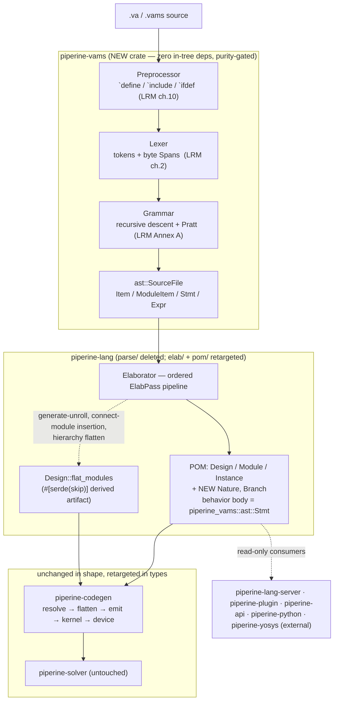

# Verilog-AMS Support — Design

**Spec**: `.specs/features/verilog-ams-support/spec.md`
**Status**: Draft
**Scope tier**: Complex (new frontend language, workspace-wide blast radius, 26 requirements)

---

## 0. What the codebase scan changed about this design

Three findings, each verified against the tree, reshaped the architecture
before a single component was drawn. They are stated first because the rest
of the document only makes sense in their light.

### F1 — The POM is *not* decoupled from the parser AST

`crates/piperine-lang/src/pom/behavior.rs:16`:

```rust
pub use crate::parse::ast::{Stmt as BehaviorStmt, StmtMatchArm as MatchArm};
```

The POM's behavior body **is** the PHDL parse AST, re-exported. The file's own
doc comment records this as deliberate ("SIMPLIFICATION.md P3 … instead of
deep-copying every statement into a parallel enum"). It was a sound call when
PHDL was the only frontend — the surface AST *was* the only representation.
It stops being sound the moment the surface language changes.

### F2 — That AST leaks across seven crates

| Crate | `parse::ast` references |
|---|---|
| `piperine-codegen` | 106 refs across 20 files (`resolve/`, `emit/`, `kernel/`, `device/`) |
| `piperine-api` | `gradient.rs`, `margins.rs`, `reduced.rs`, `session/entry.rs`, `model/descriptors.rs` |
| `piperine-plugin` | `host.rs` |
| `piperine-lang-server` | `state.rs`, `handlers/selection_range.rs`, `handlers/workspace_symbols.rs` |
| `piperine-python` | `module.rs` |
| `piperine-lang` | (owner) |
| `piperine-yosys` (**external repo**, `~/Git/piperine-yosys`) | consumes the POM to emit RTLIL — out-of-tree consumer of the same contract |

The PHDL AST is a de-facto public contract of the whole workspace. Swapping
the frontend is therefore **not** a `piperine-lang`-local change.

**User decision (this design round): no Phase 0 decoupling — the frontend
swap and the seven-crate retarget land as one effort.** The consequence is
accepted deliberately and mitigated by ordering (§7): `piperine-vams` reaches
full green against its own conformance corpus *before* `piperine-lang/parse/`
is deleted, so the traversal starts from a proven parser rather than from
two simultaneous unknowns.

The existing architectural *pattern* is preserved verbatim: the POM keeps
re-exporting the surface AST's statement/expression types — only the surface
AST's identity changes (`piperine_lang::parse::ast` → `piperine_vams::ast`).
Codegen's 106 references become a mechanical retarget plus new match arms for
VAMS-only constructs, not a redesign.

### F3 — Prior art exists, and is deliberately **not** being reused

The project **began** as a Verilog-A/AMS parser and pivoted away from it:
`cvaf` → `piperine-parser` (rename `07fc235`) → `piperine-ams`, deleted in
`1aaf6cf` (2026-07-03). It was substantial (~230 KB of lexer, preprocessor,
grammar, AST, formatter) and its AST covered most of what this spec calls
"new" — standalone natures, branches, generate, UDPs, specify blocks,
paramsets, connectrules.

**It is not the basis of this design.** That code was written against a
third-party grammar file as its reference, and its own doc comments record
that lineage. This feature takes **`VAMS-LRM-2-4.md` Annex A (normative
formal syntax) as its single, sole source** — the parser is written from the
standard, by us, from scratch.

**User directive (this round, verbatim intent): no third-party Verilog-A
compiler is consulted, referenced, or borrowed from — not its code, not its
grammar files, not its comments. We build our own.** Recorded as a hard
constraint, not a preference (§9, AD to record).

Practical consequences:

- **`git show 1aaf6cf~1:crates/piperine-ams/…` is off-limits as a source.**
  No file recovery, no production-by-production transcription, no comment
  reuse. The deleted crate is history, not a library.
- What the prior art legitimately contributes is **evidence, not code**: it
  proves a hand-written recursive-descent + Pratt pipeline is the right shape
  for this grammar (an LR(1) generator was tried first and abandoned on VAMS
  conflicts), and it proves the scale is tractable. Both facts inform §4.1's
  structure; neither requires reading the old source.
- The old crate's third-party model fixtures are likewise not vendored — see
  R2 for the corpus strategy, which now stands on its own footing.

---

## 1. Architecture Overview

Two crates own the frontend, split on the purity line the project already
uses for `piperine-ir`: **`piperine-vams` is text → AST and depends on
nothing in-tree; `piperine-lang` is AST → POM and owns every semantic pass.**



**Invariant that shapes everything below (MD-25, UNBREAKABLE):**
`Design::modules` holds exactly what the author wrote in `.va`/`.vams` —
a `generate` block stays a generate block, and an auto-inserted connect
module never appears there. Everything elaboration *synthesises* flows into
the derived side artifact, never back into the authored tree.

---

## 2. Approach exploration (recorded — decisions already taken)

| # | Approach | Verdict |
|---|---|---|
| A | Replace `piperine-lang/parse/` in place; no new crate | **Rejected by user.** Respects MD-15's spirit and MD-13 rule 4, but forfeits the independently-testable parser boundary and makes the real-model conformance corpus a downstream concern |
| B | **New `piperine-vams` crate for parse only; `piperine-lang` keeps `elab/`+`pom/`** | **CHOSEN (user).** The parser proves itself against a real-model corpus before any elaboration exists; the purity gate makes the boundary mechanical, not aspirational (MD-31), and carries the provenance constraint (R1) |
| C | VAMS parses → PHDL AST → existing elaborator unchanged | **Rejected on merit, not preference.** VAMS constructs with no PHDL equivalent (generate, UDP, specify, paramset, connectrules) have nowhere to go, and routing through a foreign AST destroys the source-mirroring MD-25 requires. This is the "overlapping representations" failure the deleted IR crate died of (`ee39953`) |

| Fork | Decision (user) | Consequence |
|---|---|---|
| Phase-0 POM/AST decoupling | **No** — swap everything at once | Suite is dark mid-traversal; mitigated by corpus-first ordering (§7) and by keeping the POM's "body is the surface AST" pattern so codegen's retarget is mechanical |
| Parser home | **New `piperine-vams` crate** | Needs an explicit note against MD-15's no-proliferation spirit — justified by the purity contract + independent conformance corpus (§9, AD to record) |
| Generate-unroll & connect-module insertion | **Derived artifact only** | `Design::modules` untouched; MD-25 upheld with zero exceptions |

---

## 3. Code Reuse Analysis

### Existing components to leverage

| Component | Location | How to use |
|---|---|---|
| `ElabPass` trait + `PASSES` const table | `crates/piperine-lang/src/elab/lower/passes.rs:21-37` | **Keep the mechanism verbatim.** It is already a data table of single-job passes (MD-13 rule 5 compliant). Retarget pass bodies; insert three new passes (§6) |
| `FlattenHierarchy` + `Design::flat_modules` | `elab/lower/flatten.rs` (960 lines) | The existing proof that a derived side artifact works under MD-25. Generate-unroll and connect-insertion feed *into* it rather than minting new POM surface |
| Purity gate pattern | `crates/piperine-ir/tests/purity.rs` (manifest `[dependencies]` must be empty + banned-token scan) | Copy the pattern for `piperine-vams` (`tests/purity.rs`), banning POM/solver/Cranelift identifiers **and third-party-compiler provenance tokens** (R1) |
| `Design`/`Module`/`Instance`/`Port`/`Param`/`Wire`/`Connection` | `pom/design.rs` (899), `pom/module.rs` (337) | Retained. VAMS modules/ports/params map onto them directly |
| `elab/registry/` (callables, operators, types, schemas) | `elab/registry/` | Retained — the MD-24 declared-surface machinery. Schema seeding (`seed_device_port_schemas`, `lib.rs:94`) re-anchors on `(* attribute *)` instances (VAMS-12/13) |
| `elab/typecheck.rs` (676), `elab/resolution.rs` | `elab/` | Retargeted, not rewritten — the type lattice is language-independent |
| `SourceMap` + `resolve.rs` (`use`-decl resolver) | `source_map.rs`, `resolve.rs` | Becomes the `` `include`` search-path resolver (VAMS-16) |
| **`VAMS-LRM-2-4.md` Annex A** (in-repo, 1 MB) | repo root | **The sole source for every grammar production.** Not "a reference" — the normative text the parser is written from, clause-cited in doc comments |
| `tests/support/ngspice.rs` `ToleranceContract` | root `tests/support/` | Reused **unmodified** as the migration oracle (VAMS-06, VAMS-08). Never loosened |
| `tests/suite_hygiene.rs` gate style | root `tests/` | Template for the `.phdl`-count monotonic-shrink gate (VAMS-11, §7) |

### Integration points

| System | Integration method |
|---|---|
| `piperine-codegen::resolve` | Retarget 106 `parse::ast` refs → `piperine_vams::ast`; add match arms for VAMS-only statements. `resolve/diff.rs` (symbolic differentiation) is **expression-shape-dependent** — highest-care file in the retarget |
| `piperine-solver` | **No change.** Contract is `Element`; nothing below the POM moves — except the P3 digital-scheduler tension flagged in §8 (R7) |
| `piperine-plugin` | `@device`/`@port` schemas re-anchor on `(* … *)` attribute instances; `PluginHost::seed_schemas` keeps schema authority (MD-21/D2 intact) |
| `piperine-lang-server` | AST-shape-coupled handlers retarget; VAMS spans are plain byte ranges mapped to `miette`/LSP at the `piperine-lang` boundary |
| `piperine-yosys` (external) | POM consumer outside this repo — coordinated breakage, flagged (§8 R5) |

---

## 4. Components

### 4.1 `piperine-vams` (new crate)

- **Purpose**: turn `.va`/`.vams` text into a Verilog-AMS AST — nothing else.
- **Location**: `crates/piperine-vams/`
- **Purity contract** (mechanical, `tests/purity.rs`): `[dependencies]` is
  **empty** — no in-tree dependency, and no external one either (matching
  `piperine-ir`'s standard). This forces AST spans to be plain byte ranges
  (`Span { start, end }`) rather than `miette` types; the mapping to
  diagnostic types happens at the `piperine-lang` boundary. Banned-token scan
  covers two families: (a) architectural leakage — POM types, `Element`,
  matrix/Cranelift symbols; (b) **provenance** — any third-party Verilog-A
  compiler name or grammar-file reference, anywhere in the crate *including
  comments* (R1).
- **Modules** (named by system function, MD-13 rule 4; `mod.rs` declares
  only, MD-34):

| Module | Owner type(s) | Responsibility | Requirements |
|---|---|---|---|
| `preprocessor.rs` | `Preprocessor` | `` `define`` (incl. arguments + CPP-style rescan), `` `include`` (path resolution injected by the caller — the crate does no I/O), `` `ifdef`/`ifndef`/`else`/`elsif`/`endif``, `` `timescale``, `` `resetall`` … | VAMS-16 |
| `lexer.rs` | `Lexer`, `Tok`, `Lexed` | LRM ch.2: integer constants (sized/based/`_`), real constants **incl. SI scale suffixes** (`1.2p`, `4k`), strings, escaped identifiers, comments, newline preservation for the preprocessor | VAMS-07, VAMS-24 |
| `keywords.rs` | `Keywords` (table + lookup) | LRM Annex B: the complete reserved-word set, as a data table the conformance gate reads directly | VAMS-24 |
| `ast/` (`expr.rs`, `stmt.rs`, `item.rs`, `mod.rs`) | `SourceFile`, `Item`, `ModuleItem`, `Stmt`, `Expr`, `Span`, `Attr`, … | The tree. Attribute instances (`Attr`) hang on every LRM-permitted site (Syntax 2-5..2-10) and **only** those | VAMS-07, VAMS-12 |
| `grammar/` (`item.rs`, `stmt.rs`, `expr.rs`, `mod.rs`) | `Grammar` (methods per production) | Recursive descent + Pratt for expressions, one method per Annex-A production, each carrying the production name in a doc comment so the Annex-A gate can index them | VAMS-23 |
| `parser.rs` | `Parser` | Façade: preprocess → lex → parse → `SourceFile`, with a typed `ParseError { span, kind }` | VAMS-05 |
| `fmt.rs` | `Formatter` | Source formatter — comment preservation and macro continuation are required behaviors; backs `piperine fmt` | — |

- **Interfaces**:
  - `Parser::new(source: &str) -> Parser`
  - `Parser::with_include_resolver(self, r: impl IncludeResolver) -> Parser` — I/O stays outside the pure crate
  - `Parser::parse(self) -> Result<ast::SourceFile, ParseError>`
  - `Keywords::is_reserved(word: &str) -> bool`
  - `Formatter::format(src: &str) -> Result<String, ParseError>`
- **Dependencies**: none.
- **Reuses**: nothing. Written from LRM Annex A (F3). Every grammar method
  carries the Annex-A production name it implements in its doc comment —
  which is also what makes the VAMS-23 conformance gate mechanical rather
  than a judgement call.
- **Test targets** (each opens with a `//!` scope header, MD-28):
  `tests/purity.rs`, `tests/lexical.rs` (VAMS-07), `tests/annex_a_grammar.rs`
  (VAMS-23), `tests/annex_b_keywords.rs` (VAMS-24),
  `tests/preprocessor.rs` (VAMS-16), `tests/corpus.rs` (the real-model
  conformance run — see §8 R2 for where the corpus lives).

### 4.2 `piperine-lang` (retargeted)

- **Purpose**: unchanged — AST → elaborated POM.
- **Removed**: `src/parse/` in its entirety (PHDL lexer, parser, AST,
  formatter, `predict.rs`) and `headers/*.phdl`.
- **Added / changed**:

| Area | Change | Requirements |
|---|---|---|
| `pom/nature.rs` (**new**) | `Nature` — standalone, `parent: Option<NatureRef>` (derived natures), attributes `abstol`/`access`/`units`/`idt_nature`/`ddt_nature` + user-defined (LRM §3.6.1) | VAMS-01 |
| `pom/branch.rs` (**new**) | `Branch` — named (`branch (a,b) br;`) and implicit; the resolution target of `V(…)`/`I(…)` access functions | VAMS-02 |
| `pom/behavior.rs` | `pub use piperine_vams::ast::{Stmt as BehaviorStmt, …}` — same pattern, new source crate | VAMS-02, VAMS-03 |
| `pom/module.rs`, `pom/design.rs` | `Module` gains `natures`/`branches`/`genvars`/`paramsets`; `Design` keeps exactly **one** derived artifact (`flat_modules`) | VAMS-01, VAMS-04 |
| `eval/interp.rs` (863) | Retargeted from PHDL AST to `piperine_vams::ast` — const/parameter evaluation and analog functions | VAMS-07, VAMS-15 |
| `elab/lower/` | Pass bodies retargeted; three new passes (§6) | VAMS-04, VAMS-17, VAMS-20 |
| `headers/` | `.phdl` → Annex-D-derived `disciplines.vams`, `constants.vams`, plus Piperine's attribute-declared extension surface | VAMS-09 |
| `headers/spice/` | 12 hand-ported ngspice models → `.va`, provenance docstrings preserved | VAMS-08 |
| `lib.rs` | `parse_and_elaborate` keeps its **signature** (`&str, &SourceMap -> Result<Design, Report>`) so no host moves; internals swap | — |

### 4.3 `piperine-codegen` (retargeted, not redesigned)

- 106 `parse::ast` references → `piperine_vams::ast`, across
  `resolve/` (`expr.rs`, `stmt.rs`, `symbols.rs`, `diff.rs`, `pom/*`),
  `emit/` (`stmt.rs`, `analog_expr.rs`, `digital_expr.rs`, `cse.rs`),
  `kernel/`, `device/`.
- **`resolve/diff.rs` is the highest-risk file in the entire retarget**: it
  pattern-matches expression shape to differentiate symbolically, and
  `CLAUDE.md` names it "the correctness-critical core". Its oracle is the
  existing derivative test suite plus `piperine-ir`'s `verify_derivatives`
  finite-difference checker — both stay in force.
- New match arms for VAMS-only constructs; anything not yet lowerable emits
  `CodegenError::Unsupported` — **never** a silent `0.0` (`CLAUDE.md`).

### 4.4 Migration corpus (140 files)

| Location | Count | Requirement |
|---|---|---|
| `tests/ngspice/` | 48 | VAMS-08 (oracle unchanged) |
| `examples/` | 24 | VAMS-10 |
| `crates/piperine-lang/tests/examples/` | 14 | VAMS-09 |
| `crates/piperine-lang/headers/` | 13 | VAMS-09 |
| `crates/piperine-lang/headers/spice/` | 12 | VAMS-08 |
| `crates/piperine-project/examples/spice_proj/**` | 26 | VAMS-10 |
| `tests/spice/`, `crates/piperine-cli/templates/` | 3 | VAMS-10 |

---

## 5. Data Models

### 5.1 `Nature` (POM, new) — LRM §3.6.1

```rust
pub struct Nature {
    pub span: Option<miette::SourceSpan>,
    pub doc: Option<String>,
    pub name: String,
    /// `nature Voltage : Potential;` — derived natures (§3.6.1.1).
    pub parent: Option<String>,
    /// Standard attributes (§3.6.1.2), each optional and each
    /// LRM-named — never a catch-all map for these five.
    pub abstol: Option<f64>,
    pub access: Option<String>,     // e.g. `V`
    pub units: Option<String>,
    pub idt_nature: Option<String>,
    pub ddt_nature: Option<String>,
    /// User-defined attributes only (§3.6.1.3).
    pub user_attrs: HashMap<String, Value>,
}
```

**Relationships**: a `Discipline` binds a potential nature and/or a flow
nature (§3.6.2.1); `Branch` access functions resolve through the discipline's
natures; `abstol` reaches the solver's per-net tolerance.

**Why the five standard attributes are named fields, not map entries**:
`ddt_nature`/`idt_nature` drive operator type-checking and `abstol` drives
solver tolerance — a typo in a stringly-keyed map would fail silently, which
is precisely the fail-loud violation `CLAUDE.md` forbids.

### 5.2 `Branch` (POM, new) — LRM §3.6, §5

```rust
pub struct Branch {
    pub span: Option<miette::SourceSpan>,
    pub name: Option<String>,          // None ⇒ implicit branch
    pub pos: NetRef,
    pub neg: Option<NetRef>,           // None ⇒ ground-referenced
    pub kind: BranchKind,              // Potential | Flow — set by first contribution
}
```

**Relationships**: `V(a,b) <+ …` / `I(br) <+ …` resolve to a `Branch`;
codegen's contribution splitting (resistive / charge / `ac_stim`) keys off it.
A branch contributed to as both potential and flow is a fail-loud error
(LRM §5 switch-branch rules are the one legal exception and are modelled
explicitly, not by relaxing the check).

### 5.3 Derived artifacts — the MD-25 boundary

```
Design::modules       ← authored VAMS structure, ONLY. Never mutated by a pass.
                        A `generate` block reads back as a generate block.
                        An auto-inserted connect module is ABSENT here.

Design::flat_modules  ← #[serde(skip)], memoized, rebuildable. The single
                        derived artifact. Fed by, in order:
                          UnrollGenerate → InsertConnectModules → FlattenHierarchy
```

**Deliberate minimalism**: generate-unroll and connect-insertion keep their
intermediate results in the *elaborator's own state*, not on `Design`. Only
the final flat form lands on the POM — exactly one derived artifact, as today.
If a consumer ever needs the unrolled-but-not-flat view (an LSP "show
generated instances" feature is the plausible one), it becomes an *additional*
derived artifact then; inventing it now would be POM surface nobody reads.

---

## 6. Elaboration pass pipeline

`PASSES` (`elab/lower/passes.rs:26`) gains three passes. Order is load-bearing
and each constraint below is a real dependency, not a preference:

```
 1 Register              index top-level items (modules, natures, disciplines, paramsets)
 2 ValidateEvents        event-kind validation
 3 FoldGlobals           constants + parameter defaults  ─┐
 4 ElabFns               analog functions / tasks         │ genvar bounds must be
 5 UnrollGenerate  ★NEW  for/if/case generate → derived  ─┘ const-folded first
 6 ElabModules           module bodies
 7 AttachBehaviors       analog / always / initial bodies
 8 ResolveDisciplines ★NEW  undeclared-net discipline resolution (Annex F)  ─┐
 9 InsertConnectModules ★NEW  A/D-D/A insertion on discipline mismatch      ─┘ needs 8
10 ElabConstraints       attribute-carried constraint blocks
11 ResolveCalls          call resolution
12 Typecheck             type lattice
13 FlattenHierarchy      derived flat form (consumes 5 + 9)
```

- **5 before 8**: generated instances have ports that need disciplines.
- **8 before 9**: connect-module insertion triggers on a *resolved* discipline
  mismatch across a connection; an unresolved net cannot be compared.
- **9 before 13**: flatten must see the connect modules as real structure.

| New pass | Requirement | Writes |
|---|---|---|
| `UnrollGenerate` | VAMS-04 | elaborator state → `flat_modules` |
| `ResolveDisciplines` | VAMS-17 (Annex F) | net discipline bindings |
| `InsertConnectModules` | VAMS-20 (ch.7) | elaborator state → `flat_modules` |

**Annex F choice (VAMS-17)**: the LRM defines two resolution methods and
leaves the choice to the tool. This design commits to a single method,
declared in the pass's `//!` contract and asserted by its test — the spec's
"documented explicitly, not implementation-defined per instance" criterion.
Which of the two is selected is a **Tasks-phase decision** made against the
LRM's worked examples, not guessed here.

---

## 7. Sequencing (the mitigation for "no Phase 0")

The user accepted a single-shot swap; ordering is what keeps it from being a
blind traversal. Each stage below ends at a **verifiable** state.

| Stage | Ends at | Oracle |
|---|---|---|
| **S1** `piperine-vams` built standalone; PHDL untouched, workspace fully green | A parser proven against a real compact-model corpus + Annex A/B gates | `tests/corpus.rs`, `annex_a_grammar.rs`, `annex_b_keywords.rs`, `purity.rs` — all green while nothing else has moved |
| **S2** POM gains `Nature`/`Branch`; `piperine-lang` grows the VAMS→POM lowering **beside** the PHDL path | Both frontends elaborate; differential parity available | The same circuit authored twice (`.phdl` + `.vams`) elaborates to equivalent POMs — this is how VAMS-06 gets proven, and it exists only during S2 |
| **S3** Codegen + 5 downstream crates retargeted; PHDL `parse/` deleted | One frontend | Full `cargo test --workspace` restored to green |
| **S4** 140-file corpus migrated, per-file `.phdl` deletion | Zero `.phdl` | `tests/ngspice_*.rs` unchanged tolerances; `run_examples.rs` unchanged logic |
| **S5** P3 completeness (1364 digital, VPI surface, Annex E) | Full LRM coverage | Per-requirement tests (spec's traceability table) |

**Dual-frontend clarification**: VAMS-11 forbids straggling `.phdl` *source
files*, not a transitional dual *compiler*. 140 files cannot migrate
atomically, so S2–S4 necessarily run both parsers. The invariant that keeps
this from becoming permanent is a **gate, not a promise** (MD-31):
`tests/suite_hygiene.rs`-style check asserting the remaining `.phdl` count is
monotonically non-increasing against a committed high-water mark, reaching
zero at S4's end — the historical precedent being commit `1a0b780`, which
already dispatched on file extension the same way.

---

## 8. Risks & Concerns

| # | Concern | Location | Impact | Mitigation |
|---|---|---|---|---|
| **R1** | **Provenance purity.** The deleted `piperine-ams` was written against a third-party compiler's grammar file and says so in its own doc comments. Any transcription from it would carry that lineage into an MIT crate — and violates the user's explicit directive | `git show 1aaf6cf~1:crates/piperine-ams/…` (off-limits) | Foreign lineage in our parser; contradicts a hard user constraint | **Closed by construction, not by review**: the old crate is not consulted at all (F3). The parser is written from `VAMS-LRM-2-4.md` Annex A, with each grammar method's doc comment citing the production it implements. A source-scan gate in `tests/purity.rs` fails on any third-party-compiler identifier appearing anywhere in `piperine-vams` — MD-31: the invariant lives in the gate |
| **R2** | **Conformance corpus is third-party licensed model code.** Real compact models (BSIM, HICUM, PSP, EKV, …) carry their own licenses; the one sampled from the old fixtures was Tiburon Design Automation / designers-guide.org | corpus (external) | Vendoring redistributes foreign-licensed sources from an MIT repo | Corpus lives **outside the tree**. `tests/corpus.rs` reads its path from an env var and **skips with a clear message when unset** (never `#[ignore]`, which `suite_hygiene.rs` bans). Models are obtained from their own upstream publishers, not inherited from the deleted crate. Only verified-permissive files are ever vendored |
| **R3** | **No Phase 0 → the workspace does not compile and the 262-target suite is dark through S2–S3** | whole workspace | The primary regression oracle is unavailable exactly when the riskiest edits happen | §7 ordering: S1 finishes with a parser already proven independently; S2 keeps PHDL alive so differential parity is possible; only S3 is genuinely dark, and it is mechanical type retargeting rather than semantic change |
| **R4** | **`resolve/diff.rs` retarget** — symbolic differentiation pattern-matches expression shape; `CLAUDE.md` flags it "do not edit casually" and "correctness-critical core" | `crates/piperine-codegen/src/resolve/diff.rs` | Silent wrong derivatives ⇒ wrong Jacobian ⇒ converged-but-wrong answers, the worst failure class | Retarget in its own task with `piperine-ir`'s `verify_derivatives` finite-difference oracle plus the ngspice op-point suite as gates. No batching with other files |
| **R5** | **`piperine-yosys` is an out-of-tree POM consumer** and will break on POM shape changes | `~/Git/piperine-yosys/src/transpile/` | External repo silently broken; its own `GAPS.md` already lists 21 unresolved gaps incl. FATALs | Coordinated task at S3: update the external repo in lockstep. Its pre-existing FATAL gaps (G1/G2) mean it is **not currently working anyway** — record that so its breakage is not misattributed to this feature |
| **R6** | **`eval/interp.rs` (863 lines) is PHDL-AST-coupled** and has no POM-level abstraction to fall back on | `crates/piperine-lang/src/eval/interp.rs` | Const-eval/parameter folding must be rewritten, not ported | Retarget to `piperine_vams::ast` (same pattern the POM uses). VAMS parameter semantics (`localparam`, `aliasparam`, value ranges §3.4.2, string params) are a **superset** of PHDL's, so this grows arms rather than changing structure |
| **R7** | **Spec says the solver is out of scope, but VAMS-20 (full ch.7–8 mixed-signal scheduling) plausibly requires digital-scheduler changes** in `piperine-solver` | `spec.md` Out of Scope row vs VAMS-20 | A P3 requirement that cannot be satisfied without touching a crate the spec froze | **Surface this as a spec amendment at S5, not silently.** Reading: "out of scope" means *no redesign of the analog solver / `Element` ABI*; extending the digital event scheduler to the LRM's stratified queue is in-scope-by-necessity for VAMS-20. Requires the user's explicit confirmation before S5 starts |
| **R8** | **Writing ~230 KB of parser from scratch is the largest single build in this feature**, and the LRM's grammar is genuinely large (Annex A spans the full language) | `crates/piperine-vams/` | Underestimated effort; a half-built parser blocks every later stage | Annex A is *enumerable* — the VAMS-23 gate turns "is the grammar done?" into a countable check rather than a feeling. S1 is sized by production count, and the corpus (R2) gives a second, independent completion signal: real models either parse or they don't |
| **R9** | **MD-24's `extern` machinery is PHDL-syntax-shaped** (seven `extern` forms, `extern_coverage_guard.rs`) and VAMS has no `extern` keyword | `crates/piperine-lang/tests/extern_coverage_guard.rs`, MD-24 | The declared-language-surface guarantee could be silently lost in translation | The guarantee ports; the *spelling* changes: LRM Annex D supplies the language's own built-ins textually, and Piperine's additions become `(* … *)`-declared (VAMS-12/13). `extern_coverage_guard.rs` must be **rewritten, not deleted** — deleting it would silently retire a locked invariant (MD-31) |
| **R10** | **`.disto` Cranelift overrun and `laplace_*`/`zi_*` absence** are pre-existing known gaps that VAMS makes *reachable by name* (they are declared constructs in the LRM) | `ROADMAP.md` P1 | Users can now write LRM-legal source that hits known-broken paths | Keep them fail-loud (`CodegenError::Unsupported`), and record in the ROADMAP that VAMS raises their priority — do not let the pivot quietly turn a documented gap into a runtime surprise |

---

## 9. Tech Decisions

| Decision | Choice | Rationale |
|---|---|---|
| **Grammar source** | **`VAMS-LRM-2-4.md` Annex A, sole and exclusive.** No third-party Verilog-A compiler is consulted — not its code, not its grammar files, not its comments; the deleted `piperine-ams` is off-limits as a source | User directive, recorded as a hard constraint. Enforced mechanically by the provenance scan in `tests/purity.rs` (R1), not by reviewer discipline |
| Parser crate boundary | `piperine-vams`, zero dependencies, purity-gated | Lets the parser be proven against a real-model corpus before any semantic work exists (S1). MD-15's no-proliferation spirit is answered by the purity contract: this is the same justification `piperine-ir` already carries |
| AST span type | plain `Span { start: usize, end: usize }` | Zero-dependency purity forbids `miette` in the AST; mapping to `SourceSpan` happens at the `piperine-lang` boundary — which is also where source text and file identity live |
| POM behavior body | keeps re-exporting the surface AST (now `piperine_vams::ast::Stmt`) | Preserves the existing architecture verbatim (F1) so codegen's 106 refs are a mechanical retarget. Revisiting it would be a POM-ownership feature of its own |
| Nature standard attributes | five named fields, not a map | `abstol` drives solver tolerance and `ddt_nature`/`idt_nature` drive operator typing — a stringly-keyed typo must not fail silently |
| Derived artifacts | exactly one (`flat_modules`), fed by unroll → connect-insert → flatten | MD-25 upheld with no new POM surface; intermediates stay in elaborator state until a consumer actually needs them |
| `` `include`` I/O | injected `IncludeResolver` trait, implemented in `piperine-lang` | Keeps `piperine-vams` pure (no filesystem) while `` `include`` still works, reusing the existing `SourceMap` search-path logic |
| Dual-frontend period | allowed S2–S4, bounded by a monotonic-shrink gate | MD-31: the invariant lives in a test, not a promise. Historical precedent: `1a0b780` dispatched on file extension |
| Annex F method choice | committed to one method, declared in the pass contract | The LRM permits either; leaving it implicit would make VAMS-17 unfalsifiable |

**Project-level decisions to record in `.specs/STATE.md` once this design is
approved** (per the skill's memory rule — not written yet, pending approval):

- **MD-42: Verilog-AMS is the frontend; PHDL is retired.** Supersedes MD-39's
  premise (which argued *"no device that PHDL already is"* — the reasoning
  survives, its subject changes to VAMS) and updates MD-24's spelling from
  `extern` declarations to LRM Annex D + `(* … *)` attribute instances.
- **MD-43: `piperine-vams` is a zero-dependency, purity-gated parse crate.**
  The second sanctioned exception to MD-15's no-proliferation stance, on the
  same grounds as `piperine-ir`.
- **MD-25 gets an explicit VAMS clause**: generate-unroll and connect-module
  insertion are derived-artifact producers; `Design::modules` mirrors the
  `.va`/`.vams` source exactly.

---

## 10. Error Handling Strategy

| Scenario | Handling | Surface |
|---|---|---|
| Lexical / syntax error | `ParseError { span, kind }` from `piperine-vams`; mapped to a `miette` diagnostic with the source attached at the `piperine-lang` boundary | line/column-anchored message (VAMS-05) |
| `` `include`` not found | `IncludeResolver` returns `Err`; preprocessing aborts | fail loud, path + including-file span (VAMS-16) |
| Unknown attribute schema | `ElabErrorKind::Other`-equivalent — never silently accepted | MD-24 parity (VAMS-13) |
| Attribute on a site the LRM forbids (Syntax 2-5..2-10) | **parse** error, not an ignored attribute | VAMS-12 edge case |
| Undeclared-net discipline unresolvable | fail loud naming the Annex F method applied and why it failed | VAMS-17 |
| Analog-only context violation (Annex C) | elaboration error citing the Annex C restriction | VAMS-25 |
| Generate/instance name collision | fail loud with both source spans — never silent rename | spec Edge Cases |
| Construct parses but cannot be lowered | `CodegenError::Unsupported` | `CLAUDE.md`: never emit `0.0` or a no-op |

---

## 11. Requirement → component traceability

| Req | Primary component | Stage |
|---|---|---|
| VAMS-01 | `pom/nature.rs`, `headers/disciplines.vams`, `Register` | S2 |
| VAMS-02 | `pom/branch.rs`, `grammar/stmt.rs`, `codegen::resolve` | S2/S3 |
| VAMS-03 | `AttachBehaviors`, `kernel/digital` | S2/S3 |
| VAMS-04 | `UnrollGenerate`, `FlattenHierarchy`, `pom/module.rs` | S2 |
| VAMS-05 | `parser.rs::ParseError` + `piperine-lang` diagnostic mapping | S1 |
| VAMS-06 | S2 differential parity harness + `ToleranceContract` | S2 |
| VAMS-07 | `lexer.rs`, `grammar/expr.rs`, `eval/interp.rs` | S1/S3 |
| VAMS-08 | `headers/spice/*.va`, `tests/ngspice_*.rs` | S4 |
| VAMS-09 | `headers/*.vams` (Annex D) | S4 |
| VAMS-10 | `examples/`, `run_examples.rs` | S4 |
| VAMS-11 | monotonic-shrink gate (§7) | S4 |
| VAMS-12 | `ast::Attr` sites, `PluginHost::seed_schemas` | S3 |
| VAMS-13 | `elab/registry/` schema lookup | S3 |
| VAMS-14 | `ElabConstraints` | S3 |
| VAMS-15 | `eval/tasks`, `elab/registry/` | S4 |
| VAMS-16 | `preprocessor.rs` + `IncludeResolver` | S1 |
| VAMS-17 | `ResolveDisciplines` | S4 |
| VAMS-18 | `grammar/item.rs` gates, `kernel/digital` | S5 |
| VAMS-19 | `PrimitiveDecl` → `kernel/digital` | S5 |
| VAMS-20 | `InsertConnectModules` + digital scheduler (**R7**) | S5 |
| VAMS-21 | `piperine-plugin` native routing | S5 |
| VAMS-22 | Annex E mapping | S5 |
| VAMS-23 | `tests/annex_a_grammar.rs` | S1→S5 ongoing |
| VAMS-24 | `keywords.rs` + `tests/annex_b_keywords.rs` | S1→S5 ongoing |
| VAMS-25 | `Typecheck` / Annex C enforcement | S2→S5 ongoing |
| VAMS-26 | `docs/` | S5 |

**Coverage: 26/26 mapped.** Every requirement has a named owning component
and a stage.
