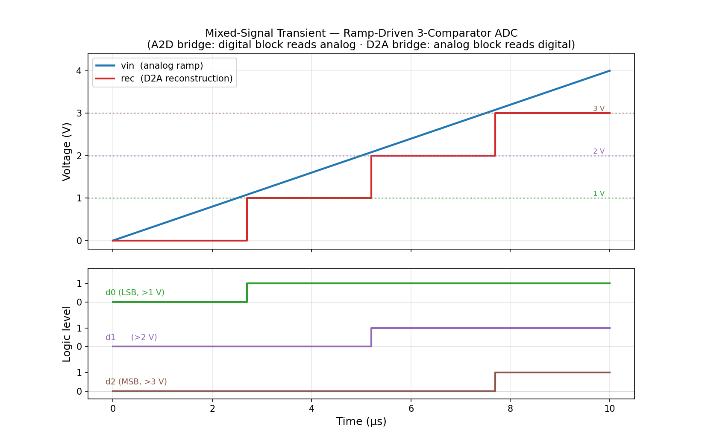
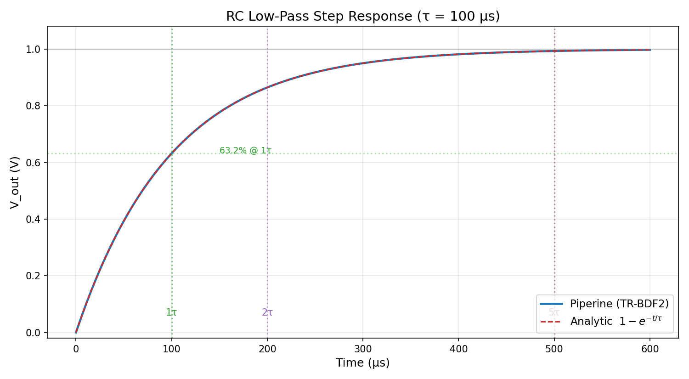
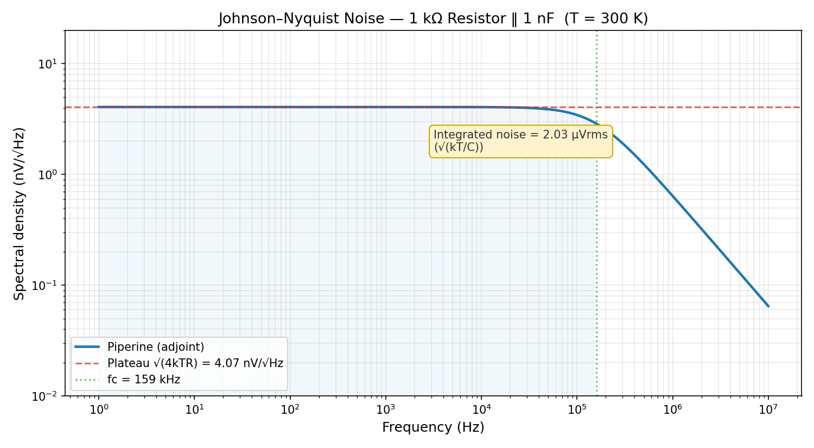

<div align="center">


**A Verilog-AMS compiler and a native analog / mixed-signal simulator — in one toolchain.**

Design a circuit in **Verilog-AMS** (LRM 2.4), simulate it on a **pure-Rust in-house solver** (no SPICE underneath), and verify it with **real Python** — not a `.measure` mini-language.

</div>

> ⚠️ **Work in progress — not production ready.** APIs, syntax, and behavior
> change without notice. Use it to explore and contribute, not for anything you
> depend on. Piperine's own PHDL language has been **retired in full** in favor
> of standard Verilog-AMS — see `CLAUDE.md` for the pivot.

---

## What is Piperine?

Piperine is a complete, HDL-centric design toolchain for the **low/medium-level
designer** — hobbyists, independent professionals, and small teams building real
products without Cadence-class tooling. One language and one host cover the whole
loop: design entry, SPICE-class simulation, mixed-signal, and interactive
verification.

- **Verilog-AMS** (`.vams`/`.va`, LRM 2.4) is the frontend — SI-suffixed literals
  (`2.2u`, `10k`), `nature`/`discipline`, `parameter`s, `generate` blocks, typed
  `(* attribute *)` instances — parsed from the LRM's own Annex A grammar
  (`piperine-lang`, written from `VAMS-LRM-2-4.md` only) and resolved at
  elaboration by a pure evaluator, **never a macro stage**.
- It compiles **straight into a native in-house solver**: analog devices are
  JIT-compiled to machine code via **Cranelift**, digital behavior runs on an
  **event-driven interpreter**. No external SPICE simulator underneath.
- The device Jacobian is **symbolically differentiated** and JIT-compiled next to
  its residual — your model's derivative is exact, not finite-difference.
- Verification is **code**: `import piperine` gives you the elaborated design,
  the analyses, and numpy waveforms. No TCL, no hidden state.

```
Verilog-AMS (.vams/.va) ──► elaborated design ──► Cranelift-JIT analog devices ──► native solver
                                                        + event-driven digital interpreter
                                                        + optional OSDI (.osdi) Verilog-A models
      hosts: Python (import piperine) · Rust (piperine-api) — drive analyses & measurement
```

---

## See it in 60 seconds

Describe a resistive divider in Verilog-AMS:

```verilog-ams
`include "disciplines.vams"

module VoltageSource (inout electrical p, inout electrical n);
    parameter real voltage = 5.0;
    analog V(p, n) <+ voltage;
endmodule

module Resistor (inout electrical p, inout electrical n);
    parameter real r = 1e3;
    analog I(p, n) <+ V(p, n) / r;
endmodule

module DividerBoard ();
    electrical gnd, vin, mid;
    VoltageSource #(.voltage(5.0)) source (vin, gnd);
    Resistor      #(.r(3e3))       r_top  (vin, mid);
    Resistor      #(.r(2e3))       r_bot  (mid, gnd);
endmodule
```

Verify it in Python — the sweep is a `for` loop, the assertion is an `assert`:

```python
import piperine

m = piperine.load("divider.vams").module("DividerBoard")

r = m.op()
assert abs(r.v("mid", "gnd") - 2.0) < 1e-6          # 5·R2/(R1+R2)
assert abs(r["r_top"].i("p", "n") - 1e-3) < 1e-9    # string current

for rl in [2e3, 1e3, 500.0, 250.0]:                 # a sweep, not a task
    m.set("r_bot", "r", rl)
    v = m.op().v("mid", "gnd")
    assert abs(v - 5.0 * rl / (3e3 + rl)) < 1e-6
```

Run it: `piperine run divider_tb.py` (or `piperine test` to discover every
`*_tb.py`). That's the whole loop.

---

## What you can do

### True mixed-signal — one model, both domains

`analog begin...end` and `always`/digital `logic` share the same module. The
boundary is explicit and type-checked: a digital register read *inside* an
analog contribution is a feature, not a hack. Here a first-order delta-sigma
modulator crosses it twice:

```verilog-ams
`include "disciplines.vams"

module DeltaSigma (input electrical vin, inout electrical gnd, input logic clk, output logic dout);
    parameter real c = 1.0e-12;  parameter real r = 1.0e3;  parameter real vref = 1.0;
    electrical intg;            // integrator output
    logic q;                    // quantizer register, held across clocks
    real vfb;

    assign dout = q;

    always @(posedge clk) q <= (V(intg, gnd) > 0.0);        // clocked 1-bit quantizer

    analog begin
        vfb = (q == 1'b1) ? vref : -vref;                   // digital state read in analog
        I(intg, gnd) <+ c * ddt(V(intg, gnd));               // integrating capacitor
        I(intg, gnd) <+ (vfb - V(vin, gnd)) / r;             // (feedback − input) drives the node
    end
endmodule
```

A ramp-driven 3-comparator ADC — the analog block reads digital (D2A), the digital
block reads analog (A2D), in one transient run:

<div align="center"></div>

### The full analysis suite — native, ngspice-cross-validated

Everything a working SPICE user expects, on the native solver — no external
engine:

| | |
|---|---|
| **DC** operating point + `.dc` source/param sweeps | **Transient** — adaptive **TR-BDF2**, LTE step control, exact breakpoint landing |
| **AC** small-signal (incl. `ac_stim` stimuli) | **Noise** — white + flicker device PSDs, per-source contributions |
| **`.tf`** transfer function (gain, Zin, Zout) | **PSS** — periodic steady state (shooting) |
| **`.sens`** DC sensitivity | **`.four`** Fourier / THD |
| **`.pz`** pole-zero | **`.disto`** distortion (HD2/HD3/IM2/IM3, Volterra) |
| **`.sp`** S-parameters (`@rfport`) | all over MNA with **symbolic** Jacobians |

Passives, sources, controlled sources, switches, diode, BJT, JFET, MOS levels
1/2/3, transmission lines, transformers, and lumped RC lines are present and
**cross-checked against ngspice** to numerical agreement.

### Verification is code — with real plots

A Python testbench drives the analyses; matplotlib does the rest. RC step
response vs. the analytic `1 − e^(−t/τ)`, straight from a transient:

```python
t = piperine.load("rc.vams").module("RcStep").tran(
        piperine.TranConfig(stop=6e-4, step=2e-6, ic={"out": 0.0}))
v = t.v("out", "gnd")                 # a Waveform: .values / .axis (numpy), .at, .cross, .rms
plt.plot(v.axis, v.values)            # your own matplotlib, no wrapper in the way
```

<div align="center"></div>

Johnson–Nyquist noise of a resistor, integrated over a bandwidth:

<div align="center"></div>

### Compile-once live sessions — for optimization loops

`design.compile()` gives a `Session` that owns the compiled circuit. Every
`set` is a **solver-level restamp — no re-JIT, no re-elaboration** — so a fit
loop runs one compilation for the whole sweep. `session.sweep(label, param,
values)` is the fluent form of the same loop, and `sweep_grid({...})` +
`.map(fn)` cover nested/named sweeps into a shaped array:

```python
session = design.compile()
lo, hi = 1e2, 1e6
for _ in range(60):                       # bisection on a nonlinear diode circuit
    mid = 0.5 * (lo + hi)
    session.set("r1", "r", mid)
    if session.op().v("out") > 0.62: lo = mid
    else:                            hi = mid
assert session.rebuilds == 0              # pure value sets never re-elaborate
```

Measured **≥ 10× faster** than re-elaborating per point, bit-for-bit equal to
fresh builds — the foundation the design-centering optimizer builds on.

### Parametric generation, resolved at elaboration

Structural scaling is the LRM's own `generate for` + `genvar` (ch. 6/Annex A) —
no external netlist generators. The generate block itself never lands in the
elaborated design (MD-25: the authored source stays walkable exactly as
written); only its *derived*, flattened instances do:

```verilog-ams
`include "disciplines.vams"

module Ladder (inout electrical bus, inout electrical gnd);
    parameter integer n = 8;
    parameter real r = 1.0e3;
    parameter real cpar = 5.0e-15;
    electrical tap [n-1:0];
    genvar i;

    generate for (i = 0; i < n; i = i + 1) begin: seg
        Resistor #(.r(r)) rseg (bus, tap[i]);
        Resistor #(.r(r)) rgnd (tap[i], gnd);
        analog I(tap[i], gnd) <+ cpar * ddt(V(tap[i], gnd));
    end endgenerate
endmodule
```

### Real device modeling — parameters, range constraints, LRM builtins

Verilog-AMS's model-card idiom is a module with a rich `parameter` set — every
declaration can carry a **range constraint** the elaborator enforces before
simulation ever starts, and every contribution is a normal expression over
LRM builtins (`exp`, `ln`, `ddt`, ...), symbolically differentiated:

```verilog-ams
`include "disciplines.vams"
`include "constants.vams"

module Diode (inout electrical a, inout electrical c);
    parameter real isat = 1e-14 from (0:inf);
    parameter real vt   = 0.02585 from (0:inf);
    analog begin
        I(a, c) <+ isat * (limexp(V(a, c) / vt) - 1.0);
    end
endmodule
```

Disciplines are user-defined too (`nature`/`discipline`, `potential`/`flow`),
so the same solver runs **electro-thermal** and other multi-physics
couplings — not just `electrical`.

### Rich behavioral operators

Analog bodies speak the operators a real device model needs — all with symbolic
derivatives: `ddt` (charge/flux), `idt` (integration), `delay`, `slew`,
`transition`, `table` (1-D interpolation), `ac_stim` (AC stimulus), and `$limit`
(pnjlim / fetlim / limvds junction limiting). Convergence uses gmin- and
source-stepping homotopy — the hard nonlinear cases converge.

### Live & interactive — mid-run parameter changes

Beyond compile-once sweeps, a `Session` can **schedule parameter changes
mid-transient**, landing exactly on the breakpoint:

```python
session = design.compile()
session.schedule_set(t=5e-6, label="v1", param="dc", value=1.8)   # step the supply at 5 µs
trace = session.tran(piperine.TranConfig(stop=1e-5, step=1e-8))
```

### Read the device, not just the terminals — introspection

Every instance exposes its computed operating-point variables, model
descriptor, terminal/observable catalog, and param bounds — not just `v`/`i`
at the pins. Useful for efficiency tuning, convergence debugging, and feeding
an optimizer's knob bounds:

```python
op = m.op()
q1 = op["q1"]
print(q1.opvar("gm"), q1.opvar("power"))     # any opvar the device computes
print(q1.model().name, q1.terminals())       # model descriptor + terminal catalog
print(q1.param("r").bounds)                  # (min, max) the optimizer can trust
print(op.stats.limiting)                     # $limit diagnostics, empty when nothing limited

trace = m.tran(piperine.TranConfig(stop=1e-3, probe=["q1.power"]))  # record it over time

nz = m.noise(piperine.NoiseConfig(...))
nz.by_source()                                # {"r1/thermal": Waveform, ...}
```

### Typed errors, SI helpers, and a uniform surface

Python and Rust are **one API** — same names, same call shape, same typed
results, locked by a parity test (MD-22). Failures raise a typed
`SimulationError` hierarchy (`ConvergenceError`, `ElaborationError`,
`UnknownModule`, `UnknownNet`), not bare `ValueError`s. Frequencies and times
take an optional SI-suffixed string:

```python
try:
    m.ac(piperine.AcConfig(fstart=piperine.Hz("1k"), fstop=piperine.Hz("10M"), points=200))
except piperine.ConvergenceError as e:
    print(e.node, e.iteration, e.analysis)

piperine.extract(trace, {"peak": lambda t: t.v("out").max(), "rms": lambda t: t.v("out").rms()})
```

### Batteries included

- **Builtin SPICE model library** — a complete ngspice-faithful device set in
  any project with **no dependency** (see [The SPICE standard library](#the-spice-standard-library-use-spice) below), plus the disciplines,
  math, constants, and collections preludes.
- **Extensible via plugins** — write a device (`(* device = "plugin", type = "..." *)`), an
  attribute schema, a lifecycle hook, or a script as a **native (dlopen)** or
  **Python** plugin. TOFU-trusted; plugins contribute no textual declaration
  surface of their own — `@device`/`@port` are the only plugin-facing schema
  names, seeded by the plugin system itself so two device plugins never
  collide.
- **OSDI support** — load `.osdi` v0.4 compiled Verilog-A device models
  alongside JIT-compiled Verilog-AMS devices — an interop path for external
  models Piperine's own `.va`/`.vams` stdlib doesn't cover.
- **Typed attributes** — the LRM's own `(* ... *)` attribute-instance syntax
  (§2.9) carries structured, schema-validated intent, not unstructured
  `PRAGMA` comments — an attribute naming an unrecognized schema fails loud
  at elaboration rather than being silently accepted. `@device`/`@port` (the
  plugin system's own schemas) are the built-in example:
  ```verilog-ams
  (* device = "my_plugin", type = "MyDevice" *)
  module Resistor (inout electrical p, inout electrical n);
  ```
- **Rich `Waveform`** — measurements (`slew_rate`/`rise_time`/`fall_time`/
  `overshoot`/`settling_time`/`delay`), transforms (`fft`/`resample`/
  `derivative`/`integral`/`clip`), and `ComplexWaveform` margins
  (`bandwidth_3db`/`gain_margin`/`phase_margin`/`unity_gain_freq`) on the Rust
  host today; `wf.plot()`/`pip.plot(...)`/`pip.bode(...)` render on Python
  when matplotlib is installed (no hard dependency).
- **No-Magic philosophy** — type conversions and domain crossings are explicit;
  anything the toolchain cannot compile faithfully is a **named error**, never a
  silent zero.

---

## The SPICE standard library — `` `include "spice/…" ``

Piperine ships a **complete, ngspice-faithful device library** as Verilog-A
stdlib headers — available in any project with **zero dependency**, and
translated **line-by-line from the ngspice C sources** (each model header
cites the exact `.c` files and line numbers it came from). Every model is
**cross-validated against ngspice** to numerical agreement.

| Namespace | Devices |
|-----------|---------|
| `spice::passives` | `res`, `cap`, `ind`, `mut` (mutual `K`), `xfmr` (combined transformer) |
| `spice::sources` | `vsrc`, `isrc` — waveforms **DC · AC · SIN · PULSE · EXP · SFFM · AM** |
| `spice::diode` | `dio` (junction diode with `$limit` convergence) |
| `spice::bjt` | `bjt` (Gummel-Poon) |
| `spice::mos` | `mos1`, `mos2`, `mos3` (MOSFET levels 1/2/3) |
| `spice::jfet` | `jfet` |
| `spice::switches` | `sw` (voltage), `csw` (current) |
| `spice::controlled` | `vcvs`, `vccs`, `ccvs`, `cccs` |
| `spice::tline` | lossless transmission line (Branin) |
| `spice::urc` | lumped RC line (`urc2` / `urc5` / `urc10`) |

These aren't toy models. The resistor carries the **full SPICE model card** —
sheet-resistance geometry (`rsh`, `w`, `l`, `narrow`), temperature coefficients
(`tc1`/`tc2`, `tnom`), thermal *and* flicker noise (`kf`/`af`), SOA limits
(`bv_max`) — and ngspice's `XXXGiven` flags map cleanly onto a negative-sentinel
default (`x >= 0.0` stands in for "was this param set?"), since Verilog-A has
no optional-parameter type of its own. A half-wave rectifier, fully from the
stdlib:

```verilog-ams
`include "disciplines.vams"
`include "sources.va"
`include "passives.va"
`include "diode.va"

module HalfWave ();
    electrical vin, out, gnd;
    vsrc #(.wave(1), .sin_va(5.0), .sin_freq(60.0)) v1 (.p(vin), .n(gnd));  // 5 V, 60 Hz sine
    dio  d1 (.p(vin), .n(out));                                             // rectifier
    res  #(.r(1e3))    rl (.p(out), .n(gnd));
    cap  #(.c(10e-6))  cl (.p(out), .n(gnd));                                // smoothing cap
endmodule
```

The **model card travels with the instance** — instance parameters set the
device physics right where it's used. A BJT common-emitter stage:

```verilog-ams
`include "disciplines.vams"
`include "sources.va"
`include "passives.va"
`include "bjt.va"

module CommonEmitter ();
    electrical gnd, vcc, vb, base, col;
    vsrc #(.dc(5.0)) vc  (.p(vcc), .n(gnd));
    vsrc #(.dc(2.0)) vbb (.p(vb),  .n(gnd));
    res  #(.r(10e3)) rb  (.p(vb),  .n(base));
    res  #(.r(1e3))  rc  (.p(vcc), .n(col));
    bjt  #(.is(1e-16), .bf(100.0)) q1 (.c(col), .b(base), .e(gnd), .sub(gnd));  // β = 100
endmodule
```

A diode-connected NMOS (level 1) with a resistive load — geometry (`w`/`l`)
and physics (`vto`/`kp`) are both instance parameters:

```verilog-ams
`include "disciplines.vams"
`include "sources.va"
`include "passives.va"
`include "mos.va"

module NmosLoad ();
    electrical gnd, vdd, d;
    vsrc #(.dc(5.0)) v1 (.p(vdd), .n(gnd));
    res  #(.r(10e3)) r1 (.p(vdd), .n(d));
    mos1 #(.l(2e-6), .w(10e-6), .vto(1.0), .kp(2e-5)) m1 (.d(d), .g(d), .s(gnd), .b(gnd));
endmodule
```

Two coupled inductors as a transformer, straight from `passives.va`:

```verilog-ams
`include "passives.va"
// primary (p1,n1) <-> secondary (p2,n2), coupling k
xfmr #(.l1(1e-3), .l2(4e-3), .k(0.98)) t1 (.p1(in_p), .n1(in_n), .p2(out_p), .n2(out_n));
```

Need a device Piperine doesn't ship? Hand-port it to Verilog-A like the stdlib
did, or load a compiled model via OSDI. Models are **always native
Verilog-AMS** — OSDI is an interop path, never the home of the library.

---

## Example gallery

`examples/` holds 23+ self-contained, numerically-validated designs — **every
`.vams` elaborates and every `.py` runs green in CI** (`tests/run_examples.rs`):

voltage divider · RC low-pass + step response · diode clipper · sine source ·
binary DAC · flash ADC · bang-bang thermostat · Johnson noise · coulomb counter ·
PWM dimmer · resistor string · op-amp follower · zero-cross counter · full adder ·
priority encoder · 4-bit ripple adder · mux tree · 2×2 multiplier · 4-bit
comparator · shift register · **mixed-signal ADC** · live optimization.

---

## Getting started

```sh
piperine new my_chip             # scaffold a project (Piperine.toml + src/)
piperine check src/main.vams     # parse, elaborate, sanity-check
piperine expand src/main.vams    # preview fully preprocessed output (`include`/`define` resolved)
piperine fmt   src/main.vams     # canonical formatting
piperine test                    # discover and run every *_tb.py testbench
piperine run script.py           # run a Python script (embedded CPython)
piperine run -i src/main.vams    # interactive REPL with the design pre-loaded
piperine add <git-url>           # add a dependency (resolved via git)
piperine tree                    # show the dependency tree
```

Build from source with `cargo build --workspace` (Rust, edition 2024).

---

## IDE support

`piperine-lang-server` speaks LSP: diagnostics with real spans, hover,
context-aware completion, go-to-definition, document symbols, formatting, semantic
tokens, references / rename, folding, and inlay hints (SI-literal expansion:
`10k` → `= 10000`). Go-to-definition and hover are `` `include``-aware —
clicking a discipline, module, or the include directive itself lands you
in the real declaring file, not a wrong line in the current buffer. The
VS Code extension (`editors/vscode/`) activates on `.vams`/`.va`.

---

## Documentation

| Document | What it covers |
|----------|----------------|
| `VAMS-LRM-2-4.md` | The Verilog-AMS language reference (LRM 2.4) — the sole grammar/semantics source for the frontend |
| `docs/spec/` (Parts I–X + appendices) | Piperine's own architecture spec (elaboration, solver, host API, plugins, codegen) — written against the now-retired PHDL originally, retained as historical/architectural reference; see the supersession notice in `docs/spec/index.md` |
| `docs/spec/part_viii_host_api.md` | The Python + Rust host APIs (load / Design / Module / Session, uniform analyses, introspection, CLI) |
| `CLAUDE.md` | Architecture overview (the pipeline, crate responsibilities) |
| `ROADMAP.md` | Where it's going — the pillars to V1, and the post-V1 gallery |

---

<div align="center">

**Piperine** — one language, one host, the whole loop. Contributions welcome.

</div>
